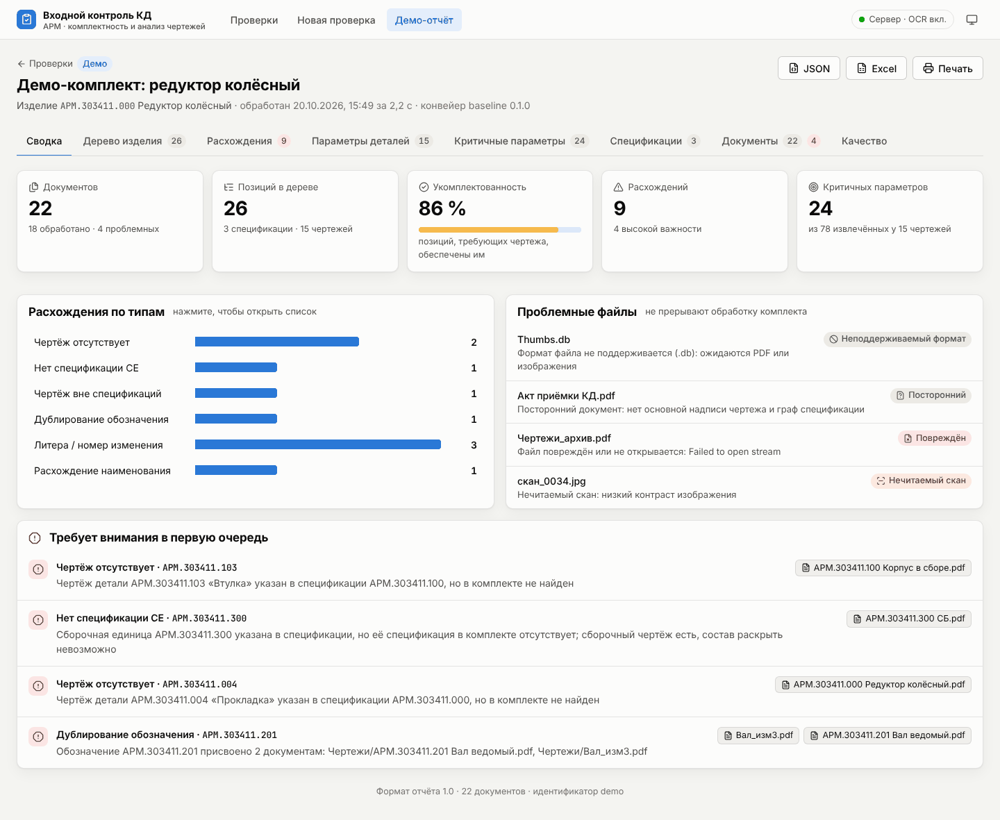
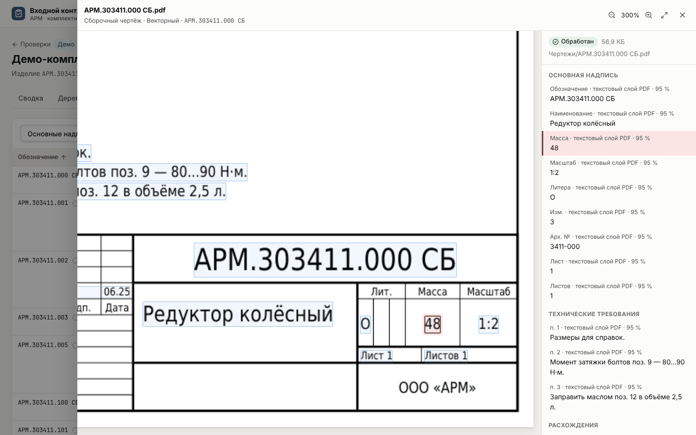
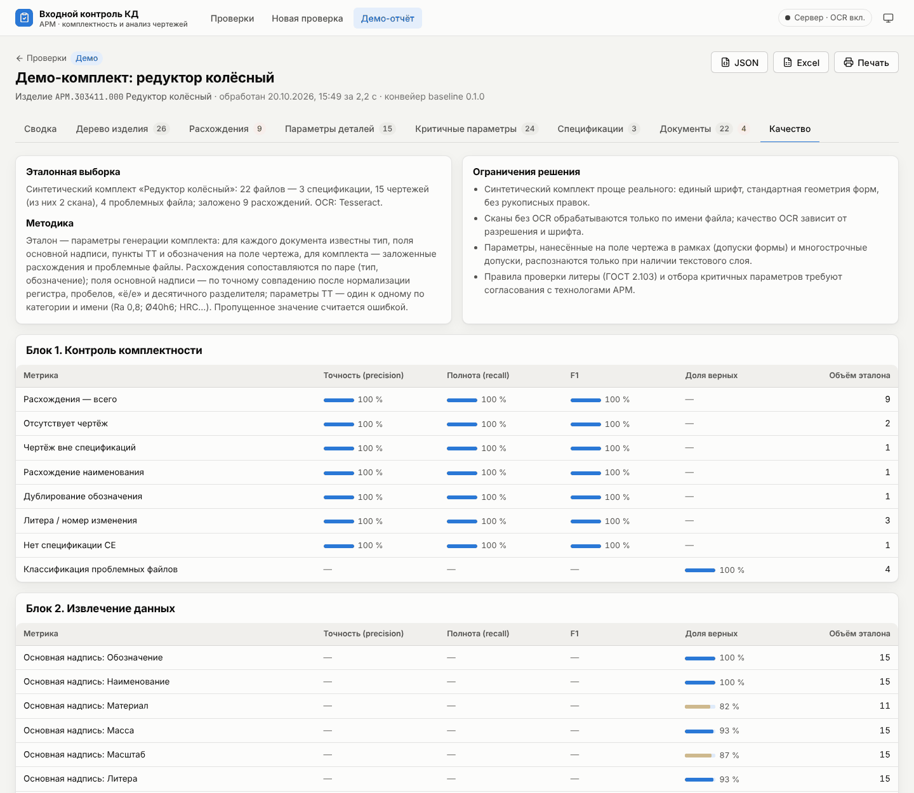

# Входной контроль КД — веб-интерфейс сервиса АРМ

Прототип по кейсу ООО «Априорные Решения Машин» «Проверка комплектности и анализ
конструкторской документации»: пакетная обработка комплекта (PDF, JPG, PNG, TIFF —
векторные документы и сканы) с отчётом по двум блокам проверки.

* **Блок 1 — комплектность.** Разбор спецификаций, рекурсивное раскрытие сборочных
  единиц в дерево изделия, сопоставление позиций с чертежами по обозначению,
  классификация расхождений: нет чертежа, чертёж вне спецификаций, расхождение
  наименования, дубль обозначения, литера / номер изменения, нет спецификации СЕ.
* **Блок 2 — анализ документов.** Графы спецификаций и основных надписей (обозначение,
  наименование, материал, масса, масштаб, литера, номер изменения, архивный номер,
  первое применение), технические требования (квалитеты и отклонения, шероховатость
  Ra/Rz, допуски формы и расположения, термообработка, покрытия) в единой структуре
  и выделение параметров, критичных для производства, с обоснованием.

Отчёт выдаётся в машиночитаемой форме (`report.json`, [формат](docs/report-format.md),
[JSON Schema](docs/report.schema.json)) и человекочитаемой — веб-интерфейс, Excel,
печатная HTML-форма. Любое значение в интерфейсе открывается в исходном документе
с подсветкой области страницы, из которой оно получено.



## Быстрый старт

Нужны Python ≥ 3.11 и Node.js ≥ 20. Для распознавания сканов — Tesseract с русским
языком (`apt install tesseract-ocr tesseract-ocr-rus`); без него сканы обрабатываются
по имени файла и помечаются в отчёте.

```bash
# 1. сервер
python -m venv .venv && . .venv/bin/activate
pip install -r backend/requirements.txt
pip install --no-deps ./packages/kdcheck

# 2. фронтенд
cd frontend && npm ci && npm run build && cd ..

# 3. запуск: интерфейс и API на http://127.0.0.1:8000
cd backend && python -m arm_web serve
```

Откройте «Демо-отчёт» или загрузите папку [`samples/demo_kit`](samples/demo_kit) через
«Новая проверка». Демо-отчёт открывается и без сервера (`npm run dev` во `frontend`).

Docker (образ включает Tesseract):

```bash
docker build -t arm-kd . && docker run -p 8000:8000 -v arm-data:/data arm-kd
# свои настройки: копия configs/ с правками поверх настроек образа
docker run -p 8000:8000 -v arm-data:/data -v "$PWD/мои_настройки:/app/configs:ro" arm-kd
```

Режим разработки с горячей перезагрузкой: `python -m arm_web serve --reload` в
`backend` и `npm run dev` во `frontend` (http://localhost:5173, запросы `/api`
проксируются на порт 8000).

## Веб-интерфейс

| Раздел | Что показывает |
|---|---|
| Проверки | история заданий с прогрессом, числом расхождений и проблемных файлов; открытие `report.json` из файла |
| Новая проверка | загрузка папки целиком (drag-and-drop или выбор папки) с сохранением структуры подпапок |
| Сводка | ключевые показатели, укомплектованность, расхождения по типам, проблемные файлы, первоочередные замечания |
| Дерево изделия | дерево по спецификациям с количеством на изделие, документами и статусом каждой позиции; поиск и фильтр «только с замечаниями» |
| Расхождения | список с фильтрами по типу, важности и позиции; ожидаемое и фактическое значение, ссылки на документы и источники |
| Параметры деталей | основные надписи, параметры ТТ в единой структуре, сравнение деталей (материал, ТО, твёрдость, покрытие, мин. Ra, точнейший квалитет) |
| Критичные параметры | распределения Ra и квалитетов по комплекту, правила отбора, обоснование и приоритет каждого параметра |
| Спецификации | строки по разделам с отметкой о наличии документа в комплекте |
| Документы | все файлы с типом, источником текста (вектор/скан/OCR) и категорией проблем |
| Качество | метрики точности и полноты по эталону, разбор ошибок, ограничения решения |

Просмотрщик документа подсвечивает область значения и показывает все значения,
извлечённые со страницы; ссылку на открытый документ можно переслать — состояние
хранится в адресе страницы. Значения, полученные OCR или из имени файла, подчёркнуты
пунктиром как требующие проверки. Поддерживаются светлая и тёмная темы и мобильная ширина.



## Командная строка

```bash
uv run kdcheck run samples/demo_kit -o out                      # out/report.json, report.xlsx, report.html
uv run kdcheck run ПАПКА --no-ocr                               # без распознавания сканов
uv run kdcheck run ПАПКА --vlm                                  # + мультимодальная модель дочитывает основные надписи сканов
uv run kdcheck run ПАПКА --max-pages 50                         # не больше 50 страниц на файл (по умолчанию из ingest.yaml)
uv run kdcheck run ПАПКА --config мои_настройки                 # свои пороги и словари: копия configs/ с правками
uv run python -m synth.demo_kit samples/demo_kit                # пересоздать демо-комплект и эталон к нему
uv run python -m synth.kits data/synth/kits --kits 20 --seed 1    # синтетические комплекты с заложенными ошибками
uv run python eval/synth_kits.py                                  # Блок 1 на этих комплектах: eval/results/synth-kits.md

cd backend
python -m arm_web process ../samples/demo_kit -o out            # то же, но с внешним конвейером из ARM_PIPELINE_CMD
python -m arm_web process ПАПКА --truth эталон.json             # + метрики качества в отчёте
python -m arm_web evaluate out/report.json ../samples/demo_kit_truth.json
python -m arm_web build-demo                                     # обновить демо-отчёт фронтенда
sh ../scripts/export_schema.sh                                   # JSON Schema отчёта и типы фронтенда
```

## Подключение конвейера команды

Над блоками могут работать разные команды, поэтому интерфейс зависит только от
формата отчёта. Варианты интеграции:

1. **Внешняя программа.** `ARM_PIPELINE_CMD="python -m team_pipeline --input {input} --output {output}"`.
   Сервер запускает команду для каждого комплекта и читает `{output}/report.json`.
   Для отображения хода обработки программа может обновлять `{output}/progress.json`:
   `{"stage": "Разбор чертежей", "progress": 0.4, "message": "файл 12 из 30"}`.
2. **Python-класс** с методом `run(input_dir, *, kit_id, kit_name, progress) -> Report`
   (протокол [`Pipeline`](backend/arm_web/pipeline/base.py)) — подключается в
   [`get_pipeline()`](backend/arm_web/pipeline/__init__.py).
3. **Отчёт из файла.** `report.json`, полученный где угодно, открывается в интерфейсе
   кнопкой «Открыть report.json» (без изображений страниц — области показываются на схеме листа).

Модули базового конвейера заменяются по отдельности: например, OCR на VLM при
сохранении логики проверки комплектности ([`checks/`](packages/kdcheck/src/kdcheck/checks)).

## Настройки

Пороги, шаблоны форм и словари лежат в [`configs/`](configs), а не в коде ([ADR-0012](docs/adr/0012-configs.md)):

| Файл | Что задаёт |
|---|---|
| [`forms.yaml`](configs/forms.yaml) | шаблоны ГОСТ: форматы листа, ячейки основной надписи форм 1 и 2, колонки спецификации, блок техтребований, допуски поиска |
| [`ingest.yaml`](configs/ingest.yaml) | чтение файлов: страниц на файл, разрешение растра, распознавание скана в PDF, пороги качества скана, уверенность по способу чтения |
| [`dictionaries.yaml`](configs/dictionaries.yaml) | словари ЕСКД: разделы спецификации, коды документов, литеры, виды термообработки, допуски, символы, покрытия |
| [`checks.yaml`](configs/checks.yaml) | правила Блока 1: какие включены и с какой важностью сообщают о расхождениях |
| [`criticality.yaml`](configs/criticality.yaml) | пороги и оценки критичных параметров Блока 2 |
| [`models.yaml`](configs/models.yaml) | движки: PDF, OCR и его языки, мультимодальная модель — сервер, модель, промпт, ячейки |
| [`api.yaml`](configs/api.yaml) | лимиты веб-сервиса: размер и число файлов загрузки, время и память задания |

Файлы проверяются при запуске: неизвестный ключ или неверное значение останавливают обработку
с именем файла и поля. Отчёт хранит SHA-256 действующих настроек и версии движков, поэтому
по отчёту видно, с какими порогами он получен. Свой набор настроек — копия `configs/` с правками:
`kdcheck run ПАПКА --config мои_настройки` или `ARM_CONFIG_DIR`; в Docker — том поверх `/app/configs`.

Переменные окружения:

| Переменная | Назначение |
|---|---|
| `ARM_CONFIG_DIR` | каталог настроек (по умолчанию `configs/` репозитория) |
| `ARM_PROMPTS_DIR` | каталог промптов моделей (по умолчанию `prompts/` репозитория) |
| `ARM_DATA_DIR` | каталог заданий (по умолчанию `backend/data`) |
| `ARM_PIPELINE_CMD` | внешний конвейер команды |
| `ARM_INPROCESS=1` | откат: обрабатывать в потоках процесса API, без тайм-аута и лимита памяти |
| `ARM_FRONTEND_DIST` | путь к собранному фронтенду |

Переопределяют одно значение из `configs/`:

| Переменная | Значение | Смысл |
|---|---|---|
| `ARM_PIPELINE_TIMEOUT` | `job_timeout_sec`, `api.yaml` | время на комплект, с; по истечении задание завершается ошибкой |
| `ARM_JOB_MEMORY_MB` | `job_memory_mb`, `api.yaml` | память процесса задания, МБ (0 — без лимита; соблюдается в Linux) |
| `ARM_MAX_UPLOAD_MB` | `max_upload_mb`, `api.yaml` | размер загрузки, МБ |
| `ARM_MAX_FILES` | `max_files`, `api.yaml` | файлов в одной загрузке |
| `ARM_WORKERS` | `workers`, `api.yaml` | комплектов, обрабатываемых параллельно |
| `ARM_MAX_PAGES` | `max_pages_per_file`, `ingest.yaml` | страниц на файл (0 — все); остальные пропускаются с пометкой в документе |
| `ARM_OCR=0` | `ocr.enabled`, `models.yaml` | не распознавать сканы |
| `ARM_PDF_BACKEND` | `pdf.backend`, `models.yaml` | движок PDF: `pdfium` или `pymupdf` — откат под AGPL, ставится отдельно: `pip install "pymupdf>=1.24"` |
| `ARM_VLM=1` | `vlm.enabled`, `models.yaml` | мультимодальная модель дочитывает основные надписи сканов |
| `ARM_VLM_URL` | `vlm.base_url`, `models.yaml` | OpenAI-совместимый сервер модели; адрес вне этой машины — только с `allow_remote: true` |
| `ARM_VLM_MODEL` | `vlm.model`, `models.yaml` | имя модели на этом сервере |

## Базовый конвейер

Опорная реализация, чтобы интерфейс работал на реальных файлах сразу; обоснование выбора:
векторные PDF из САПР уже содержат текст с координатами, поэтому правила по геометрии
форм ГОСТ 2.104/2.106 дают точные значения и полную прослеживаемость без моделей, а
сканы распознаются Tesseract.

1. **Приём файлов.** Формат по сигнатуре, а не по расширению; повреждённые, пустые,
   неподдерживаемые файлы и нечитаемые сканы (контраст, резкость) получают статус и не
   прерывают обработку.
2. **Текст.** Текстовый слой PDF с координатами слов; для сканов — OCR (rus+eng).
3. **Классификация.** Спецификация — по заголовкам граф, чертёж — по подписям основной
   надписи, иначе документ посторонний.
4. **Основная надпись.** Положение и масштаб формы — по подписям «Лит.», «Масса»,
   «Масштаб», затем значения из ячеек формы; вертикальные графы — архивный номер и
   первое применение; номер изменения — максимум в графе «Изм.».
5. **Спецификация.** Графы по положению заголовков и стандартной ширине граф, разделы,
   переносы наименований, многолистовые спецификации.
6. **Требования.** Пункты ТТ над основной надписью и обозначения на поле чертежа —
   регулярными выражениями в единую структуру параметров.
7. **Комплектность и критичность** — см. [формат отчёта](docs/report-format.md).

Геометрия форм, пороги и словари этих шагов — в `configs/` (раздел «Настройки»).

Качество на демо-комплекте (синтетический, 22 файла, 9 заложенных расхождений;
PDFium и Tesseract): расхождения — точность и полнота 100 %; основные надписи
векторных PDF — 100 %, сканов — 63 % (OCR не находит материал и не читает вертикальные
графы — архивный номер и первое применение); параметры ТТ — точность 99 %, полнота 94 %.
Замер — [eval/results/pdf-backends.md](eval/results/pdf-backends.md), разбор ошибок —
вкладка «Качество» демо-отчёта.
Синтетический комплект проще реального, поэтому эти цифры — проверка работоспособности,
а не оценка на документах АРМ: для неё нужна эталонная выборка из реальных комплектов
в формате [`samples/demo_kit_truth.json`](samples/demo_kit_truth.json).



## Мультимодальная модель

Модель с открытыми весами дочитывает ячейки основной надписи сканов, которые OCR оставил пустыми
([ADR-0014](docs/adr/0014-local-vlm.md)). Ячейку вырезают по шаблону ГОСТ, модель только читает её текст,
значение нормализуют те же правила, что и для OCR. Поэтому у значения остаётся область-источник, а в отчёте —
способ `vlm`, имя модели и версия промпта. Пока модель не откалибрована, её значения помечены «проверить».
По умолчанию она выключена.

Модель работает на OpenAI-совместимом сервере на этой же машине:

1. [LM Studio](https://lmstudio.ai): скачать модель со зрением, например Gemma 4 E4B (около 6 ГБ) или
   Qwen3.6-27B (около 18 ГБ), и включить сервер — `lms server start`, адрес `http://127.0.0.1:1234/v1`.
   Так же подходят llama.cpp (`llama-server -m модель.gguf --mmproj mmproj.gguf --port 1234`), Ollama
   (`http://127.0.0.1:11434/v1`) и vLLM на машине с GPU.
2. В [`configs/models.yaml`](configs/models.yaml) в разделе `vlm` указать `model` — имя модели на сервере.
3. Запуск: `uv run kdcheck run ПАПКА --vlm`, для веба — `ARM_VLM=1`.

Сервер на другой машине получит документы заказчика, поэтому такой адрес — ошибка настроек, пока в разделе `vlm`
нет `allow_remote: true`; ставится только с разрешения АРМ. Промпты — версионные файлы в [`prompts/`](prompts).
Если сервер не отвечает, комплект обрабатывается без модели, а журнал отчёта говорит почему.
На 117 синтетических сканах точность основной надписи — 0,378 с одним OCR, 0,709 с Gemma 4 E4B и 0,727
с Qwen3.6-27B, около 2 и 5 с на ячейку на Apple M5 ([замер](eval/results/vlm-title-block.md)).
Модели-кандидаты — в [docs/RESEARCH.md](docs/RESEARCH.md#мультимодальные-модели-с-открытыми-весами).

## HTTP API

| Метод | Путь | Назначение |
|---|---|---|
| GET | `/api/health` | состояние, активный конвейер, наличие OCR |
| GET | `/api/jobs` | список заданий |
| POST | `/api/jobs` | загрузка комплекта: `multipart/form-data` с полями `files[]`, `paths[]` (относительные пути), `name` |
| GET | `/api/jobs/{id}` | состояние и прогресс |
| POST | `/api/jobs/{id}/rerun` | обработать заново |
| DELETE | `/api/jobs/{id}` | удалить задание и файлы |
| GET | `/api/jobs/{id}/report` | отчёт JSON |
| GET | `/api/jobs/{id}/report.json` · `.xlsx` · `.html` | выгрузки |
| GET | `/api/jobs/{id}/documents/{doc}/pages/{n}.png` | изображение страницы |
| GET | `/api/jobs/{id}/documents/{doc}/file` | исходный файл |

Интерактивная документация — `/docs` (Swagger UI).

## Структура

```
packages/kdcheck/src/kdcheck/
  schemas/                   формат отчёта (контракт)
  ingest/                    чтение файлов: формат, текстовый слой, адаптер PdfBackend
  ocr/                       распознавание сканов (Tesseract)
  extract/                   основная надпись, строки спецификации, блок техтребований
  normalize/                 обозначения, наименования, литеры
  tree/                      Блок 1: дерево изделия
  checks/                    Блок 1: реестр правил и проверка комплектности
  params/                    Блок 2: параметры техтребований и поля чертежа, критичность
  pipeline.py                базовый конвейер: порядок стадий
  report/                    выгрузки Excel и HTML, подписи значений
  config.py                  настройки из configs/*.yaml: проверка, переопределения, хэш
  run.py                     публичный запуск ядра для API и CLI
  render.py                  растеризация страниц для просмотра
  cli.py                     kdcheck run
packages/kdcheck/tests/      pytest
backend/arm_web/
  main.py, jobs.py           API и фоновая обработка заданий
  settings.py                лимиты сервиса из configs/api.yaml
  models.py                  модель задания; реэкспорт контракта на время переноса
  pipeline/                  выбор конвейера: базовый из ядра или внешняя программа
  evaluate.py                метрики по эталону
  build_demo.py              демо-отчёт интерфейса по samples/demo_kit
backend/tests/               pytest
frontend/src/
  pages/                     список проверок, загрузка, страница задания
  report/                    вкладки отчёта
  components/                просмотрщик документов, таблицы, графики
frontend/public/demo/        демо-отчёт, страницы и выгрузки
synth/src/synth/
  model.py                   документы синтетического комплекта как данные
  render.py                  листы на reportlab: рамка, основная надпись, спецификации, чертежи; шрифт из fonts/
  scans.py                   сканы листов: рендер PDFium, наклон и шум от сида
  truth.py                   модели разметки: поля документов, ожидаемые расхождения, проблемные файлы
  demo_kit.py                демо-комплект: данные и сборка
  product.py, vocab.py       случайное дерево изделия, обозначения, наименования, материалы, техтребования
  kits.py, mutations.py      синтетические комплекты и 18 мутаций с ожидаемыми расхождениями
synth/tests/                 pytest: демо-комплект совпадает с выводом генератора, сид повторяет комплект, мутации оставляют след
eval/                        замеры: движки PDF, Блок 1 на синтетических комплектах; результаты — в eval/results/
configs/                     пороги, шаблоны форм ГОСТ, словари, правила, движки, лимиты
samples/                     демо-комплект и эталон к нему
docs/                        формат отчёта, JSON Schema, иллюстрации
```

## Тесты

```bash
uv sync --all-packages --all-extras && uv run pytest
cd frontend && npm test && npm run typecheck
```

## Ограничения

* Правила разбора рассчитаны на формы ГОСТ 2.104/2.106; нестандартные штампы и
  рукописные правки требуют донастройки или замены модулей на VLM.
* Допуски формы, нанесённые в рамках на поле чертежа, и многоэтажные допуски на сканах
  распознаются плохо — в отчёте такие значения помечаются как требующие проверки.
* Пороги критичности (`configs/criticality.yaml`) и правила проверки литер (`B1.LITERA.001`, `B1.LITERA.002`
  в `configs/checks.yaml`) нужно согласовать с технологами АРМ.
* Обработка однопоточная по умолчанию (`workers` в `configs/api.yaml`). Каждое задание — отдельный процесс
  `kdcheck run` с тайм-аутом и лимитом памяти. Загрузка ограничена по размеру и числу файлов,
  чтение — по числу страниц на файл; архивы zip пока не принимаются.
