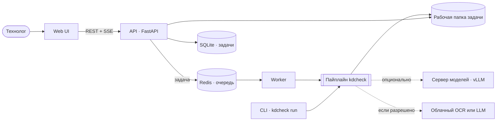
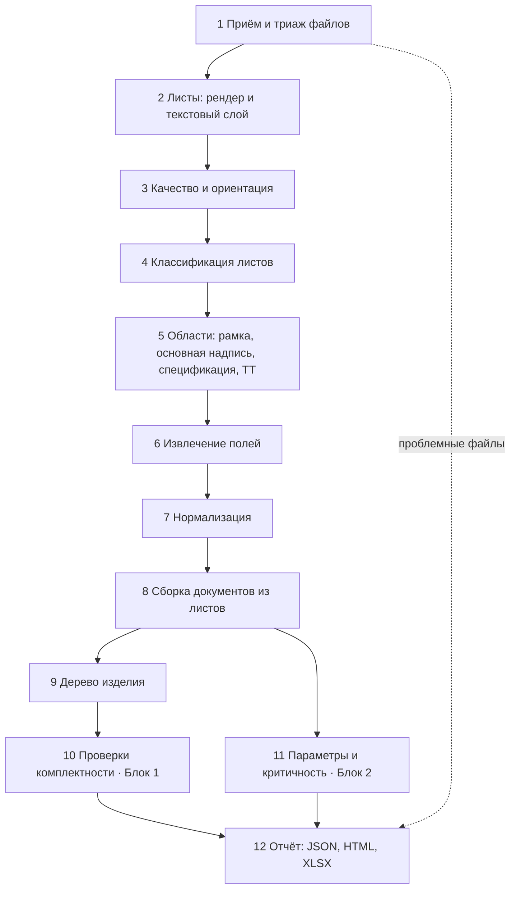
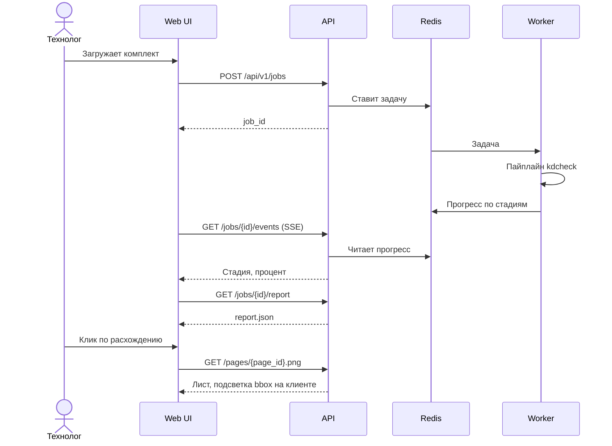

# Архитектура

Версия 1 от 20.10.2026.

Ядро — Python-библиотека `kdcheck` с CLI. Веб-приложение — оболочка над тем же ядром: API принимает комплект, воркер запускает пайплайн, фронтенд показывает отчёт. CLI и веб дают одинаковый результат, а команды Блоков 1, 2 и веба работают независимо через общие схемы данных.

## Компоненты



| Компонент | Ответственность | Технологии |
| --- | --- | --- |
| `kdcheck` (ядро) | Пайплайн, правила, схемы, отчёты, CLI | Python 3.11+, pydantic, OpenCV, pdfplumber, pypdfium2, networkx |
| API | Приём комплекта, задачи, статусы, выдача отчёта и изображений | FastAPI, SQLite (SQLModel) |
| Worker | Запуск пайплайна, прогресс по стадиям | RQ + Redis |
| Web UI | Загрузка, отчёт, просмотр листов с подсветкой | Решает веб-команда; контракт — OpenAPI |
| Сервер моделей | VLM и LLM по OpenAI-совместимому API | vLLM, профиль GPU |

## Пайплайн



| № | Стадия | Что делает | MVP | Выход |
| --- | --- | --- | --- | --- |
| 1 | Приём и триаж | Обход папки, тип по сигнатуре, хэш, дубликаты; повреждённые, зашифрованные, неподдерживаемые → категория | filetype, pypdfium2, Pillow | `files.json` |
| 2 | Листы | Рендер 300 dpi; текстовый слой с координатами и проверка его «битости»; размер листа → формат по ГОСТ 2.301 | pypdfium2, pdfplumber | `pages/*.png`, `pages.json` |
| 3 | Качество и ориентация | Резкость, контраст, наклон; поворот 0/90/180/270 по положению основной надписи | OpenCV | поля качества в `pages.json` |
| 4 | Классификация | Спецификация, чертёж детали, СБ, прочий КД, посторонний, пустой, нечитаемый | Правила: форма основной надписи, сетка спецификации, код документа | `page_types.json` |
| 5 | Области | Рамка, основная надпись, таблица спецификации, блок ТТ, знак общей шероховатости | Вектор — линии из PDF; растр — морфология OpenCV + шаблоны ГОСТ | `regions.json` |
| 6 | Извлечение полей | Ячейки по шаблону → текст | Вектор — текстовый слой; растр — OCR через адаптер `OcrEngine`; VLM — для ячеек с низкой уверенностью | `fields.json` |
| 7 | Нормализация | Обозначения, наименования, материалы, допуски (ISO 286), шероховатость, твёрдость | Правила, словари в `configs/` | `normalized.json` |
| 8 | Сборка документов | Листы → документы по обозначению и «Лист/Листов» | Правила | `documents.json` |
| 9 | Дерево изделия | Узлы — обозначения, рёбра — позиции спецификаций (раздел, количество) | networkx | `tree.json` |
| 10 | Проверки | Движок правил; каждое правило выдаёт `Finding` с доказательствами | Правила | `findings.json` |
| 11 | Параметры и критичность | Таблица «деталь × параметр», отметки критичности с причинами | Правила + статистика по комплекту | `parameters.json` |
| 12 | Отчёт | Сводка всех стадий | Jinja2, openpyxl | `report.json`, `report.html`, `report.xlsx` |

Каждая стадия читает и пишет типизированные артефакты в рабочую папку задачи. Это даёт кэш, отладку по стадиям и независимость команд: Блок 1 тестируется на `fields.json` без запуска OCR.

```python
class Stage(Protocol):
    """A pipeline stage that reads and writes typed artifacts in the job workspace."""

    name: str

    def run(self, ctx: RunContext) -> None:
        """Process the job; record per-file failures in ctx.problems instead of raising."""
```

Рабочая папка задачи:

```
data/jobs/<job_id>/
├── input/       # файлы как загружены
├── pages/       # PNG листов
├── artifacts/   # JSON по стадиям
├── evidence/    # вырезки областей-источников
└── report/      # report.json, report.html, report.xlsx
```

## Почему шаблоны ГОСТ, а не «VLM на весь лист»

ЕСКД фиксирует геометрию: основная надпись формы 1 — 185 × 55 мм в правом нижнем углу, колонки спецификации имеют фиксированную ширину. Зная форму, вырезаем каждую ячейку и читаем её отдельно. Это даёт точный bbox для прослеживаемости и не даёт модели «придумать» значение.

Исследования это подтверждают: дообученная Donut-модель извлекает основную надпись и примечания с F1 0,67, а числовые аннотации — с F1 0,96 (см. [RESEARCH.md](RESEARCH.md)). Поэтому VLM подключаем точечно: ячейки с низкой уверенностью OCR, нестандартные бланки, поле чертежа.

## Модели по стадиям

| Задача | Базовый вариант (CPU) | Усиление | Критерий выбора |
| --- | --- | --- | --- |
| Текст векторного PDF | pdfplumber, pypdfium2 | — | Без ошибок OCR, точные координаты |
| OCR ячеек: кириллица, печатный текст | Tesseract 5 (rus), PP-OCR | PaddleOCR-VL (0,9B), Qwen-VL; Yandex Vision OCR при разрешении облака | Бенчмарк на эталонных вырезках |
| Таблица спецификации | Сетка по линиям + шаблон колонок ГОСТ | PaddleOCR-VL (таблицы), VLM → HTML | ГОСТ фиксирует колонки |
| Детекция областей | Правила + шаблоны ГОСТ | RT-DETR или D-FINE (Apache-2.0) | Нестандартные бланки, сканы |
| Размеры, допуски, шероховатость, GD&T на поле чертежа | Текстовый слой + regex (вектор) | eDOCr2 (MIT), дообученная VLM (Florence-2, Qwen-VL) | Расширение после MVP |
| Разбор техтребований | Regex + словари ГОСТ | Локальная LLM (Qwen, GigaChat 3) со структурированным выводом по JSON-схеме | Длинный хвост формулировок |
| Сравнение наименований | rapidfuzz + нормализация | LLM-судья для спорных пар | Порог по эталону |

Все движки — за интерфейсами `OcrEngine`, `VlmClient`, `LlmClient`; выбор — в `configs/models.yaml`. Облачные адаптеры выключены по умолчанию.

## Прослеживаемость

Любое извлечённое значение — `Field[T]`:

| Поле | Смысл |
| --- | --- |
| `value` | Нормализованное значение |
| `raw` | Как прочитано |
| `status` | `ok`, `low_confidence`, `missing`, `conflict` |
| `evidence[]` | Источники |

`Evidence`: `file_id`, `sha256`, `page`, `bbox` (pt, система координат листа), `method` (`pdf_text`, `ocr:<движок>`, `vlm:<модель>`, `rule`), `model_version`, `confidence`, `crop` — путь к вырезке.

В вебе клик по значению или расхождению открывает лист с подсветкой `bbox`.

## Отчёт: контракт (черновик)

```json
{
  "schema_version": "0.1",
  "run": {"id": "…", "started_at": "…", "pipeline_version": "…", "models": {"ocr": "…", "vlm": null}},
  "files": [{"file_id": "f001", "path": "…", "sha256": "…", "status": "ok", "pages": 2}],
  "documents": [{
    "doc_id": "d001",
    "doc_type": "part_drawing",
    "designation": {
      "value": "АРМ.123456.001", "raw": "АРМ.123456.001", "status": "ok",
      "evidence": [{"file_id": "f001", "page": 1, "bbox": [400.2, 15.1, 520.8, 29.4],
                    "method": "pdf_text", "confidence": 1.0}]
    },
    "title_block": {"name": {}, "material": {}, "mass": {}, "scale": {}, "litera": {},
                    "change_number": {}, "archive_number": {}, "first_use": {}},
    "pages": ["f001:1", "f001:2"]
  }],
  "tree": {
    "roots": ["АРМ.100000.000"],
    "edges": [{"parent": "АРМ.100000.000", "child": "АРМ.123456.001", "section": "Детали",
               "position": 3, "qty": 2, "evidence": []}]
  },
  "findings": [{
    "id": "F0001", "type": "NAME_MISMATCH", "rule_id": "B1.NAME.001", "severity": "major",
    "message": "Наименование на чертеже «Вал ведущий» не совпадает со спецификацией «Вал»",
    "designations": ["АРМ.123456.001"], "confidence": 0.93, "evidence": []
  }],
  "parameters": [{
    "designation": "АРМ.123456.001",
    "tolerances": [{"nominal": 40.0, "fit": "k6", "it_grade": 6, "lower": 0.002, "upper": 0.018, "evidence": []}],
    "roughness": [{"param": "Ra", "value": 0.8, "scope": "surface", "evidence": []}],
    "gdt": [], "heat_treatment": [], "coatings": [],
    "critical": [{"param": "tolerances[0]", "reason": "Квалитет IT6 и точнее: нужно шлифование", "basis": "rule"}]
  }],
  "problems": [{"file_id": "f007", "category": "damaged", "detail": "PDF не открывается"}],
  "stats": {"files": 0, "pages": 0, "pages_ocr": 0, "duration_s": 0.0}
}
```

Уровни важности расхождений: `critical` (останавливает производство), `major`, `minor`, `info`.

## API (черновик)

| Метод | Путь | Назначение |
| --- | --- | --- |
| POST | `/api/v1/jobs` | Загрузка комплекта (файлы или zip) → `job_id` |
| GET | `/api/v1/jobs` | Список задач |
| GET | `/api/v1/jobs/{id}` | Статус и прогресс по стадиям |
| GET | `/api/v1/jobs/{id}/events` | Прогресс в реальном времени (SSE) |
| GET | `/api/v1/jobs/{id}/report` | `report.json` |
| GET | `/api/v1/jobs/{id}/report.xlsx`, `/report.html` | Выгрузки |
| GET | `/api/v1/jobs/{id}/pages/{page_id}.png` | Изображение листа |
| GET | `/api/v1/jobs/{id}/evidence/{evidence_id}.png` | Вырезка-источник |
| GET | `/api/v1/health` | Проверка живости |



## Веб-интерфейс

1. Загрузка комплекта и список задач.
2. Отчёт по задаче. Вкладки: «Дерево изделия», «Расхождения» с фильтрами по типу и важности, «Параметры» с выделением критичных, «Проблемные файлы», «Качество».
3. Просмотр листа: изображение и слой с bbox; переход из любой строки отчёта.

Если стек фронтенда ещё не выбран: React + TypeScript + Vite, TanStack Table, типы из OpenAPI (openapi-typescript), подсветка — SVG поверх PNG.

## Устойчивость и безопасность

| Ситуация | Поведение |
| --- | --- |
| Файл не открывается | `problems: damaged`, обработка продолжается |
| PDF зашифрован | `problems: encrypted` |
| Не PDF, JPG, PNG или TIFF | `problems: unsupported` |
| Нет основной надписи после 4 поворотов и нет сетки спецификации | `problems: foreign` — посторонний документ |
| Качество ниже порога или низкая уверенность OCR | `problems: unreadable`, значения со статусом `low_confidence` |
| Побайтовый дубликат | `problems: duplicate_file` |
| Огромный скан, тысячи страниц, zip-бомба | Лимиты размера, числа страниц и времени на лист; распаковка zip с защитой от выхода из папки |

Загруженные файлы — недоверенные данные: разбор в процессе воркера с лимитами памяти и времени.

## Развёртывание

- `docker compose up`: web, api, worker, redis. Профиль `gpu` добавляет vLLM.
- Без интернета: веса моделей загружаются заранее в `models/` (вне git), версии фиксируются в `configs/models.yaml`.
- По умолчанию все модели локальные. Облачные адаптеры включаются флагом только с разрешения АРМ.

## Структура репозитория (целевая)

```
ARM/
├── docs/                   # кейс, план, архитектура, обзор, оценка
├── packages/kdcheck/       # ядро
│   ├── src/kdcheck/
│   │   ├── schemas/        # pydantic-модели и JSON Schema
│   │   ├── ingest/         # триаж, рендер, текстовый слой
│   │   ├── layout/         # рамка, основная надпись, сетка спецификации, блок ТТ
│   │   ├── ocr/            # интерфейс OcrEngine и адаптеры
│   │   ├── extract/        # поля основной надписи, строки спецификации, техтребования
│   │   ├── normalize/      # обозначения, наименования, допуски
│   │   ├── tree/           # сборка документов, дерево изделия
│   │   ├── checks/         # правила Блока 1
│   │   ├── params/         # параметры и критичность, Блок 2
│   │   ├── report/         # JSON, HTML, XLSX
│   │   └── cli.py
│   └── tests/
├── services/api/           # FastAPI
├── services/worker/        # воркер RQ
├── web/                    # фронтенд
├── synth/                  # генераторы документов, комплектов, мутаций
├── eval/                   # эталон, метрики, разбор ошибок
├── configs/                # шаблоны ГОСТ, пороги, словари, модели
├── prompts/                # промпты VLM и LLM с версиями
├── fixtures/               # пример report.json для веба и тестов
├── data/                   # вне git
└── docker-compose.yml
```

## Решения

| № | Решение | Почему | Статус |
| --- | --- | --- | --- |
| 1 | Ядро — библиотека с CLI, веб — оболочка | Кейс допускает CLI или приложение; один код для обоих; воспроизводимость | Принято |
| 2 | Python для ядра и API | Экосистема OCR и ML | Принято |
| 3 | Шаблоны ГОСТ и правила — основа, нейросети — точечно | Геометрия известна; правила прозрачны и проверяемы | Принято |
| 4 | Векторный PDF читаем по текстовому слою, OCR — только для растра | Точность и скорость | Принято |
| 5 | Локальные модели по умолчанию | Конфиденциальность КД | Ждём ответа АРМ |
| 6 | Очередь RQ + Redis, задачи в SQLite | Простота; масштаб кейса не требует большего | Предложено |
| 7 | pdfplumber и pypdfium2 вместо PyMuPDF | Разрешительные лицензии; у PyMuPDF — AGPL | Предложено |
| 8 | Стек фронтенда | Решает веб-команда | Открыто |
