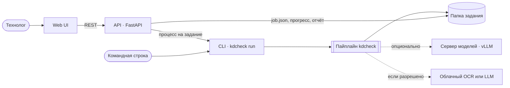
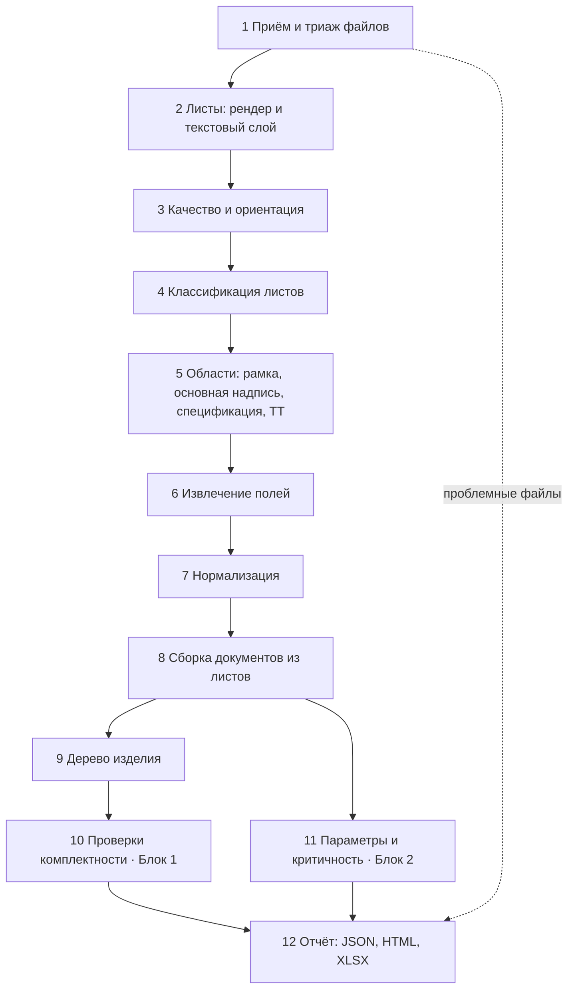
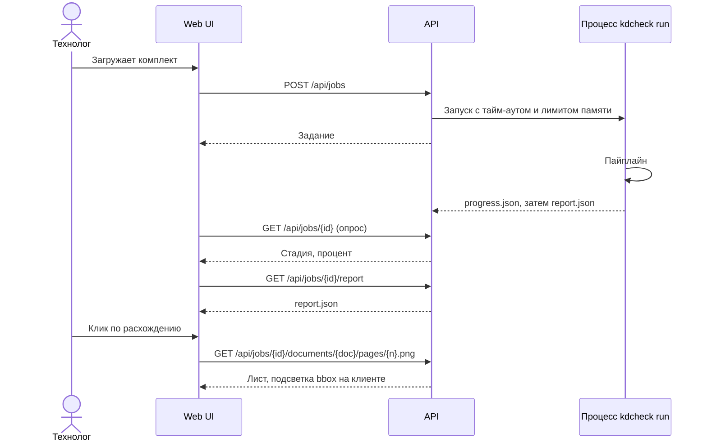

# Архитектура

Версия 6 от 26.10.2026: мультимодальная модель через локальный сервер дочитывает основные надписи сканов, по умолчанию выключена ([ADR-0014](adr/0014-local-vlm.md), принято).

Ядро — Python-библиотека `kdcheck` с CLI. Веб-приложение — оболочка над тем же ядром: API принимает комплект и запускает ядро отдельным процессом, фронтенд показывает отчёт. CLI и веб дают одинаковый результат, а команды Блоков 1, 2 и веба работают независимо через общие схемы данных.

Сейчас в ядре `packages/kdcheck` контракт отчёта, чтение файлов (`ingest`, `ocr`, `render`), разбор основной надписи и спецификации (`extract`, `normalize`), Блок 1 (`tree` — дерево изделия, `checks` — реестр правил и проверки), Блок 2 (`params`), конвейер, выгрузки и CLI `kdcheck run`. Пороги, шаблоны форм ГОСТ, словари, правила Блока 1, выбор движков и лимиты API лежат в `configs/*.yaml`, ядро читает их через `kdcheck.config` ([ADR-0012](adr/0012-configs.md)). В `backend/` остались API, задания, оценка по эталону и сборка демо-отчёта; веб — в `frontend/`. Генераторы синтетики — в `synth/`: демо-комплект и случайные комплекты с заложенными ошибками и разметкой, групповые документы ГОСТ 2.113, технические требования из шаблонов (`synth.requirements`), шрифты ГОСТ тип А и Б, растры и сканы трёх классов качества (`synth.degrade`), reportlab, pypdfium2 и Pillow, без PyMuPDF. Стрессовый корпус — те же комплекты со сканами через Augraphy (`synth.augraphy_scans`, `synth.stress`): собран один раз на Python 3.11 и заморожен манифестом `eval/stress_corpus.json` ([ADR-0013](adr/0013-synthetic-data.md)). Переход к этой схеме идёт по шагам из [сверки прототипа](reviews/2026-10-20-prototype.md#7-план-миграции).

## Компоненты



| Компонент | Ответственность | Технологии |
| --- | --- | --- |
| `kdcheck` (ядро) | Пайплайн, правила, схемы, отчёты, CLI | Python 3.11+, pydantic, pypdfium2 за адаптером `PdfBackend` (PyMuPDF — только для отката, в поставку не входит), OpenCV, networkx |
| API | Приём комплекта, задания в `job.json`, запуск `kdcheck run` отдельным процессом с лимитами, выдача отчёта и изображений | FastAPI |
| Web UI | Загрузка, отчёт, просмотр листов с подсветкой | React, TypeScript, Vite; типы из JSON Schema отчёта |
| Сервер моделей | VLM и LLM по OpenAI-совместимому API | vLLM, профиль GPU |

## Пайплайн



| № | Стадия | Что делает | MVP | Выход |
| --- | --- | --- | --- | --- |
| 1 | Приём и триаж | Обход папки, тип по сигнатуре, хэш, дубликаты; повреждённые, зашифрованные, неподдерживаемые → категория | filetype, pypdfium2, Pillow | `files.json` |
| 2 | Листы | Текстовый слой с координатами листа с учётом поворота и проверка его «битости»; скан — по собственным пикселям, иначе рендер 200 dpi; размер листа → формат по ГОСТ 2.301 (`PageInfo.format`); сбой страницы — `PageInfo.problem`, остальные страницы читаются | pypdfium2 | `pages/*.png`, `pages.json` |
| 3 | Качество и ориентация | Резкость, контраст, наклон; поворот 0/90/180/270 по положению основной надписи | OpenCV | поля качества в `pages.json` |
| 4 | Классификация | Спецификация, чертёж детали, СБ, прочий КД, посторонний, пустой, нечитаемый | Правила: форма основной надписи, сетка спецификации, код документа | `page_types.json` |
| 5 | Области | Рамка, основная надпись, таблица спецификации, блок ТТ, знак общей шероховатости | Вектор — линии из PDF; растр — морфология OpenCV + шаблоны ГОСТ | `regions.json` |
| 6 | Извлечение полей | Ячейки по шаблону → текст | Вектор — текстовый слой; растр — OCR через адаптер `OcrEngine`; VLM — для ячеек с низкой уверенностью | `fields.json` |
| 7 | Нормализация | Обозначения, наименования, материалы, допуски (ISO 286), шероховатость, твёрдость | Правила, словари в `configs/` | `normalized.json` |
| 8 | Сборка документов | Листы → документы по обозначению и «Лист/Листов» | Правила | `documents.json` |
| 9 | Дерево изделия | Узлы — обозначения, рёбра — позиции спецификаций (раздел, количество) | networkx | `tree.json` |
| 10 | Проверки | Реестр правил `kdcheck.checks.rules`; каждое правило выдаёт `Discrepancy` со своим `rule_id` и доказательствами, `configs/checks.yaml` включает правило и задаёт важность | Правила | `findings.json` |
| 11 | Параметры и критичность | Таблица «деталь × параметр», отметки критичности с причинами | Правила + статистика по комплекту | `parameters.json` |
| 12 | Отчёт | Сводка всех стадий | Jinja2, openpyxl | `report.json`, `report.html`, `report.xlsx` |

Каждая стадия читает и пишет типизированные артефакты в рабочую папку задачи. Это даёт кэш, отладку по стадиям и независимость команд: Блок 1 тестируется на `fields.json` без запуска OCR.

```python
class Stage(Protocol):
    """A pipeline stage that reads and writes typed artifacts in the job workspace."""

    name: str

    def run(self, ctx: RunContext) -> None:
        """Process the job; record per-file failures in ctx.problems instead of raising."""
```

Рабочая папка задачи:

```
data/jobs/<job_id>/
├── input/       # файлы как загружены
├── pages/       # PNG листов
├── artifacts/   # JSON по стадиям
├── evidence/    # вырезки областей-источников
└── report/      # report.json, report.html, report.xlsx
```

## Почему шаблоны ГОСТ, а не «VLM на весь лист»

ЕСКД фиксирует геометрию: основная надпись формы 1 — 185 × 55 мм в правом нижнем углу, колонки спецификации имеют фиксированную ширину. Зная форму, вырезаем каждую ячейку и читаем её отдельно. Это даёт точный bbox для прослеживаемости и не даёт модели «придумать» значение.

Исследования это подтверждают: дообученная Donut-модель извлекает основную надпись и примечания с F1 0,67, а числовые аннотации — с F1 0,96 (см. [RESEARCH.md](RESEARCH.md)). Поэтому VLM подключаем точечно: ячейки с низкой уверенностью OCR, нестандартные бланки, поле чертежа.

## Модели по стадиям

| Задача | Базовый вариант (CPU) | Усиление | Критерий выбора |
| --- | --- | --- | --- |
| Текст векторного PDF | pypdfium2 | PyMuPDF: `pdf.backend` в `configs/models.yaml` или `ARM_PDF_BACKEND` | Без ошибок OCR, точные координаты; замер — [pdf-backends.md](../eval/results/pdf-backends.md) |
| OCR ячеек: кириллица, печатный текст | Tesseract 5 (rus), PP-OCR | Мультимодальная модель на локальном сервере читает ячейки основной надписи скана, которые OCR не заполнил: `vlm` в `configs/models.yaml`, [ADR-0014](adr/0014-local-vlm.md). Кандидаты — [RESEARCH.md](RESEARCH.md#мультимодальные-модели-с-открытыми-весами); Yandex Vision OCR — при разрешении облака | Бенчмарк на эталонных вырезках; замер — [vlm-title-block.md](../eval/results/vlm-title-block.md) |
| Таблица спецификации | Сетка по линиям + шаблон колонок ГОСТ | PaddleOCR-VL (таблицы), VLM → HTML | ГОСТ фиксирует колонки |
| Детекция областей | Правила + шаблоны ГОСТ | RT-DETR или D-FINE (Apache-2.0) | Нестандартные бланки, сканы |
| Размеры, допуски, шероховатость, GD&T на поле чертежа | Текстовый слой + regex (вектор) | eDOCr2 (MIT), дообученная VLM (Florence-2, Qwen-VL) | Расширение после MVP |
| Разбор техтребований | Regex + словари ГОСТ | Локальная LLM (Qwen, GigaChat 3) со структурированным выводом по JSON-схеме | Длинный хвост формулировок |
| Сравнение наименований | rapidfuzz + нормализация | LLM-судья для спорных пар | Порог по эталону |

Все движки — за интерфейсами `PdfBackend`, `OcrEngine`, `VlmClient`, `LlmClient`; выбор — в `configs/models.yaml`. Облачные адаптеры выключены по умолчанию. `VlmClient` (`kdcheck.vlm`) обращается к OpenAI-совместимому серверу: LM Studio, llama.cpp или Ollama на ноутбуке, vLLM на машине с GPU. Сервер — только на этой машине, пока в настройках нет `allow_remote` с разрешения АРМ.

## Прослеживаемость

Любое извлечённое значение — `Extracted`:

| Поле | Смысл |
| --- | --- |
| `value` | Нормализованное значение |
| `raw` | Как прочитано |
| `confidence` | Уверенность, 0–1 |
| `status` | `ok`, `low_confidence`, `missing`, `conflict` — с версии 1.2; `low_confidence` ставит ядро по правилу `review` в `configs/ingest.yaml` |
| `source` | Источник, `SourceRef` |

`SourceRef` — это `Evidence` из инженерных правил: `document_id`, `page`, `bbox` (доли ширины и высоты листа, начало — левый верхний угол), `text`, `method` (`text_layer`, `ocr`, `vlm`, `llm`, `filename`, `rule`, `manual`), `confidence`, а с версии 1.1 — `engine` и `engine_version`. Хэш файла — в `DocumentInfo.sha256`.

В вебе клик по значению или расхождению открывает лист с подсветкой `bbox`.

## Отчёт: контракт

Контракт — формат прототипа ([ADR-0009](adr/0009-report-contract.md)). Поля описаны в [report-format.md](report-format.md), схема — [report.schema.json](report.schema.json), модели — `kdcheck.schemas`. Схема генерируется из моделей, типы TypeScript — из схемы; тесты сверяют и то и другое.

`Report` версии 1.3: `schema_version`, `kit`, `summary`, `documents`, `specifications`, `tree`, `discrepancies`, `parts`, `critical_parameters`, `quality`, `log`, `extensions`.

Дополнения из ADR-0009 вышли версиями 1.1 и 1.2 ([ADR-0012](adr/0012-configs.md)), версия 1.3 добавила поля страницы. Новые поля необязательные, поэтому отчёты прежних версий остаются валидными:

| Версия | Что | Зачем |
| --- | --- | --- |
| 1.1, шаг 7 | `SourceRef.engine`, `SourceRef.engine_version`, `KitInfo.engines`, `KitInfo.config_sha256` | Воспроизводимость: какой движок и какой версии дал значение, с какими настройками получен отчёт |
| 1.2, шаг 8 | `Discrepancy.rule_id` вида `B1.NAME.001` | У каждого срабатывания есть правило, сообщение и тесты |
| 1.2, шаг 8 | `Extracted.status` | `ok`, `low_confidence`, `missing`, `conflict` |
| 1.2, шаг 8 | `DocumentInfo.status`: `encrypted`, `duplicate_file` | Отдельные категории проблемных файлов (раздел «Устойчивость») |
| 1.2, шаг 8 | `extensions` на верхнем уровне | Данные внешних конвейеров; модели ядра неизвестные поля запрещают |
| 1.3, этап 3 | `PageInfo.format`, `PageInfo.problem` | Формат листа по ГОСТ 2.301 для проверки форматов (этап 4); страница со сбоем помечена, остальные обработаны |

Модель задания `Job` — часть API, не контракта. Уровни важности пока `high`, `medium`, `low`; шкалу уточняем с АРМ.

## API

Пути — как в прототипе. При выносе ядра они получают префикс `/api/v1`, старые работают ещё один релиз ([ADR-0009](adr/0009-report-contract.md)).

| Метод | Путь | Назначение |
| --- | --- | --- |
| GET | `/api/health` | Состояние, активный конвейер, наличие OCR |
| GET | `/api/jobs` | Список заданий |
| POST | `/api/jobs` | Загрузка комплекта: файлы и их относительные пути |
| GET | `/api/jobs/{id}` | Состояние и прогресс |
| POST | `/api/jobs/{id}/rerun` | Обработать заново |
| DELETE | `/api/jobs/{id}` | Удалить задание и файлы |
| GET | `/api/jobs/{id}/report` | `report.json` |
| GET | `/api/jobs/{id}/report.json`, `.xlsx`, `.html` | Выгрузки |
| GET | `/api/jobs/{id}/documents/{doc}/pages/{n}.png` | Изображение листа |
| GET | `/api/jobs/{id}/documents/{doc}/file` | Исходный файл |

Прогресс веб получает опросом `GET /api/jobs/{id}`. SSE и вырезки-источники добавим, если опроса или подсветки на листе не хватит.



## Веб-интерфейс

1. Список заданий и загрузка папки комплекта.
2. Отчёт по заданию, вкладки: «Сводка», «Дерево изделия», «Расхождения», «Параметры деталей», «Критичные параметры», «Спецификации», «Документы», «Качество».
3. Просмотр листа: изображение и слой с bbox; переход из любой строки отчёта.

Стек — React, TypeScript, Vite в `frontend/` (решение 8). Типы TypeScript генерируются из JSON Schema отчёта (json-schema-to-typescript), подсветка — слой поверх PNG листа.

## Устойчивость и безопасность

| Ситуация | Поведение |
| --- | --- |
| Файл не открывается или не читается, например нет прав | статус `damaged`, обработка продолжается |
| PDF зашифрован | статус `encrypted` (с версии 1.2; до неё — `damaged` с пояснением) |
| Не PDF, JPG, PNG или TIFF | статус `unsupported` |
| Нет основной надписи после 4 поворотов и нет сетки спецификации | статус `foreign` — посторонний документ |
| Качество ниже порога или низкая уверенность OCR | статус `unreadable`, значения со статусом `low_confidence` |
| Побайтовый дубликат | статус `duplicate_file` (с версии 1.2): копия не разбирается, пояснение называет первый файл |
| Сбой на одной странице | Страница получает `problem` (с версии 1.3), остальные страницы файла читаются и разбираются, документ — `warning`; не прочитана ни одна страница — `damaged` |
| Огромный скан, тысячи страниц, zip-бомба | Лимиты размера загрузки и числа файлов, страниц на файл, времени и памяти на комплект; zip пока не принимаем, при поддержке — распаковка с защитой от выхода из папки |

Загруженные файлы — недоверенные данные. Ядро разбирает их в отдельном процессе задания с лимитами памяти и времени ([ADR-0006](adr/0006-job-execution.md)), поэтому зависший файл не останавливает API.

## Развёртывание

- Один Docker-образ: API, веб и ядро. Задания выполняются в том же контейнере отдельными процессами ([ADR-0006](adr/0006-job-execution.md)).
- Сервер моделей vLLM для профиля GPU — отдельным контейнером через `docker compose`, когда появится VLM.
- Без интернета: веса моделей загружаются заранее в `models/` (вне git), версии фиксируются в `configs/models.yaml`.
- Настройки — в образе в `/app/configs` (`ARM_CONFIG_DIR`). Чтобы поменять порог без пересборки, каталог с изменёнными копиями файлов подключается томом поверх `/app/configs`; хэш настроек в отчёте показывает, с какими значениями он получен ([ADR-0012](adr/0012-configs.md)).
- По умолчанию все модели локальные. Облачные адаптеры включаются флагом только с разрешения АРМ.
- В образе нет зависимостей под AGPL: CI проверяет `backend/requirements.txt` через pip-licenses ([ADR-0007](adr/0007-pdf-library.md)). PyMuPDF для отката ставится отдельно.

## Структура репозитория (целевая)

Решение 10, [ADR-0010](adr/0010-repo-layout.md). Каталоги появляются, когда в них появляется код.

```
ARM/
├── docs/                   # кейс, план, архитектура, ADR, обзоры, оценка
├── packages/kdcheck/       # ядро
│   ├── src/kdcheck/
│   │   ├── schemas/        # pydantic-модели и JSON Schema
│   │   ├── ingest/         # триаж, рендер, текстовый слой
│   │   ├── layout/         # рамка, основная надпись, сетка спецификации, блок ТТ
│   │   ├── ocr/            # интерфейс OcrEngine и адаптеры
│   │   ├── vlm/            # клиент сервера мультимодальной модели, чтение ячеек основной надписи
│   │   ├── extract/        # поля основной надписи, строки спецификации, техтребования
│   │   ├── normalize/      # обозначения, наименования, допуски
│   │   ├── tree/           # сборка документов, дерево изделия
│   │   ├── checks/         # правила Блока 1
│   │   ├── params/         # параметры и критичность, Блок 2
│   │   ├── report/         # JSON, HTML, XLSX
│   │   ├── config.py       # настройки из configs/*.yaml
│   │   └── cli.py
│   └── tests/
├── backend/                # API: FastAPI, задания, раздача веба
├── frontend/               # веб: React, TypeScript, Vite
├── synth/                  # генераторы документов, комплектов, мутаций
├── eval/                   # эталон, метрики, разбор ошибок
├── configs/                # шаблоны ГОСТ, пороги, словари, лимиты, модели
├── prompts/                # промпты VLM и LLM с версиями
├── samples/                # демо-комплект с эталоном, фикстура тестов
├── data/                   # вне git
├── pyproject.toml          # uv workspace: packages/kdcheck, backend, synth
└── Dockerfile
```

Фикстуры контракта — `samples/` и `frontend/public/demo/report.json`.

Границы проверяет import-linter в CI ([ADR-0011](adr/0011-core-public-api.md)). `backend` импортирует из ядра только `kdcheck.schemas`, `kdcheck.run`, `kdcheck.render` и `kdcheck.report`: настройки ядра он загружает через `kdcheck.run`, свои лимиты читает из `configs/api.yaml` сам. Блок 1 (`tree`, `checks`) и Блок 2 (`params`) не импортируют друг друга, дерево изделия не зависит от проверок. `kdcheck.schemas` не зависит от остального ядра. Генератор `synth` не импортирует ядро и API, чтобы тестовые данные не зависели от проверяемого кода, а ядро и API не импортируют `synth`.

## Решения

| № | Решение | Почему | Статус |
| --- | --- | --- | --- |
| 1 | Ядро — библиотека с CLI, веб — оболочка | Кейс допускает CLI или приложение; один код для обоих; воспроизводимость | Принято |
| 2 | Python для ядра и API | Экосистема OCR и ML | Принято |
| 3 | Шаблоны ГОСТ и правила — основа, нейросети — точечно | Геометрия известна; правила прозрачны и проверяемы | Принято |
| 4 | Векторный PDF читаем по текстовому слою, OCR — только для растра | Точность и скорость | Принято |
| 5 | Локальные модели по умолчанию | Конфиденциальность КД | Ждём ответа АРМ |
| 6 | Задание — отдельный процесс `kdcheck run` с лимитами; без Redis, RQ и SQLite ([ADR-0006](adr/0006-job-execution.md)) | Изоляция недоверенных файлов при одном сервисе | Принято |
| 7 | PDF — через адаптер `PdfBackend`: pypdfium2 и pdfplumber по умолчанию, PyMuPDF — только за флагом по итогам замера ([ADR-0007](adr/0007-pdf-library.md)) | Разрешительные лицензии; у PyMuPDF — AGPL | Принято |
| 8 | Стек фронтенда: React, TypeScript, Vite, как в прототипе ([ADR-0010](adr/0010-repo-layout.md)) | Веб уже работает на этом стеке | Принято |
| 9 | Контракт отчёта — формат прототипа 1.0, дополнения в 1.1 ([ADR-0009](adr/0009-report-contract.md)) | Реализован, на нём работают веб и внешние конвейеры | Принято |
| 10 | Ядро в `packages/kdcheck`; `backend/` и `frontend/` остаются; перенос по шагам ([ADR-0010](adr/0010-repo-layout.md)) | Небольшие PR, приложение работает после каждого шага | Принято |
| 11 | Публичный API ядра: `schemas`, `run`, `render`, `report`; границы проверяет import-linter ([ADR-0011](adr/0011-core-public-api.md)) | Выгрузки на лету покрывают внешние конвейеры и старые задания; Excel — 0,4 с на 330 документах | Принято |
| 12 | Пороги, шаблоны форм, словари, движки и лимиты — в корневом `configs/*.yaml`, проверка моделями pydantic; в отчёте — хэш настроек и версии движков, контракт 1.1 ([ADR-0012](adr/0012-configs.md)) | Порогов в коде нет, источник значений один; результат прослеживается до настроек и движков | Принято |
| 13 | Синтетика — библиотека `synth`: модель документов и рисовальщик, разметка в моделях `synth.truth` с bbox полей, случайное дерево изделия, мутации с ожидаемым типом и правилом `B1.*`; деградации — свой модуль (основной, повтор по сиду) и Augraphy (замороженный стрессовый корпус); шрифты OpenGost тип А и Б, шаблоны ТТ, групповые документы ГОСТ 2.113 ([ADR-0013](adr/0013-synthetic-data.md)) | Разметки нет — эталон строим сами; метрики воспроизводимы и режутся по качеству сканов | Принято |
| 14 | Мультимодальная модель — через локальный сервер с OpenAI-совместимым API (LM Studio, llama.cpp, Ollama, vLLM); первая задача — ячейки основной надписи сканов: модель читает текст ячейки, правила его нормализуют, bbox — ячейка шаблона; только адреса этой машины, по умолчанию выключено ([ADR-0014](adr/0014-local-vlm.md)) | Процесс на задание с лимитом памяти (ADR-0006) не держит модель; смена модели — строка в настройках; прослеживаемость сохраняется | Принято |

Номер строки совпадает с номером ADR в `docs/adr/`. Основание для решений 6–10 — [сверка прототипа](reviews/2026-10-20-prototype.md).
