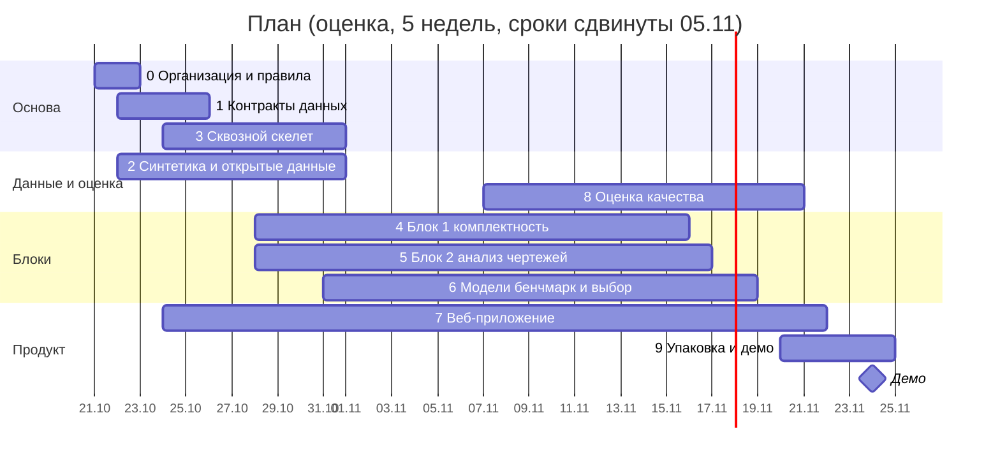

# План работ

Версия 2 от 05.11.2026: порядок работ до демо, график и сроки этапов — под состояние на эту дату. Версия 1 — от 20.10.2026. Обновляется после ответов АРМ и по итогам каждого этапа.

Сроки — оценка на 5 недель от 21.10.2026. Длительность кейса пока неизвестна: график сдвигаем под фактический.

Состояние на 02.11.2026 и предложения по улучшению — [сводка](reports/2026-11-02-status.md). Что делаем дальше и в каком порядке — [Порядок работ до демо](#порядок-работ-до-демо).

## Как начать без датасета

Начинать без данных заказчика можно и нужно. Формат документов задан ЕСКД, поэтому три источника данных доступны сразу:

| Источник | Что даёт | Чего не даёт |
| --- | --- | --- |
| Синтетика по ГОСТ: основные надписи, спецификации, технические требования с известной разметкой | Обучение и метрики извлечения, любой объём | Реальное разнообразие оформления и дефектов |
| Синтетические комплекты с внесёнными ошибками (мутации) | Метрики полноты Блока 1 по каждому типу расхождений | Неизвестные заранее типы ошибок |
| Открытые чертежи по ЕСКД: учебные пособия, публичные каталоги | Реализм, небольшая эталонная выборка | Масштаб; лицензии запрещают публикацию |

Реальные комплекты АРМ нужны для эталонной выборки, финальной калибровки и демо. Решение от 20.10.2026: работу начинаем без данных заказчика, у АРМ запрашиваем только датасет — комплекты КД в том виде, в каком они хранятся. Подробный опросник («Запрос заказчику (АРМ): материалы и вопросы», ссылку в публичном репозитории не храним) отложен.

## Датасет АРМ

02.11.2026 АРМ передал три комплекта и 16 отдельных листов. Они лежат в `data/arm` вне git: это данные заказчика. В репозитории — только числа под обезличенными идентификаторами ([arm-kits.md](../eval/results/arm-kits.md)).

| Комплект | Роль | Файлов | Вход |
| --- | --- | ---: | --- |
| `arm-1` | dev | 53 | JPG, растр из CAD |
| `arm-2` | test | 332 | JPG, растр из CAD |
| `arm-3` | test | 119 | векторные PDF; спецификаций нет |
| `arm-4` | вне разбиения | 16 | мелкие JPG, около 750 × 1050 пкс, с крапом; другая система обозначения; что это, уточняем у АРМ |

- Разбиение — по комплектам, а не по листам: листы одного комплекта оформлены одинаково, и разбиение по листам перенесло бы это оформление из dev в test.
- Правила настраиваются на `arm-1`: он маленький и полный — спецификации, сборочные чертежи, детали. `arm-2` оформлен так же и в шесть раз больше, `arm-3` — другое оформление и вектор. Test меряется один раз, на замороженных правилах.
- Системы обозначения видны в именах файлов всех комплектов. Их грамматики — знание о правилах предприятия, а не подгонка под test; сверяем их на консультации.
- Растровых PDF в поставке нет, сканов разного качества — тоже: изображения `arm-1` и `arm-2` — растры, выгруженные из CAD. Сканы по-прежнему меряются на реальных листах открытого корпуса и на синтетике; о комплектах со сканами спрашиваем АРМ.

## Критерии оценки → чем закрываем

| Критерий кейса | Чем закрываем | Этапы |
| --- | --- | --- |
| 1. Точность извлечения | Шаблоны ГОСТ, текстовый слой PDF, бенчмарк OCR и VLM, метрики по полям в разрезе качества сканов | 5, 6, 8 |
| 2. Полнота проверки комплектности | 5 обязательных типов расхождений + дополнительные проверки, мутационные тесты | 4, 8 |
| 3. Обоснованность оценки | Методика эталонной выборки, двойная разметка, честный разбор ошибок | 2, 8 |
| 4. Работоспособность | Изоляция ошибок по файлам, CLI, Docker, фиксированные версии | 3, 9 |

## График

## Порядок работ до демо

Порядок с 05.11.2026. Первые шаги — те, что названы в [сводке](reports/2026-11-02-status.md#3-дальнейшая-работа): сборка документов из листов, чтение растров и сканов моделью, эталон `arm-1`. После них правила замораживаются, и test меряется один раз. Даты — оценка; график выше и сроки этапов сдвинуты под них. Что сделано по каждому шагу, отмечается в пунктах этапов.

1. **Начатое — 05–06.11.** Прогоны чтения основной надписи сканов с моделями повторены по общему правилу верного извлечения (2.4). Пустой лист получает свой статус (4.1). ADR-0016 и ADR-0017 приняты.
2. **Остаток 4.5 — 06–07.11.** Генератор раскладывает листы растров по файлам с «(N)», как в комплектах АРМ, в части комплектов по сиду. Сборка документов и `B1.SHEETS.001` меряются на синтетике с разметкой. Готово, когда 4.5 закрыт замером.
3. **Чтение растров и сканов — 07–12.11, этап 6; пробелы 4.2, 4.3 и 5.3.**
    - Кэш ответов OCR и моделей — первым: без него крупная модель читает 332 листа `arm-2` около 6 часов.
    - Модель — основной способ чтения ячеек основной надписи растров и сканов: решение поверх [ADR-0014](adr/0014-local-vlm.md). Кандидат по замеру режимов: модель перечитывает все ячейки, при расхождении с OCR берётся её значение, поле отмечается «проверить». Так верны около 0,96 полей с Gemma 4 31B против 0,65 у OCR ([отчёт 02.11.2026](reports/2026-11-02-models.md)).
    - Строки спецификаций растров. Сначала правило без модели: обозначение строки сверяется с закрытым словарём обозначений комплекта — из имён файлов и основных надписей — с допуском на типичные ошибки OCR; если имя файла, основная надпись и строка спецификации расходятся, значение получает статус `conflict`. Затем модель на вырезках строк, с замером выигрыша поверх правила. Сейчас на `arm-1` из 64 заполненных граф обозначения грамматике отвечают 2, корня у дерева нет ([arm-kits-dev.md](../eval/results/arm-kits-dev.md)).
    - Технические требования растров и сканов — модель на вырезках блока. Сейчас ядро находит на них 0,25 параметров ([synth-kits.md](../eval/results/synth-kits.md)); на вырезках модели находят 38–52 параметра из 61, Tesseract — 19 ([vlm-bench.md](../eval/results/vlm-bench.md)).
    - Распознаватель PP-OCRv5 для кириллицы на тех же вырезках — путь на CPU на случай, если GPU нет. Сделано по [ADR-0024](adr/0024-ppocr-cells.md): ячейки основной надписи и строк спецификаций без модели читает PP-OCRv5 `eslav`, 4 мс на ячейку. На `arm-1` без модели обозначений строк по грамматике 49 из 64 вместо 19, как с моделью ([arm-kits-dev.md](../eval/results/arm-kits-dev.md)).
    - Готово, когда движок каждого вида поля выбран по замеру, а на `arm-1` дерево изделия сходится к корню. Движки выбраны (таблица в ADR-0024). Корень на `arm-1` найден ([arm-kits-dev.md](../eval/results/arm-kits-dev.md)). Таблицу спецификации, начерченную в 1,012 масштаба надписи, ядро находит по её крайним линиям (поправка к [ADR-0015](adr/0015-raster-regions.md#поправка-от-10112026-таблица-по-её-крайним-линиям)). Последней была групповая спецификация по варианту Б на альбомных листах A4 — форма 1 ГОСТ 2.113. Теперь ядро читает её и форму 5 с количеством по исполнениям и раскрывает исполнение по ней ([ADR-0025](adr/0025-group-spec-variant-b.md)). Строки 100 вместо 85, малая сборочная единица встала под изделие. Отклонение от порядка: строки групповых спецификаций были в шаге 5, без них критерий шага 3 не выполнялся. Критерий шага 3 выполнен.
4. **Эталон `arm-1` — 07–12.11, параллельно с шагом 3; этап 8.** До разметки с заказчиком согласуется порядок работы с листами: в графах подписей основной надписи — фамилии. `arm-1` размечается целиком, дважды, по [eval/gold/README.md](../eval/gold/README.md#комплекты-арм); у каждого значения отмечается, верно ли подсвечен его источник. Дерево изделия меряется по рёбрам «сборочная единица → позиция» с количеством. Готово, когда эталон заморожен и согласие разметок посчитано, как в [gold-agreement.md](../eval/results/gold-agreement.md).
5. **Блок 1 — 12–15.11, этап 4.** Лишние срабатывания на синтетике — пробелы, перечисленные в этапе 4: групповые документы по варианту А (исполнение «-01» как отдельный документ, заголовок исполнения в наименовании) и таблица исполнений группового чертежа; вариант Б сделан в шаге 3 ([ADR-0025](adr/0025-group-spec-variant-b.md)), «БЧ» в графе «Формат», обозначение из имени файла вида «обозначение_наименование»; `B1.MISSING.001` знает о непрочитанных документах. Новые правила из таблицы этапа 4: `format_mismatch`, `section_mismatch`, `position_anomaly`, `first_use_mismatch`; `B1.SPEC.001` — и для комплекта без спецификаций, как `arm-3`. Все срабатывания на `arm-1` разобраны по эталону. Готово, когда выполнен критерий этапа 4 на синтетике: полнота ≥ 0,95 по каждому обязательному типу при точности ≥ 0,9. Сделано: групповая спецификация по варианту А ([ADR-0026](adr/0026-group-spec-variant-a.md)), «БЧ» в графе «Формат», обозначение из имени файла вида «обозначение_наименование». Теперь с OCR полнота 0,922 при точности 0,724 вместо 0,909 и 0,464, с моделью — 0,935 и 0,889 вместо 0,922 и 0,592 ([synth-kits.md](../eval/results/synth-kits.md)). Затем — правила `format_mismatch`, `section_mismatch`, `position_anomaly`, `first_use_mismatch`, `B1.SPEC.001` для сборочного чертежа без спецификации и предварительные находки, когда в комплекте есть непрочитанные документы ([ADR-0027](adr/0027-block1-rules.md)). С OCR полнота 0,974 при точности 0,728, с моделью — 0,987 и 0,884. С моделью по обязательным типам полнота 1, кроме `revision_mismatch` — 0,9: `B1.LITERA.002` на скане; точность — от 0,786 у `name_mismatch` до 1. Критерий пока не выполнен. Лишние срабатывания — ошибки чтения сканов спецификаций, ими займётся калибровка уверенности (шаг 7). Остаются разбор срабатываний `arm-1` по эталону и `B1.MISSING.001` у исполнения на растровом групповом чертеже, где «См. табл.» не прочитано: такая находка теперь предварительная.
6. **Блок 2 — 13–16.11, этап 5.** Записи технических требований, которых ядро не знает: «Общие допуски по ГОСТ 30893.1: …», общие допуски формы и расположения по ГОСТ 30893.2, нитроцементация; глубина слоя термообработки на растрах. Числовые отклонения из поля допуска и выгрузка CSV (5.5). Детали в «хвосте» распределения внутри комплекта (5.6). Готово, когда выполнен критерий этапа 5.
7. **Калибровка и заморозка — 16–18.11, этапы 6 и 8.** Уверенность калибруется на эталоне с разбиением по документам. Признаки: уверенность OCR, согласие OCR и модели, согласие двух моделей, проверки по ГОСТ — грамматика обозначения, ряд масштабов. Порог отметки «проверить» выбирается по целевой доле ошибок. Затем правила замораживаются, `arm-2` и `arm-3` меряются один раз, вместе с файловыми мутациями 4.8.
8. **Оценка — 17–20.11, этап 8.** Для Блока 2 размечается стратифицированная выборка листов `arm-2` и `arm-3`. `docs/EVALUATION.md`: метрики Блоков 1 и 2 в разрезе вида входа и качества скана, метрика дерева, разбор ошибок по категориям, ограничения. Таблица движков этапа 6 — точность, CER, время на лист, требования к GPU, лицензия — с обоснованием выбранной конфигурации.
9. **Веб — 18–21.11, этап 7.** Путь «загрузил → увидел расхождение → открыл лист с подсветкой» проходит без консоли и отмечен в этапе 7. Веб показывает листы документа и `sheets_missing` (контракт 1.4), пустой лист и статус `conflict`.
10. **Упаковка и демо — 20–24.11, этап 9.** Образ с профилем модели и заранее загруженными весами проверен на чистой машине, инструкция по запуску написана. Демо на реальном комплекте — 3–5 верных срабатываний и 2–3 ошибочных с причинами, в рамках соглашения о конфиденциальности с заказчиком. Передача: код, модели, промпты, инструкция.

Вне критического пути, параллельно:

- открытый корпус (2.1): современная производственная КД и реальные сканы по ЕСКД — реальные сканы эталона пока только бланки до ЕСКД;
- вопросы на консультацию АРМ, собранные из этапов: трактовка литеры, применяемые формы основной надписи (в том числе 2б), правило «(N)» в именах файлов, варианты групповых документов, место количества при переносе наименования, системы обозначения, комплекты со сканами, назначение `arm-4`.

## Этапы

### Этап 0. Организация и правила — 21–22.10

Цель: правила, документы и окружение готовы до начала разработки.

- [x] Правила репозитория: языки, инженерные правила, глоссарий
- [x] Требования кейса, план, архитектура, обзор решений — в `docs/`
- [x] Черновик запроса заказчику
- [ ] Запросить у АРМ датасет, договориться о консультациях. Работу не блокирует. Датасет получен 02.11.2026 — [Датасет АРМ](#датасет-арм)
- [x] Распределять направления и согласовывать структуру с отдельным веб-разработчиком не нужно: ядро, API и веб — в одном репозитории
- [x] Сверить прототип из PR #1 (`frontend/`, `backend/`) с ARCHITECTURE.md: [отчёт сверки](reviews/2026-10-20-prototype.md)
- [x] Принять решения 6–10 из ARCHITECTURE.md (ADR в `docs/adr/`) — приняты 20.10.2026
- [x] Окружение: uv workspace, ruff, mypy, pytest, pre-commit, CI (GitHub Actions); тесты не зависят от шрифтов ОС — шаги 1–2 [плана миграции](reviews/2026-10-20-prototype.md#7-план-миграции)

Готово, когда: решения приняты, CI проходит на прототипе.

### Этап 1. Контракты данных — 22–25.10

Цель: Блоки 1 и 2 и веб работают независимо, договорившись о форматах.

- [x] Перенести контракт прототипа в `kdcheck.schemas`, `arm_web.models` реэкспортирует его ([ADR-0009](adr/0009-report-contract.md), шаг 3 плана миграции)
- [x] Контракт 1.1: движки и версии (`KitInfo.engines`, `SourceRef.engine`, `SourceRef.engine_version`), хэш настроек `KitInfo.config_sha256` — шаг 7 плана миграции ([ADR-0012](adr/0012-configs.md))
- [x] Контракт 1.2: `rule_id`, статус значения, статусы `encrypted` и `duplicate_file`, `extensions` — шаг 8 плана миграции (ARCHITECTURE.md, «Отчёт: контракт»). Модели отклоняют неизвестные поля, данные внешних конвейеров — в `extensions`. Отчёты 1.0 и 1.1 валидны, тест это проверяет
- [x] JSON Schema из моделей и типы TypeScript из схемы; CI сверяет их с моделями — `scripts/export_schema.sh`, тесты в `packages/kdcheck/tests` и `frontend/scripts`
- [x] Фикстуры: `samples/` и `frontend/public/demo/report.json` обновляются при смене версии. Демо-отчёт пересобран под 1.1, тест сверяет его версию с моделями; в `samples/` отчётов нет, только комплект и эталон
- [x] Каталог типов расхождений и категорий проблемных файлов: коды, уровни важности, тексты — [report-format.md](report-format.md): правила Блока 1 с типом, важностью и условием срабатывания, статусы документов. Тест сверяет каталог правил с реестром и `configs/checks.yaml`

Готово, когда: схемы покрыты тестами, веб отображает пример отчёта.

### Этап 2. Данные без заказчика — 22–31.10

Цель: данные для разработки и метрик до получения комплектов АРМ.

**2.1 Открытые чертежи**

- [ ] Собрать не меньше 200 чертежей разных лет, включая советский период (цель от 26.10.2026; было 50–150 листов): векторные PDF и сканы; детали, сборки, спецификации. Источники: архивы и библиотеки, стандарты, методички, GitHub, патентные базы и интернет. Собрано из первых четырёх: 82 документа, 506 листов производственной КД (327 до ЕСКД, 53 советских без года, 118 ЕСКД 1971–1991, 5 по ГОСТ 2.104-2006), 4 учебных комплекта «спецификация + чертежи» с GitHub — 26 файлов ([DATA_SOURCES.md](DATA_SOURCES.md)), учебные примеры и 18 стандартов 1968–2023 годов — [сводка](../eval/results/open-drawings.md). Не хватает современной производственной КД
- [x] Реестр — [eval/open_drawings.csv](../eval/open_drawings.csv): источник, ссылка, год, период стандартов, категория, листы, качество, лицензия, sha256. Отклонение: реестр в git, а не в `data/`, чтобы корпус собирался на любой машине одной командой `eval/open_drawings.py fetch`; сами файлы — вне git

Решения по генераторам — [ADR-0013](adr/0013-synthetic-data.md): библиотека `synth` с разметкой в моделях `synth.truth`, мутации с ожидаемым типом и правилом, корпуса по сиду в `data/synth/` вне git. Порядок работ: вынос рисования из генератора демо-комплекта и модель разметки → 2.3 → 2.2.

- [x] Рисование вынесено из генератора демо-комплекта: `synth.model`, `synth.render`, `synth.scans`; разметка — модели `synth.truth`. Демо-комплект и его разметка собираются байт в байт как прежде

**2.2 Генератор документов (`synth/`)**

- [x] Основная надпись: формы 1, 2, 2а; ГОСТ 2.104-2006 и ГОСТ Р 2.104-2023. Формы 1, 2 и 2а общие для обеих редакций; форма 2а — на последующих листах спецификаций и чертежей. Форму 2б ГОСТ Р 2.104-2023 (текстовые документы при двусторонней печати) не рисуем: её геометрию сверим с текстом стандарта или спросим на консультации, какие формы применяет АРМ
- [x] Спецификация: разделы, позиции, многострочные наименования, несколько листов, БЧ, исполнения. Длинное наименование переносится на следующие строки той же страницы, количество — на первой строке: ГОСТ 2.106 место количества при переносе не задаёт, вопрос — на консультацию. Исполнения — групповые документы по тексту и формам ГОСТ 2.113-75: у части деталей есть второе исполнение в той же сборке, у части сборочных единиц из одних деталей — одно-два исполнения, в каждом свои исполнения одной-двух деталей и другое количество стандартного изделия; родитель держит часть исполнений. Все исполнения детали — на одном групповом чертеже с таблицей исполнений: обозначение (полное в первой строке, ниже — «-01», п. 4.1.12), переменный размер, масса, в основной надписи — «См. табл.» (п. 4.1.10). У групповой сборочной единицы — групповой сборочный чертёж и групповая спецификация по варианту А (постоянные данные, затем «Переменные данные для исполнений:» и данные каждого исполнения под его обозначением, в тех же позициях, п. 5.5.1) или по варианту Б на форме 5 (графа «Кол. на исполн.» с колонкой на каждое исполнение, «×» у документов, исполнения детали делят её позицию, п. 5.5.2); строка под полным обозначением пишет «-01» (п. 5.3). В разметке — исполнения документа, количества по исполнениям, обозначение полностью и как его пишет строка. Мутации групповые документы не трогают: такой документ покрывает несколько обозначений. Вариант Б на форме 1 (А4 горизонтально, больше трёх исполнений), варианты В и Г и базовые документы не рисуем: какие применяет АРМ, спросим на консультации. Замер — [synth-kits.md](../eval/results/synth-kits.md): из 171 лишнего срабатывания ядра без OCR 83 — на групповых документах; исполнение «-01» ядро ищет как отдельный документ (47), строк формы 5 не читает (32 лишних и 5 пропусков), заголовок исполнения варианта А дописывает к наименованию строки выше (4)
- [x] Технические требования: шаблоны типовых пунктов (неуказанные отклонения, термообработка, покрытия, шероховатость). `synth.requirements`: пункты — в порядке ГОСТ 2.316-2008, п. 4.12; термообработка и покрытие — по марке материала: цементуемая сталь — цементация или нитроцементация, сталь 45 и 40Х — улучшение и закалка, в том числе ТВЧ, чугун — окраска, алюминиевый сплав — анодирование, бронза — без них. Пункт пишется одним из нескольких способов: неуказанные отклонения — как в ГОСТ 25670 и как в ГОСТ 2.307-2011, табл. 1 («Общие допуски по ГОСТ 30893.1: H14, h14, ±IT14/2»), общие допуски формы и расположения — как в ГОСТ 2.308-2011, п. 4.7, шероховатость поверхности — по ГОСТ 2.309-73, п. 2.13, покрытия — по ГОСТ 9.306. В разметке у параметра — значения: глубина слоя, твёрдость, Ra и Rz, допуск формы. Длинный пункт продолжается со следующей строки. Замер — [synth-kits.md](../eval/results/synth-kits.md), Блок 2: на векторе ядро находит 1875 параметров из 2054 (0,913) при точности 0,996; всё потерянное — записи, которых ядро не знает: «Общие допуски по ГОСТ 30893.1: …» — 137 из 273 общих допусков, «Общие допуски формы и расположения — по ГОСТ 30893.2 — К» — 35, нитроцементацию оно называет цементацией — 7
- [x] Шрифты ГОСТ тип А и Б, рендер в PDF (Typst или ReportLab), растеризация 150–600 dpi. Тип А — шрифт рисовальщика: OpenGost Type A 0.3 (SIL OFL 1.1), файл байт в байт из пакета openSUSE `opengost-ttf-fonts` 0.3-7.32; лежит в `synth/src/synth/fonts` рядом с DejaVu Sans, тип Б — там же. Высота прописных — по метрикам шрифта, без прежнего сжатия под DejaVu. Демо-комплект и демо-отчёт перерисованы, замеры повторены: на шрифте ГОСТ OCR ошибается чаще — основная надпись сканов 0,375 вместо 0,625 ([pdf-backends.md](../eval/results/pdf-backends.md)), Блок 1 с OCR — полнота 0,835 вместо 0,861, точность 0,537 вместо 0,63 ([synth-kits.md](../eval/results/synth-kits.md)). Растеризация 150–600 dpi — в модуле деградаций (следующий пункт). Тип Б — в половине комплектов, по сиду комплекта: комплект рисуется одним типом целиком, в разметке у каждого документа — `font_type`. Знаков «Ø» и «↗» в OpenGost Type B нет: их рисует тип А той же высоты прописных, текстовый слой не меняется. Замер по шрифту — [scan-quality.md](../eval/results/scan-quality.md): на векторе ядро читает основную надпись обоих типов одинаково (0,98), строки спецификаций — 1,00 у типа А и 0,95 у типа Б; на растрах и сканах с OCR — 0–6 % полей основной надписи у типа А и 3–10 % у типа Б. Выборка мала: в корпусе замера 2 комплекта типа А и 4 типа Б
- [x] Деградации «как скан»: шум, наклон, размытие, JPEG, штампы, сгибы. Основной путь — свой модуль: повтор по сиду, параметры и класс качества листа в разметке. Augraphy — второй источник, для замороженного стрессового корпуса (ADR-0013). Свой модуль сделан — `synth.degrade`: растр без сканирования и скан через бумажную копию — утолщение и выцветание штрихов, тон и пятна бумаги, штампы, сгибы листов больше A4, наклон и сдвиг, тень у края, пыль, размытие, шум, удаление фона драйвером, порог ч/б или JPEG; PDF (JPEG или CCITT G4), TIFF, JPEG и PNG при 150–600 dpi. Классы «хорошее», «среднее» и «плохое» читаются человеком, как кейс обещает о своих сканах, «нечитаемое» — для проблемного файла мутации. Сид и все параметры — в разметке (`Capture`), bbox переносятся через наклон и сдвиг листа; сканируются и спецификации, и все листы. Замер — [scan-quality.md](../eval/results/scan-quality.md): по туши, бумаге, шуму, крапу, неровности фона, наклону и разрешению классы перекрывают 14 реальных сканов альбомов ВЛ60 и приборов; штрих у синтетики толще (0,29–0,69 мм против 0,21–0,47), фото ИЖ-250 не покрыты (неровность фона 15–24 против 0–5,4), JBIG2 и JPEG 2000 модуль не пишет. Наклон по профилю туши оценивается с ошибкой 0,03°. Удаление фона добавлено по этому сравнению: фон всех реальных сканов вычищен. Адаптер Augraphy — `synth.augraphy_scans`, вход тот же `capture`: настройки сканера — из класса по сиду, как у своего модуля, бумага и стекло — конвейер Augraphy по умолчанию без правок; bbox разметки проходят через каждый эффект, в разметке — сработавшие эффекты каждого листа с настройками. С засеянным генератором numba на одном потоке и своей рабочей папкой Augraphy повторяет файл по сиду; на Python 3.12 он падает на 6 листах из 60, поэтому группа зависимостей `augraphy` — только для 3.11. Стрессовый корпус — комплекты корпуса `scan_quality.py` со сканами через Augraphy: 88 сканов, 98 листов, `data/synth/stress`; заморожен манифестом [eval/stress_corpus.json](../eval/stress_corpus.json) — sha256 файлов, версии, сиды, журнал эффектов, — `python -m synth.stress verify` сверяет файлы. После исполнений, шаблонов ТТ и типа Б корпус пересобран тем же сидом: иначе его чертежи не совпали бы с чертежами своего модуля. Замер на тех же чертежах с теми же настройками сканера: ядро с OCR читает на сканах Augraphy 14 полей основной надписи из 412, на сканах своего модуля — 23; Augraphy строже в классах «хорошее» и «среднее» (4 против 7 и 4 против 13), мягче в «плохом» (6 против 3). За границы 17 реальных листов оба выходят шумом, тоном бумаги и крапом, свой модуль — ещё наклоном, Augraphy — ещё толщиной штриха, неровностью фона и наклоном; бледную тушь и неровный фон фото ИЖ-250 достаёт только Augraphy
- [x] Разметка генерируется вместе с документом: значение и bbox каждого поля. Рисовальщик записывает, где рисует значение: поля основной надписи и граф полей подшивки, ячейки строк спецификации, пункты ТТ, обозначения на поле чертежа; у параметра — bbox текста, в котором он записан. bbox — доли листа от левого верхнего угла, как в `SourceRef`. Тест читает каждый bbox из PDF через PDFium, а не ядром. Чертежи бывают на 2–3 листах, последующие листы — с формой 2а

**2.3 Генератор комплектов и мутаций**

- [x] Случайное дерево изделия глубиной 2–4 → согласованные спецификации и чертежи: `synth.product`, `synth.kits`, обозначения в структурной схеме и по классификатору, разные папки, имена файлов, доли сканов и растров; детали «БЧ» помечены в графе «Формат», как в ГОСТ 2.106. Корпус — `python -m synth.kits data/synth/kits --kits 20 --seed 1`, каждый пятый комплект чистый
- [x] Мутации с меткой ожидаемого расхождения: удалить чертёж, добавить лишний, изменить наименование, продублировать обозначение, сменить литеру или номер изменения, сменить формат, удалить лист, подложить посторонний документ, повредить файл. `synth.mutations` — 19 мутаций, каждая пишет тип, обозначение, правило `B1.*` и следствия, например чертежи, оставшиеся без утерянной спецификации; ещё защита паролем, нечитаемый скан, побайтовая копия и неподдерживаемый файл. «Удалить лист» (`drop_sheet`) — вместе с многолистовыми чертежами. Замер ядра на 20 комплектах — [synth-kits.md](../eval/results/synth-kits.md): полнота 0,70 без OCR и 0,68 с OCR, точность 0,24 и 0,22 (28.10.2026); у каждого расхождения с разметкой названа причина. До деградаций 2.2 было 0,85 и 0,84, 0,63 и 0,54: 102 документа из 617 стали растрами и сканами, а строки спецификации с пикселей ядро не читает (пробелы этапа 4). До исполнений, шаблонов ТТ и типа Б — 0,64 и 0,60, 0,26 и 0,22: корпус с тем же сидом другой, в нём групповые документы

**2.4 Правила разметки**

- [x] Инструкция: что считается верным извлечением (нормализация пробелов, регистра, кириллицы и латиницы, десятичной запятой), как разрешать спорные случаи. Для Блока 1 на реальных комплектах — [eval/gold/README.md](../eval/gold/README.md): что размечать, как переписывать значения, какие расхождения ставить, двойная разметка и протокол спорных случаев. Разметка — в формате `KitTruth` синтетики, черновик и сверку делает `eval/gold.py`. Размечены три учебных комплекта, 23 листа: ИТМО и ЛЭТИ — дважды, независимо, согласие 1,00 и 0,94 ([gold-agreement.md](../eval/results/gold-agreement.md)); модуль питания — один раз. Отдельно размечены основные надписи 22 листов производственной КД: 5 векторных, 11 сканов альбома ВЛ60 1963 года, 3 фото ИЖ-250 с надписями от руки, 3 листа альбомов приборов; 5 листов — дважды, согласие 0,89. Всего размечено 45 реальных листов, все три вида входа: вектор, PDF со слоем распознавания, картинки и фото. Правило верного извлечения — одно для всех замеров, [eval/gold/README.md](../eval/gold/README.md#что-считается-верным-извлечением), в коде — `eval/scoring.py`, с тестами. Прежде замеры сравнивали по трём правилам: чтение основной надписи сканов (`vlm_title_block.py`, `scan_quality.py`) различало латинские буквы, похожие на русские, тире и кавычки, сравнение моделей и разметок — нет, а у параметров технических требований проверялось только, что параметр найден. Теперь у найденного параметра проверяются и числа с единицей: на векторе синтетики верны 386 из 386, на растрах и сканах — 19 из 32, у 11 из 13 неверных ядро не прочитало глубину слоя термообработки ([synth-kits.md](../eval/results/synth-kits.md)). Правило не изменило ни одного числа OCR-замеров: из 1591 значения, которые они сравнивают на сканах своего модуля, стрессового корпуса и реальных листах, по-новому нормализуются 11, и все — шум OCR, неравный разметке при любом правиле. Сравнение моделей по прежнему правилу основной надписи засчитало бы ячеек меньше — 90 вместо 102 у Qwen3.6-27B и 91 вместо 103 у Gemma 4 31B: модели пишут литеру и обозначение латинскими буквами ([vlm-bench.md](../eval/results/vlm-bench.md)). Прогоны `vlm_title_block.py` с моделями повторены по новому правилу ([vlm-title-block.md](../eval/results/vlm-title-block.md)): точность основной надписи прежняя — OCR 0,65, с моделями 0,704–0,748, — потому что ядро само сводит латиницу в литере и обозначении. Изменились только режимы при расхождении с OCR: если брать значение модели, доля верных — 0,945 вместо 0,941 у Qwen3.8-27B и 0,964 вместо 0,962 у Gemma 4 31B
- [ ] Label Studio для ручной разметки реальных листов. Отклонение: для Блока 1 он не нужен — разметка комплекта — JSON, его проверяет и сверяет `eval/gold.py`; Label Studio остаётся для областей полей на листах

Готово, когда: ≥ 1000 синтетических листов и ≥ 20 синтетических комплектов с разметкой, 30–50 реальных открытых листов размечены.

### Этап 3. Сквозной скелет — 24–31.10

Цель: работающая цепочка «папка → отчёт» на любом входе, пусть пока с низким качеством.

Цепочка уже есть в прототипе; этап переносит её в ядро по шагам 4–6 [плана миграции](reviews/2026-10-20-prototype.md#7-план-миграции).

- [x] CLI: `kdcheck run <папка> -o <папка_отчёта>`
- [x] Перенос модулей прототипа в `kdcheck` по одному; import-linter в CI ([ADR-0010](adr/0010-repo-layout.md), [ADR-0011](adr/0011-core-public-api.md)). Перенесено: чтение файлов, OCR, рендер листов, основная надпись, спецификация, обозначения, Блок 1 (дерево — `tree`, правила и проверки — `checks`, разделены на шаге 8), Блок 2 (параметры и критичность), конвейер и выгрузки. API берёт из ядра только `schemas`, `run`, `render`, `report`
- [x] Триаж файлов: тип по сигнатуре, хэш, повреждённые, зашифрованные, неподдерживаемые, дубликаты; перехват ошибок по страницам. С шага 8 зашифрованные PDF и побайтовые копии — отдельные статусы. Страница PDF или кадр изображения со сбоем получают `PageInfo.problem` (контракт 1.3), остальные страницы читаются и разбираются, документ — `warning`; не прочитана ни одна страница — `damaged`. Разбор поля чертежа тоже изолирован по страницам. Файл без прав на чтение — `damaged`, а не остановка прогона
- [x] Адаптер `PdfBackend`: pypdfium2 и pdfplumber, замер против PyMuPDF на демо-комплекте ([ADR-0007](adr/0007-pdf-library.md)). По умолчанию pypdfium2, PyMuPDF — `ARM_PDF_BACKEND=pymupdf`; замер — [pdf-backends.md](../eval/results/pdf-backends.md). Отклонение от ADR-0007: pdfplumber не понадобился, текст pypdfium2 совпал с PyMuPDF по всем полям. Сканы в PDF читаются по собственным пикселям, без пересчёта в 200 dpi
- [x] Генератор демо-комплекта — в `synth/` на reportlab (BSD) и pypdfium2. Шрифт DejaVu Sans лежит в репозитории, шум сканов идёт от сида, поэтому комплект не зависит от машины. `samples/demo_kit` перегенерирован: векторные PDF извлекаются так же, сканы — новые, замер повторён. Тест сверяет `samples/demo_kit` с выводом генератора. Отклонение от сверки прототипа: `build_demo.py` остался в `backend/`, он собирает демо-отчёт через оценку по эталону и переедет вместе с ней (этап 8)
- [x] PyMuPDF ушёл из обязательных зависимостей: в `backend/requirements.txt` и Docker-образе его нет, для отката `ARM_PDF_BACKEND=pymupdf` он ставится отдельно; pypdfium2 стал обязательной зависимостью ядра. CI проверяет поставку pip-licenses и падает на AGPL (`scripts/check_licenses.sh`). Тесты ядра собирают PDF через reportlab, поэтому без PyMuPDF пропускаются только случаи самого PyMuPDF. Шаг 6 плана миграции завершён
- [x] Пороги, шаблоны форм ГОСТ, словари, движки и лимиты API — в `configs/*.yaml` ([ADR-0012](adr/0012-configs.md)): `forms`, `ingest`, `dictionaries`, `criticality`, `models`, `api`. Модели pydantic проверяют файлы, при ошибке прогон останавливается с именем файла и поля. Каталог задают `kdcheck run --config` или `ARM_CONFIG_DIR`, по умолчанию — `configs/` рабочей копии. Отчёт хранит версии движков и хэш настроек (контракт 1.1), печатная форма и Excel показывают их. Тест-ограничитель пускает в код ядра только числа 0–3 и факты из списка с причинами: единицы, повороты PDF, оформление. Значения перенесены как есть: отчёт по демо-комплекту совпал с прежним с OCR и без. Отклонения: порог «проверить» в вебе (`LOW_CONFIDENCE = 0.6`) уйдёт в ядро вместе с `Extracted.status` (контракт 1.2); генератор `synth/` хранит свою геометрию (ADR-0010). Шаг 7 плана миграции завершён
- [x] Реестр правил Блока 1 и контракт 1.2 — шаг 8 плана миграции. Дерево изделия (`kdcheck.tree`) отделено от проверок (`kdcheck.checks`), import-linter держит дерево независимым от проверок. Реестр `kdcheck.checks.rules` — 12 правил вида `B1.NAME.001`: тип расхождения и заголовок; `configs/checks.yaml` включает каждое правило и задаёт важность, неизвестное или пропущенное правило останавливает прогон. На каждое правило — тест, где оно срабатывает, и тест на близкий случай, где молчит. Порог «проверить» ушёл из веба в ядро: значения получают `Extracted.status` по правилу `review` в `configs/ingest.yaml`, веб читает статус. Зашифрованный PDF — `encrypted`, побайтовая копия — `duplicate_file`. Значения перенесены как есть: отчёт по демо-комплекту совпал с прежним, кроме новых полей. Отклонение: побайтовые копии — категория проблемных файлов, а не подтип расхождения `duplicate_designation` (таблица этапа 4): по кейсу дублирование обозначения — это разные документы с одним обозначением. Шаг 8 плана миграции завершён, план миграции выполнен
- [x] Рендер листов, текстовый слой PDF с координатами, формат листа. Рендер и текстовый слой — адаптер `PdfBackend` (шаг 6). Формат по ГОСТ 2.301 — `PageInfo.format` (контракт 1.3): основные форматы, А5 и дополнительные, допуск 3 % на сторону, таблица — в `configs/forms.yaml`. У изображения формат определяется только по разрешению из метаданных: оценка разрешения сама предполагает формат. На демо-комплекте чертежи — A3, спецификации — A4
- [x] `report.json`, `report.html`, `report.xlsx`: `kdcheck run` пишет все три, API строит выгрузки из `report.json` на лету ([ADR-0011](adr/0011-core-public-api.md))
- [x] API: задание — отдельный процесс `kdcheck run` с тайм-аутом и лимитом памяти, лимиты загрузки ([ADR-0006](adr/0006-job-execution.md)). Лимиты: размер загрузки, число файлов, страниц на файл. С шага 7 они в `configs/api.yaml` и `configs/ingest.yaml`, переменные `ARM_*` их переопределяют
- [x] Веб: загрузка, прогресс, отчёт — работает на прототипе, следим, чтобы не сломался. Проверено в конце этапа: комплект с битым кадром TIFF загружен через API, задание прошло отдельным процессом с OCR, отчёт 1.3 с форматами листов и проблемой страницы, выгрузки и изображения листов отдаются. CI собирает веб и проверяет, что Docker-образ отдаёт API и веб
- [x] Лимит времени на лист: лист, который читается дольше лимита, получает `PageInfo.problem`, остальные листы и файлы читаются. Прежде лимит был только у задания целиком (`job_timeout_sec` в `configs/api.yaml`), у вызова Tesseract его не было, и один зависший лист оставлял без отчёта весь комплект. Теперь лимит — `page_timeout_sec` в `configs/ingest.yaml`, модуль `kdcheck.limits`: каждый вызов Tesseract получает остаток времени листа как тайм-аут, поиск бланка проверяет его между положениями формы. Рендер страницы PDFium — один вызов библиотеки, его не прервать, и его по-прежнему покрывает лимит задания. Значение — 300 с. Замер на 511 листах с OCR — сканы своего модуля и стрессового корпуса, растры `arm-1`, при параллельном прогоне моделей на той же машине: медиана 1,3 с, 99 % листов — до 11,9 с, самый долгий — 187,5 с, скан стрессового корпуса, следующий — 35,8 с. Лимит не останавливает ни один из них и не даёт зависшему листу занять час задания
- [x] Лимит пикселей изображения. Pillow по умолчанию отказывает изображениям больше 179 Мп, и загрузчик записывал такой файл как повреждённый, а лист A1 при 600 dpi — 279 Мп, A0 — 558 Мп. Теперь ядро само сверяет размер каждого изображения файла JPG, PNG или TIFF по заголовку, до декодирования, с `max_image_pixels` в `configs/ingest.yaml`, 600 Мп. Большее изображение не декодируется: кадр получает `PageInfo.problem` с размером и лимитом, остальные кадры читаются, файл без других кадров — `unsupported`, подпись статуса стала «Не поддерживается». Отдельного статуса нет: файл цел и, как файл другого формата, лежит вне того, что читает сервис, а контракт отчёта не меняется. Просмотр листа в API сверяется с тем же лимитом, декодирует JPEG сразу уменьшенным и уменьшает серое изображение без копии. Замер на синтетическом листе A0 при 600 dpi, 557 Мп — чертёж A3 демо-комплекта при 600 dpi, уложенный 2 × 4: чтение с OCR — 12 с, процесс задания — 1,7 ГБ для серого PNG и TIFF G4 и 3,3 ГБ для цветного JPEG, Tesseract отдельным процессом — 2,8 ГБ, из 12 с поиск областей по линиям занимает 1,1 с, проверка пустого листа (4.1) — 0,6 с и 0,1 ГБ. Это вдвое ниже `job_memory_mb` 8192 и далеко от `page_timeout_sec` 300, поэтому изображение при чтении не уменьшается. Уменьшение до `scan.max_dpi`, как у сканов в PDF, сократило бы чтение до 8 с и память до 0,8 и 1,3 ГБ, но оно меняет разрешение, на котором работает OCR, и решается замером на эталоне. Просмотр листа A0 занимает в процессе API 0,1 ГБ для JPEG, 0,6 ГБ для серого PNG и 1,1 ГБ для TIFF G4, прежде он такие листы не показывал. Изображения PDF декодирует PDFium, в полном размере при любом масштабе рендера, и без проверки PDF в 0,9 МБ с изображением Flate, которое объявляет 30000 × 30000 пикс., занимал при чтении 1,1 ГБ процесса задания и при просмотре 1,0 ГБ процесса API, а PDF в 2,0 МБ на 45000 × 45000 пикс. — 1,9 и 1,3 ГБ. Теперь размер каждого изображения страницы, во вложенных формах и во внешнем виде аннотаций, берётся из словаря изображения до того, как страницу сканируют или рендерят. Страница с изображением больше лимита не читается и не показывается в просмотре, получает тот же `PageInfo.problem`, остальные страницы читаются, PDF без других страниц — `unsupported`; те же два файла отклоняются за 0,03 с без роста памяти. Текстовый слой такую страницу не спасает: просмотр не показал бы источник её значений. Изображения мягких масок, узоров и глифов шрифтов Type 3 PDFium в объекты страницы не выносит, и проверка их не видит: в задании их покрывает лимит памяти, в процессе API лимита нет

Готово, когда: любая папка, включая битые и посторонние файлы, даёт отчёт без падения.

### Этап 4. Блок 1 — комплектность — 28.10–15.11

Цель: дерево изделия и все расхождения с доказательствами.

- [ ] 4.1 Классификация листов: спецификация, чертёж детали, сборочный чертёж, прочий КД, посторонний, пустой, нечитаемый. Лист PDF со слоем распознавания читается как скан: изображение во весь лист под невидимым или искажённым текстом — признак такого слоя, и слой служит вторым мнением, а не источником. Прежде любой непустой текстовый слой делал лист векторным, и PDF со слоем распознавания архива ядро считало посторонним документом ([vlm-title-block-real.md](../eval/results/vlm-title-block-real.md)). Теперь лист с текстом, который на `scan.min_coverage` и больше закрыт изображениями, читается как скан, слой не используется, а в документе остаётся заметка. Признак разделяет корпус без порога на грани: на листах открытого корпуса и эталона со слоем распознавания изображения закрывают от 0,84 страницы (сжатие MRC хранит скан двумя слоями, это 2,0), на векторных листах с изображениями — не больше 0,12. Невидимый текст признаком не годится: на части листов ВЛ60 слой набран видимым шрифтом. Вторым мнением слой не стал: на 8 листах эталона в нём 2 значения из 23. Скан из нескольких слоёв теперь отрисовывается целиком, а не читается по одному слою, где нет туши. На эталоне 8 PDF со слоем — уже не посторонние документы, а сканы, у которых основная надпись не найдена: это бланки до ЕСКД (4.2). Пустой лист отделён от нечитаемого скана. Прежде лист без текста и линий ядро называло нечитаемым сканом («изображение размыто»), а пустой оборот на первой странице делал нечитаемым весь файл: качество мерилось по первой странице. Теперь пустым считается лист без текста, у которого на копии 3 пкс/мм без полос по 12 мм у краёв отметки есть не больше чем в двух клетках по 20 мм — это номер страницы или соринка. Отметка — деталь уже 1,7 мм на 10 уровней серого темнее бумаги вокруг; пятна, тень сгиба и дыры переплёта шире любой линии и считаются бумагой. Пустой лист не распознаётся, его страница получает `problem`, в документе остаётся заметка, файл только из пустых листов получает статус `blank` (контракт 1.5), а качество скана меряется по первому непустому листу. Простые меры пустой лист не отделяют: доля тёмных пикселей у пятнистой бумаги альбомов выше, чем у бледного нечитаемого чертежа, а на копии постоянной ширины лист A3 сжат вдвое сильнее A4, и на 59 нечитаемых сканах генератора 12 оказались бы пустыми; поэтому масштаб и клетки заданы в миллиметрах. Замер — [blank-sheets.md](../eval/results/blank-sheets.md). Ни один из листов без текста, на которых работает проверка, не принят за пустой: 338 листов синтетики, 17 сканов эталона и 385 растров `arm-1` и `arm-2`; тестовый `arm-2` измерен один раз, по замороженным правилам, а в `arm-3` все листы векторные, с текстом. В открытом корпусе пустыми названы 23 страницы, и все они пустые: при просмотре 122 страниц с наименьшим числом отметок пустыми оказались 37, у ближайшей непустой отметки в 4 клетках. Остальные 14 пустых — серая пятнистая бумага старых альбомов, неотличимая по отметкам от бледного чертежа; они остаются нечитаемыми сканами, как прежде: ложный пустой лист скрыл бы документ. Пустые страницы генератора опознаются во всех хороших растрах и сканах, в 6 из 12 средних и 2 из 12 плохих; шум, который Augraphy рисует на пустой странице, пустым листом не считается. Проверка занимает 27–57 мс на лист A4–A3. Последующие листы спецификаций `arm-1`, которые прежде не опознавались, опознаются со сборкой документов из листов (4.5); групповой спецификации на форме 5 среди них нет — это последующие листы спецификаций формы 1. Последней спецификацией `arm-1`, которую ядро читало как чертёж детали, был одиночный лист, где основные надписи формы 1 и формы 2 набирали одинаковый счёт: крупное наименование ложилось поперёк места, где у формы 2 нет линии, а форма 1, положенная низом за край листа, теряла только линии, которые там не проверить. Теперь из надписей, которые подходят одинаково и с одним числом линий на изображении, выигрывает та, у которой меньше линий за краем. Из 408 растровых листов синтетики, стрессового корпуса, эталона и `arm-1` решение изменилось на трёх, и все три — спецификации, перешедшие с формы 1 на форму 2; на 117 листах синтетических комплектов не изменилось ни одно, чтение полей в [scan-quality.md](../eval/results/scan-quality.md) прежнее. На `arm-1` спецификациями опознаны все 16 листов «СП», расхождений 36 вместо 37 ([arm-kits-dev.md](../eval/results/arm-kits-dev.md)). Таблица этой спецификации пока не находится: надпись поставлена при масштабе на 1 % меньше, и колонки справа съезжают почти на 2 мм. Предпочесть масштаб, заданный разрешением файла, нельзя: на синтетике это стоило 3 строк спецификаций из 27 на хороших сканах, потому что сканер слегка масштабирует лист; уточнять геометрию нужно по внешним линиям самой таблицы (4.3). Осталось: вида «прочий документ» (`other`) ядро не ставит — любой документ с основной надписью формы 2 считается спецификацией, даже без таблицы, а пояснительная записка или ведомость станут спецификацией без строк
- [ ] 4.2 Основная надпись по шаблону ГОСТ: ячейки → текст (вектор — текстовый слой, растр — OCR). Обозначение основной надписи растра, прочитанное OCR или моделью, сверяется с обозначением в имени файла по цифрам ([ADR-0022](adr/0022-designation-by-file-name.md), предложено): при тех же цифрах или одной пропущенной или лишней документ получает обозначение из имени файла, при замене цифры остаётся прочтение; любое расхождение даёт статус `conflict`. На синтетике с OCR верных обозначений растров и сканов 69 из 76 вместо 58, лишних срабатываний 154 вместо 167 при той же полноте 0,844; с моделью — 79 из 80 вместо 78 ([synth-kits.md](../eval/results/synth-kits.md)). На `arm-1` без изменений: обозначения уже совпадают с именами файлов. Осталось: 5 обозначений, где OCR прочёл цифру как другую. Имя файла вида «обозначение_наименование» ядро теперь разбирает: в имени файла «_» разделяет, как пробел
- [ ] 4.3 Спецификация: сетка → колонки «Формат, Зона, Поз., Обозначение, Наименование, Кол., Примечание» → строки; разделы, переносы, продолжение на следующих листах. Обозначение строки растра сверяется с обозначениями документов комплекта по цифрам ([ADR-0020](adr/0020-row-designations-by-kit.md), предложено): на синтетике с OCR лишних срабатываний 167 вместо 172 при той же полноте 0,844, на `arm-1` с комплектом сверены 17 строк из 64, `B1.ORPHAN.001` — 17 вместо 26 ([synth-kits.md](../eval/results/synth-kits.md), [arm-kits-dev.md](../eval/results/arm-kits-dev.md)). Корня у дерева `arm-1` нет: в основных надписях спецификаций не прочитано обозначение
- [ ] 4.4 Нормализация обозначений: кириллица и латиница, тире, пробелы, коды документов (СБ, ВО…), исполнения (-01). Системы обозначения — грамматики в `configs/dictionaries.yaml`, по одной на систему ([ADR-0016](adr/0016-designation-grammars.md)): классификатор ГОСТ 2.201 и три системы АРМ. Код «СП» из имени файла в обозначение не входит, номер листа «(N)» — в наименование. На `arm-1` обозначение получают 47 документов из 53 вместо 0 ([arm-kits-dev.md](../eval/results/arm-kits-dev.md)); на учебных комплектах с обозначениями найдено 11 расхождений разметки из 12 вместо 0, лишних 8 ([gold-kits.md](../eval/results/gold-kits.md))
- [x] 4.5 Сборка документов из листов по «Лист/Листов», дерево изделия, поиск корня, циклы. Документ, разложенный по листу в файл, — один документ ([ADR-0017](adr/0017-sheet-assembly.md)): файлы с одним обозначением, одним видом и разными номерами листов сводятся, если каждый лист после первого несёт форму 2а; номер листа — из графы «Лист», иначе из «(N)» в имени файла. Спецификация и запись детали — по первому листу, со строками и параметрами всех листов; новое правило `B1.SHEETS.001` «Не хватает листов документа», контракт 1.4. На `arm-1` расхождений 37 вместо 40: ушли 3 `B1.DUP.003` от последующих листов, обозначение получают все 53 документа, в дереве 93 элемента вместо 74, а `B1.NAME.001` стало 9 вместо 8 — у позиций последующих листов наименования, прочитанные OCR ([arm-kits-dev.md](../eval/results/arm-kits-dev.md)). На синтетике `B1.SHEETS.001` находит оба удалённых листа, полнота Блока 1 — 0,724 без OCR и 0,842 с OCR вместо 0,697 и 0,816, лишних столько же ([synth-kits.md](../eval/results/synth-kits.md)). «Листов», прочитанное OCR, правило не учитывает: Tesseract читает 1 шрифта ГОСТ как 7, и на `arm-1` это дало бы 25 ложных срабатываний. Генератор раскладывает листы растров и сканов по файлам с «(N)», как АРМ, в части комплектов по сиду (`--sheet-files`); раскладка разыгрывается отдельно, и остальное в комплекте не меняется. В корпусе `synth_kits.py`, где половина комплектов так разложена, по листу в файле лежат 11 документов в 23 файлах. С OCR ядро сводит с первым листом 10 файлов последующих листов из 12 и собирает целиком 9 документов из 11; без OCR — ни одного, обозначение последующего листа не прочитано. `B1.SHEETS.001` находит 2 удалённых листа из 3: у документа, где удалён лист 2, ядро не свело лист 3 с первым и пропуска в нумерации не видит. Полнота Блока 1 на этом корпусе — 0,74 без OCR и 0,844 с OCR при точности 0,242 и 0,274 ([synth-kits.md](../eval/results/synth-kits.md))
- [ ] 4.6 Правила расхождений — таблица ниже
- [ ] 4.7 Мутационные тесты: полнота по каждому типу, ложные срабатывания на чистых комплектах
- [ ] 4.8 Файловые мутации комплектов АРМ: удалить чертёж или лист, подложить посторонний документ, скопировать файл — полнота по типам на `arm-2` и `arm-3`, где полной разметки нет

Тип — `discrepancies[].type` отчёта; правила уже реализованных типов — в [каталоге](report-format.md), для новых типов коды предварительные.

| Тип | Расхождение | Как находим | Правила | Статус |
| --- | --- | --- | --- | --- |
| `missing_drawing` | Позиция есть в спецификации, документа нет | Обозначение из разделов «Документация», «Сборочные единицы», «Детали» не найдено; БЧ исключаем. Если в комплекте есть непрочитанные документы или документы без обозначения, находка предварительная и ссылается на них | `B1.MISSING.001`, `B1.MISSING.002` | Обязательно |
| `orphan_drawing` | Документ есть, но не входит ни в одну спецификацию | Обозначение не встречается в спецификациях и не является корнем | `B1.ORPHAN.001` | Обязательно |
| `name_mismatch` | Наименование на чертеже ≠ в спецификации | Нормализация + нечёткое сравнение; порог отделяет ошибку OCR от реального расхождения | `B1.NAME.001`, `B1.NAME.002` | Обязательно |
| `duplicate_designation` | Одно обозначение у нескольких документов | Разное содержимое при одном обозначении; побайтовые копии — статус файла `duplicate_file` | `B1.DUP.001`–`B1.DUP.003` | Обязательно |
| `revision_mismatch` | Расхождение литеры или номера изменения | Спецификация и СБ одного изделия; литеры «изделие — составная часть» (трактовку уточняем у АРМ) | `B1.VERSION.001`, `B1.LITERA.001`, `B1.LITERA.002` | Обязательно |
| `format_mismatch` | Формат в спецификации ≠ фактическому | Размер листа → формат по ГОСТ 2.301; у сборочной единицы — формат спецификации или сборочного чертежа | `B1.FORMAT.001` | Дополнительно |
| `sheets_missing` | Не хватает листов | «Листов» в основной надписи против найденных листов | `B1.SHEETS.001` | Дополнительно |
| `missing_specification` | У сборочной единицы нет своей спецификации | Дерево не раскрывается; сборочный чертёж без спецификации, которого не называет ни одна спецификация | `B1.SPEC.001` | Дополнительно |
| `section_mismatch` | Раздел спецификации не соответствует типу документа | Позиция в «Деталях», а документ сборочный, и наоборот; дерево берёт позицию по документам | `B1.SECTION.001` | Дополнительно |
| `first_use_mismatch` | «Перв. примен.» не совпадает ни с одним родителем | Сверка с деревом; информационно: применение вне комплекта не проверяется | `B1.FIRSTUSE.001` | Дополнительно |
| `position_anomaly` | Повтор позиций, нет количества или обозначения | Внутри спецификации, по строкам текстового слоя; пропуск номера — не нарушение, ГОСТ 2.106 разрешает резервировать позиции | `B1.POS.001`–`B1.POS.003` | Дополнительно |

Проблемные файлы (повреждён, зашифрован, не поддерживается, посторонний, нечитаемый, пустой лист, побайтовая копия) — отдельная категория отчёта.

Непрочитанный документ не делает позицию отсутствующей. Прежде правило `B1.MISSING.001` о непрочитанных документах комплекта не знало: скан без обозначения в имени файла, у которого OCR не прочитал основную надпись, превращался в «чертёж отсутствует». Теперь такая находка предварительная (`Discrepancy.preliminary`, контракт 1.8): сообщение и `document_ids` называют файлы без прочитанного обозначения. Так же `B1.ORPHAN.001` — предварительная, пока в комплекте есть спецификация без прочитанных строк ([ADR-0027](adr/0027-block1-rules.md)).

Синтетические комплекты ([synth-kits.md](../eval/results/synth-kits.md)) показали пробелы ядра, которые закрываем на этом этапе:

- деталь с «БЧ» в графе «Формат», как пишет ГОСТ 2.106, ядро считало деталью с чертежом: пометку оно искало только в примечании — 19 ложных `B1.MISSING.001`. Теперь «БЧ» читается и в графе «Формат». В этой узкой графе OCR читает буквы как цифры — «Б4», «64», «54»; такое прочтение растра тоже значит «БЧ», потому что формат ГОСТ 2.301 всегда начинается с «А», а прочитанное остаётся в `raw`. На синтетике лишних от «БЧ» нет: было 26 с OCR и 27 с моделью;
- из имени файла вида «обозначение_наименование» обозначение не бралось: подчёркивание после номера ломало поиск, а у скана без OCR другого источника нет. Теперь в имени файла «_» разделяет, как пробел;
- расхождение формата в спецификации и на листе правила пока не имеет (`format_mismatch`).

Учебные комплекты с GitHub ([DATA_SOURCES.md](DATA_SOURCES.md)) добавили пробел 4.4: обозначения не по классификатору (`СУИР.06.06.01`, `ПМИГ 2208.23.001`, `МПСТ.01.00.01`) ядро не распознавало, и дерево изделия оставалось пустым. Закрыт грамматиками обозначений ([ADR-0016](adr/0016-designation-grammars.md)): на комплектах ИТМО и ЛЭТИ дерево строится, из 12 расхождений разметки найдено 11, лишних 8 ([gold-kits.md](../eval/results/gold-kits.md)). Формат обозначений, принятый в АРМ, уточняем на консультации.

Комплекты АРМ ([arm-kits.md](../eval/results/arm-kits.md)) до всякой настройки показали пробелы 4.1 и 4.3–4.5 на реальных данных:

- 4.4: обозначение не получил ни один документ из 520. У АРМ три системы обозначения, и ни одна не по классификатору ГОСТ 2.201. Дерево изделия пустое на всех комплектах, расхождений ноль;
- 4.1: на растрах `arm-1` спецификациями опознаны 10 листов «СП» из 16, а все 11 сборочных чертежей — чертежами деталей;
- 4.3: строки спецификаций растров Tesseract читает с ошибками: в `arm-1` графа обозначения заполнена в 58 строках из 64, а обозначения нет ни в одной;
- 4.5: многолистовой документ растров лежит по листу в файле, номер листа — в скобках в имени: в `arm-2` 41 документ занимает 117 файлов;
- в `arm-3` спецификаций нет. Ядро пишет в журнал, что дерево не построено, а сборочные чертежи без спецификации расхождением не отмечало, хотя по ГОСТ 2.102 она обязательна. Теперь `B1.SPEC.001` отмечает и сборочный чертёж, которого не называет ни одна спецификация ([ADR-0027](adr/0027-block1-rules.md)); `arm-3` — test, и меряется он один раз, на замороженных правилах (шаг 7).

После грамматик обозначений ([ADR-0016](adr/0016-designation-grammars.md)) на `arm-1` обозначение получают 47 документов из 53, все 11 сборочных чертежей опознаны ([arm-kits-dev.md](../eval/results/arm-kits-dev.md)). Дерево из 74 элементов распадается на отдельные изделия: обозначение распознано в одной строке спецификаций из 64. Отсюда 29 срабатываний `B1.ORPHAN.001` и 8 `B1.NAME.001`; разобрать их — по эталону `arm-1`. Следующие пробелы — 4.5 и чтение строк спецификаций растров (этап 6).

Последующие листы спецификаций растров `arm-1` ([arm-kits-dev.md](../eval/results/arm-kits-dev.md)) — пробел 4.1 и 4.3: ни один из 5 файлов листов 2 и 3 не опознан. Форма 2а находилась, но её шаблон знал только внешние линии и линию графы «Лист»: под него подходили строки таблицы над надписью и положение на графу «Изм.» правее при масштабе на 4 % меньше, а первыми пробовались формы 1 и 2, и форма 1 на сетке таблицы набирала порог. Теперь шаблон формы 2а — с линиями граф извещения и графы «Лист» по ГОСТ 2.104, генератор рисует форму 2а так же. Формы 1, 2 и 2а сравниваются при каждом масштабе, а угол надписи должен лежать у угла листа (`regions.corner_slack` в `configs/ingest.yaml`): форма 2а поверх верха формы 1 или 2, где те же линии, и форма 1 поверх таблицы лежат в 30–50 мм от него. На `arm-1` спецификацией опознаны 13 листов «СП» из 16 вместо 10, строк — 82 вместо 64, обозначение получают 50 документов из 53 вместо 47; не опознаны 2 последующих листа групповой спецификации на форме 5. Пока листы не собираются в документ (4.5), последующие листы дают 3 срабатывания `B1.DUP.003`. Растры и сканы генератора и учебные комплекты — без изменений ([scan-quality.md](../eval/results/scan-quality.md), [gold-kits.md](../eval/results/gold-kits.md)). Корпус Augraphy пересобран тем же сидом, потому что генератор рисует форму 2а иначе. На нём прежнее ядро и новое расходятся на трёх листах, где прежнее ставило надпись неверно; потеряно одно поле из 325 — обозначение, которое прежнее ядро при неверной надписи брало из имени файла. В Блоке 2 на растрах синтетических комплектов найдено на 2 параметра поля чертежа меньше и на 3 лишних больше: на последующих листах генератора теперь таблица извещений формы 2а ([synth-kits.md](../eval/results/synth-kits.md)).

Реальные сканы эталона ([vlm-title-block-real.md](../eval/results/vlm-title-block-real.md)) добавили пробелы 4.1 и 4.2: ни на одном из 17 сканов ядро не читает верно ни одного поля основной надписи. PDF со слоем распознавания архива оно считает посторонним документом. На картинках и фото это бланки до ЕСКД и альбомные подписи, а не формы ГОСТ 2.104, поэтому поиск по линиям выигрыша не дал: 31.10 форма 1 нашлась на одном листе, модель вызвана дважды и значений не вернула, а при перемере 05.11 форма не нашлась ни на одном листе и модель не вызывалась. Мультимодальная модель дочитывает только ячейки найденной основной надписи.

Растры и сканы генератора ([scan-quality.md](../eval/results/scan-quality.md)) подтвердили пробелы 4.1–4.3 на синтетике с разметкой. Закрыты так, решение — [ADR-0015](adr/0015-raster-regions.md):

- основная надпись. Было 0–16 % полей по классам качества и 2–17 % по разрешениям, даже на растре без деградаций: Tesseract не читал подписи граф, и надпись не находилась, а смена `--psm` всего листа этого не меняла. Теперь надпись ищется по основным линиям форм 1, 2 и 2а ГОСТ 2.104, с наклоном до 3° и на листе, съехавшем со стекла. На листе с зерном порог плотности туши поднимается, пока в маске не останутся линии на бумаге; перебор положений ограничен, чтобы один лист не занимал минуты. Каждая ячейка читается отдельно: линии стёрты, строка текста приведена к 40 пкс, `rus`, `--psm 6`, у обозначения и материала — свой алфавит. Значения проверяются по ГОСТ: масштаб — по ряду ГОСТ 2.302, «См. табл.» — по ГОСТ 2.113, точки обозначения — по его структуре. Стало: растры 0,77, сканы 0,74, сканы Augraphy 0,36; по разрешениям 0,63 при 150 dpi и 0,76–0,79 при 200–600 dpi; вектор 1,00 вместо 0,98, потому что «См. табл.» читается и там. Номер изменения — 0,87–0,89, «Листов» — 0,82–1,00;
- строки спецификации. Было 4 из 284, все на сканах Augraphy. Теперь таблица ГОСТ 2.106 находится по рамке и основной надписи, а строка читается по ячейкам колонок: растры 50 из 74, сканы 63 из 105, сканы Augraphy 14 из 105. Заголовки разделов сравниваются с допуском на ошибки OCR. Форму 5 ГОСТ 2.113 ядро опознавало по линиям и не читало; теперь читает её и форму 1 ГОСТ 2.113 ([ADR-0025](adr/0025-group-spec-variant-b.md));
- «нечитаемый». Контраст теперь — расстояние между уровнями туши и бумаги по порогу Оцу, резкость меряется у туши, края листа под крышкой сканера не считаются. Ложных статусов было 8 (5 сканов и 3 скана Augraphy), стало 0; все 6 сканов класса «нечитаемое» по-прежнему нечитаемые.

Блок 1 с OCR ([synth-kits.md](../eval/results/synth-kits.md)): полнота 0,684 → 0,816 (62 из 76), точность 0,222 → 0,267, ложных срабатываний на чистых комплектах 24 → 25. Из 170 лишних 116 — групповые документы и «БЧ» (пробелы этого раздела), 54 — ошибки OCR.

Групповые документы генератора ([synth-kits.md](../eval/results/synth-kits.md)) добавили пробелы 4.3 и 4.4:

- исполнение «-01» ядро ищет как отдельный документ, а оно — в таблице исполнений группового чертежа или в групповой спецификации: 47 лишних срабатываний без OCR, `B1.MISSING.001` и `B1.SPEC.001`. Теперь исполнение сборочной единицы раскрывается по групповой спецификации по варианту Б, а исполнение детали закрывает групповой чертёж базы с «См. табл.» в графе «Масса» ([ADR-0025](adr/0025-group-spec-variant-b.md)). Без OCR осталось 11 лишних: исполнения по варианту А (6) и исполнения на растровых чертежах, где «См. табл.» не прочитано (5). Исполнение по варианту А теперь раскрывается по групповой спецификации базы ([ADR-0026](adr/0026-group-spec-variant-a.md)): с OCR лишних от него 1 вместо 6, на скане, где OCR не прочитал заголовок исполнения;
- групповую спецификацию по варианту Б на форме 5 ГОСТ 2.113 ядро опознаёт, но строк не читает: заголовок «Наименование» на форме — в две строки, а вместо графы «Кол.» — графы исполнений; её позиции становятся лишними `B1.ORPHAN.001` (32), а их расхождения пропадают (5). Теперь строки форм 1 и 5 ГОСТ 2.113 читаются с количеством по исполнениям — по линиям на растре и по номерам исполнений в шапке текстового слоя ([ADR-0025](adr/0025-group-spec-variant-b.md)); таких лишних и пропусков на синтетике нет;
- по варианту А заголовок следующего исполнения ядро дописывало к наименованию строки выше — лишние `B1.NAME.001` (4). Теперь заголовки «Переменные данные для исполнений» и обозначения исполнений узнаются по тексту всей строки, а строки под заголовком получают номер исполнения в `SpecRow.variant`, контракт 1.7 ([ADR-0026](adr/0026-group-spec-variant-a.md)); таких лишних на синтетике нет.

Готово, когда: на синтетических комплектах полнота ≥ 0,95 по каждому обязательному типу при точности ≥ 0,9 (целевые значения, уточняются); на комплектах АРМ из test — `arm-2` и `arm-3` — разобраны все срабатывания и найдены файловые мутации.

### Этап 5. Блок 2 — анализ чертежей и спецификаций — 28.10–16.11

Цель: таблица параметров по деталям с источниками и отметками критичности.

- [ ] 5.1 Поля спецификации — общий код с 4.3
- [ ] 5.2 Основная надпись: обозначение, наименование, материал, масса, масштаб, литера, номер изменения, архивный номер, первичное применение
- [ ] 5.3 Технические требования: блок над основной надписью → текст → пункты → параметры. Сначала правила и словари; LLM — для длинного хвоста формулировок, с проверкой по JSON-схеме. На растрах и сканах блок читает модель ([ADR-0023](adr/0023-vlm-tech-requirements.md), предложено): область — строки OCR над основной надписью без проверки номера пункта, пункты — по ответу модели, область пункта — его строки OCR. На синтетике с Qwen3.6-35B-A3B полнота параметров растров и сканов 0,468 вместо 0,25, точность 0,791 вместо 0,62, область параметра верна у 183 из 189 ([synth-kits.md](../eval/results/synth-kits.md)). Строка «48...53 HRC» продолжает пункт, а не начинает пункт 48
    - квалитеты и предельные отклонения, неуказанные предельные отклонения (ГОСТ 25346, 25347, 30893.1)
    - шероховатость Ra/Rz, включая знак в правом верхнем углу (ГОСТ 2.309, 2789)
    - допуски формы и расположения (ГОСТ 2.308)
    - термообработка: вид, твёрдость HRC/HB, глубина слоя
    - покрытия (ГОСТ 9.306)
- [ ] 5.4 Поле чертежа: размеры с допусками, знаки шероховатости, рамки допусков. Вектор — текстовый слой и геометрия; растр — детектор и VLM. Это расширение: MVP закрывает техтребования и общую шероховатость
- [ ] 5.5 Единая структура «деталь × параметр»: числовые отклонения из поля допуска (Ø40H7 → 0/+0,025), единицы, ссылка на источник; выгрузка JSON, CSV, XLSX
- [ ] 5.6 Критичность:
    - правила с инженерным обоснованием: квалитет IT6 и точнее, Ra ≤ 0,8, допуск формы ≤ 0,01 мм, твёрдость ≥ 50 HRC, покрытие на точной посадке, термообработка после окончательных размеров
    - распределение внутри комплекта: детали в «хвосте» по каждому признаку (перцентили, выбросы)
    - каждая отметка — с причиной текстом и ссылкой на источник

Шаблоны ТТ генератора ([synth-kits.md](../eval/results/synth-kits.md), Блок 2) показали пробелы 5.3 на векторных чертежах, где OCR ни при чём: записи «Общие допуски по ГОСТ 30893.1: H14, h14, ±IT14/2» и «…±t2/2» ядро не читает — его правило ищет только «Неуказанные предельные отклонения» (137 из 273 общих допусков); общих допусков формы и расположения по ГОСТ 30893.2 оно тоже не знает (35); «Нитроцементировать» словарь `heat_treatments` относит к цементации, потому что её шаблон стоит выше (7).

Готово, когда: точность полей основной надписи ≥ 95 % на векторных и ≥ 85 % на сканах, F1 по параметрам техтребований ≥ 0,8 (целевые значения); список критичных параметров с обоснованием.

### Этап 6. Модели: бенчмарк и выбор — 31.10–18.11

Цель: движок для каждого типа поля выбран по измерениям.

- [ ] Эталонные вырезки: ячейки основной надписи и спецификации, блоки техтребований — вектор и сканы разного качества
- [x] Список мультимодальных моделей с открытыми весами — задача команды (6) от 26.10.2026: около 50 моделей с датой, размером, лицензией, русским языком и сборками для локального запуска, [RESEARCH.md](RESEARCH.md#мультимодальные-модели-с-открытыми-весами)
- [x] Подключить к прототипу локальную мультимодальную модель — задача команды (7) от 26.10.2026. Модель на OpenAI-совместимом сервере этой машины дочитывает ячейки основной надписи сканов, которые OCR оставил пустыми: `kdcheck run --vlm`, [ADR-0014](adr/0014-local-vlm.md), принято. Замер на 130 синтетических сканах, после поиска надписи по линиям бланка ([ADR-0015](adr/0015-raster-regions.md)) — [vlm-title-block.md](../eval/results/vlm-title-block.md): точность основной надписи — OCR 0,65, с Gemma 4 E4B 0,743, с Qwen3.6-27B 0,747, около 1,6 и 7 с на ячейку по замеру 04.11 (при перемере 05.11 машина была занята другими задачами, и время там выше); из значений модели верны 75 из 76 и 78 из 82. При проверке Gemma всех ячеек в 170 из 234 расхождений с OCR права модель, в 53 — OCR. До ADR-0015 было 0,378, 0,709 и 0,727 на 117 сканах: модель не читала 25 сканов, где OCR не находил надпись, — теперь надпись находится. Режимы при расхождении с OCR на прогоне с проверкой: если брать значение модели, доля верных — 0,898 с Gemma 4 E4B, 0,945 с Qwen3.8-27B, 0,955 с Qwen3.6-35B-A3B и 0,964 с Gemma 4 31B; если отмечать «проверить», без пометки остаются 7–9 неверных значений из 758. Qwen3.6-35B-A3B проходит 130 сканов с проверкой в 4,6 раза быстрее Gemma 4 31B ([отчёт 02.11.2026](reports/2026-11-02-models.md)). Дальше — калибровка уверенности по эталону
- [ ] Сравнить: Tesseract (rus), PP-OCR, PaddleOCR-VL, Qwen-VL; eDOCr2 — для размеров; Yandex Vision OCR — если АРМ разрешит облако. Первый замер — `eval/vlm_bench.py`, [vlm-bench.md](../eval/results/vlm-bench.md): модели по одной на сервере этой машины читают одни и те же изображения. 17 реальных сканов эталона целиком: Qwen3.6-27B верно заполняет 40 полей из 50 и выдумывает 4 значения на 52 пустых полях, 67,5 с на лист; Gemma 4 E4B — 5 из 50 и 10 выдуманных; у Tesseract значение есть в тексте листа для 13 полей из 50. Блоки ТТ синтетики, вырезанные по разметке: параметров Qwen находит 52 из 61, PaddleOCR-VL 1.6 — 39, Gemma — 38, Tesseract — 19. Ячейки основной надписи: 102, 83, 82 и 49 из 112 при CER 0,052, 0,086, 0,109 и 0,169. Добавлены Qianfan-OCR, Qwen3.8-27B, Gemma 4 31B, Qwen3.6-35B-A3B, MiniCPM-V 4.7, GLM-4.6V-Flash, dots.mocr, Unlimited-OCR и LightOnOCR-3-1B; методика, примеры и все результаты — [отчёт 02.11.2026](reports/2026-11-02-models.md). По замеру роли такие: поля целого листа и вырезки читает Qwen3.6-35B-A3B — 36 полей из 50 за 10,7 с на лист, 99 ячеек из 112 за 0,8 с; быстрый сплошной проход вместо Tesseract — dots.mocr: в тексте листа 35 значений из 50, параметров ТТ 51 из 61. PP-OCRv5 измерен на вырезках ячеек, которые ядро даёт Tesseract ([ADR-0024](adr/0024-ppocr-cells.md)); eDOCr2 и облако не мерены
- [ ] Таблица: точность, CER, время на лист, требования к GPU, лицензия
- [ ] При нехватке точности — дообучение распознавателя на синтетике со шрифтами ГОСТ
- [ ] Калибровка уверенности: низкая уверенность → отметка «проверить» в отчёте
- [x] Кэш ответов OCR и моделей по хэшу изображения, движку и его версии, промпту и хэшу настроек: повторный прогон даёт те же значения без повторного чтения. Нужен до того, как модель станет основным способом чтения растров: крупная модель читает 332 листа `arm-2` около 6 часов ([сводка 02.11.2026](reports/2026-11-02-status.md)). Сделано по [ADR-0018](adr/0018-read-cache.md), предложено: ключ — содержимое вызова Tesseract или запроса к модели с хэшем пикселей вместо изображения, а не хэш настроек, так что правка кода других стадий кэш не сбрасывает. Включают `kdcheck run --cache`, `ARM_CACHE_DIR`, `cache_dir` в `api.yaml` и `--cache` замеров, по умолчанию кэш выключен. На 130 синтетических сканах OCR повторно занимает 84 с вместо 261, прогон с Qwen3.6-35B-A3B и проверкой ячеек — 94 с вместо 961; отчёты совпадают
- [x] Модель — основной способ чтения ячеек основной надписи растров и сканов ([ADR-0019](adr/0019-vlm-main-reader.md), предложено): она перечитывает все ячейки, на расхождении с OCR в отчёте её прочтение со статусом `conflict`, прочтение OCR — в заметках документа; `vlm.conflict: ocr` оставляет прежнее правило. Модель по умолчанию — Qwen3.6-35B-A3B. На 130 синтетических сканах прогон с ней даёт в отчёте 0,955 верных полей вместо 0,745; на 216 расхождениях права модель в 194, OCR — в 35, без отметки остаются 9 неверных значений из 758 ([vlm-title-block.md](../eval/results/vlm-title-block.md)). Модель по-прежнему включают `--vlm` и `ARM_VLM=1`: по умолчанию её включат после замера на эталоне `arm-1`
- [x] Модель читает основную надпись спецификации и ячейки «Обозначение» и «Наименование» строк спецификаций растров и сканов ([ADR-0021](adr/0021-vlm-spec-rows.md), предложено), поверх неё — сверка с комплектом (ADR-0020). На синтетике с Qwen3.6-35B-A3B полнота Блока 1 — 0,870 вместо 0,844 с одним OCR, лишних срабатываний 128 вместо 167, точность 0,344 вместо 0,280 ([synth-kits.md](../eval/results/synth-kits.md)); из 12 новых ошибок 3 — от основной надписи чертежа, где модель путает букву, 3 — от букв в строках, 6 — групповые документы и «БЧ» в графе «Формат», которые стали видны На `arm-1` у всех 11 спецификаций прочитано обозначение вместо ни одной ([arm-kits-dev-vlm.md](../eval/results/arm-kits-dev-vlm.md))
- [x] Модель читает блок технических требований растров и сканов ([ADR-0023](adr/0023-vlm-tech-requirements.md), предложено). Область — строки OCR над основной надписью без проверки номера пункта: на синтетике он отбрасывал 25 блоков из 71, на `arm-1` — 22 из 26. На вырезке по этим строкам Qwen3.6-35B-A3B находит 120 параметров ТТ из 147, на вырезке по рамке разметки — 118, Tesseract — 42. В прогоне ядра полнота параметров растров и сканов 0,468 вместо 0,25, точность 0,791 вместо 0,62, верных значений 77 из 77 вместо 19 из 32 ([synth-kits.md](../eval/results/synth-kits.md)). На `arm-1` пункты ТТ есть у всех 26 чертежей деталей вместо 4, параметров ТТ 12 вместо 0; общих допусков 0: пункт «Общие допуски по ГОСТ 30893.1: …» модель прочла у всех 26, а ядро такой записи не знает — это шаг 6 ([arm-kits-dev-vlm.md](../eval/results/arm-kits-dev-vlm.md))
- [x] Ячейки основной надписи и строк спецификаций растров и сканов без модели читает распознаватель PP-OCRv5 `eslav` на CPU через onnxruntime ([ADR-0024](adr/0024-ppocr-cells.md), предложено). Строки ячейки вырезаются по туши: с полями всей ячейки распознаватель теряет знаки. На 672 ячейках синтетики с разметкой верно 512 значений, у Tesseract — 439, 4 мс на ячейку против 16. В прогоне ядра с одним OCR полнота Блока 1 0,870 вместо 0,844 при точности 0,296 вместо 0,297, область основной надписи растров и сканов верна у 565 из 565 ([synth-kits.md](../eval/results/synth-kits.md)). На `arm-1` прочтение ячейки обозначения основной надписи совпадает с именем файла у 49 из 53 вместо 0, обозначений строк по грамматике 49 из 64 вместо 19, расхождений 16 вместо 33 ([arm-kits-dev.md](../eval/results/arm-kits-dev.md)). Файлы модели делает `scripts/fetch_ppocr.sh`, без них читает Tesseract

Готово, когда: в `docs/` есть таблица сравнения и обоснование выбранной конфигурации.

### Этап 7. Веб-приложение — 24.10–21.11

Цель: технолог работает с отчётом без консоли.

- [ ] Загрузка комплекта (папка или zip), список задач, прогресс по стадиям
- [ ] Вкладки отчёта: дерево изделия, расхождения с фильтрами, параметры, проблемные файлы, качество
- [ ] Просмотр листа с подсветкой области-источника для любого значения
- [ ] Выгрузки: JSON, XLSX, HTML

Готово, когда: путь «загрузил → увидел расхождение → открыл лист с подсветкой» проходит без консоли.

### Этап 8. Оценка качества — 07–20.11

Цель: метрики, которым можно верить, и честный разбор ошибок.

- [ ] Эталонная выборка: стратифицированный отбор (векторные, растровые без сканирования и сканы × тип документа × качество), двойная разметка 15–20 % листов, протокол спорных случаев. Для АРМ — по комплектам: `arm-1` размечается целиком, дважды; для Блока 2 — стратифицированная выборка листов `arm-2` и `arm-3`; разметка — вне git ([eval/gold/README.md](../eval/gold/README.md#комплекты-арм)); у каждого значения размечающий отмечает, верно ли подсвечен его источник
- [ ] Блок 2: точность по полям после нормализации, CER, F1 по параметрам; разрез по качеству скана
- [ ] Блок 1: точность и полнота по типам расхождений — на мутациях и на реальном комплекте
- [ ] Блок 1: дерево изделия — точность и полнота рёбер «сборочная единица → позиция» с количеством против разметки. Сейчас дерево с эталоном не сравнивается, хотя от него зависят все расхождения. Истинное дерево выводится из разметки спецификаций синтетических комплектов и эталона `arm-1`: позиции с количеством
- [ ] Разбор ошибок по категориям с примерами; ограничения решения
- [ ] `docs/EVALUATION.md`

Готово, когда: каждая цифра в презентации ссылается на файл метрик.

### Этап 9. Упаковка, демо, передача — 20–24.11

- [ ] Docker-образ: API, веб и ядро; профиль GPU с vLLM — через `docker compose`, если понадобится VLM; веса моделей загружаются заранее, версии фиксированы
- [ ] Инструкция по запуску
- [ ] Демо на реальном комплекте: 3–5 верных срабатываний и 2–3 ошибочных с объяснением причин
- [ ] Передача: исходный код, модели, промпты, инструкция

Готово, когда: на чистой машине `docker run` даёт отчёт по демо-комплекту.

## Направления и зависимости

| Направление | Этапы | Зависит от |
| --- | --- | --- |
| Данные и оценка | 2, 8 | 1 — схемы разметки |
| Блок 1 | 4 | 1; 2.2–2.3; разбор основной надписи и спецификации |
| Блок 2 | 5, 6 | 1; 2.2; 4.2–4.3 |
| Веб и API | 3, 7 | 1 — схема отчёта и пример |
| Упаковка | 9 | всё |

Общий код Блоков 1 и 2 — разбор основной надписи и спецификации (4.2, 4.3, 5.1, 5.2). Пишем его один раз для обоих блоков.

## Риски

| Риск | Что делаем |
| --- | --- |
| Реальные данные приходят поздно | Синтетика и открытые чертежи с первого дня; правила настраиваются в конфиге |
| Текстовый слой PDF «битый»: шрифты ГОСТ с нестандартной кодировкой, текст кривыми | Проверка качества текстового слоя, откат на OCR. Случай из открытых комплектов: КОМПАС-3D через библиотеку Haru пишет текст в UTF-8, PDFium отдаёт байты вместо букв, а «№» — кодом вне Юникода, и страница терялась. Ядро декодирует такие коды, код не-символ становится U+FFFD |
| Облако запрещено, GPU нет | Лёгкие модели на CPU (Tesseract, PP-OCR, PaddleOCR-VL 0,9B); VLM — опционально |
| Поле чертежа на сканах распознаётся плохо | MVP — основная надпись и техтребования; поле чертежа — расширение |
| Трактовка «литера / номер изменения» неоднозначна | Уточняем у АРМ; правило настраивается |
| Лицензии: AGPL у PyMuPDF и Ultralytics YOLO | Предпочитаем Apache и MIT; AGPL — только за адаптером и по решению |
| Переобучение на синтетике | Итоговые метрики считаем только на реальных листах |

## Неделя 1

- [x] Запросить у АРМ датасет — получен 02.11.2026
- [x] Схемы данных и пример `report.json`
- [ ] Генератор основной надписи и спецификации v0
- [ ] Собрать первые 50 открытых листов
- [x] Скелет CLI с триажем файлов
