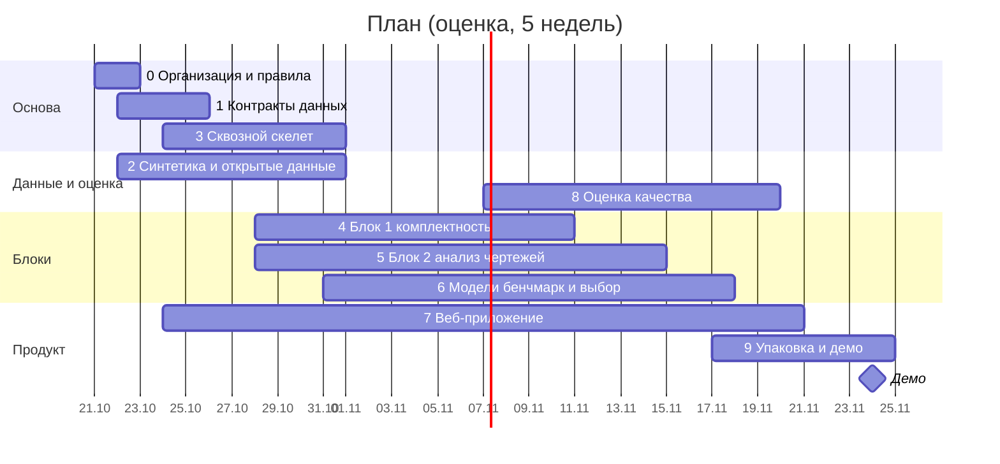

# План работ

Версия 1 от 20.10.2026. Обновляется после ответов АРМ и по итогам каждого этапа.

Сроки — оценка на 5 недель от 21.10.2026. Длительность кейса пока неизвестна: график сдвигаем под фактический.

## Как начать без датасета

Начинать без данных заказчика можно и нужно. Формат документов задан ЕСКД, поэтому три источника данных доступны сразу:

| Источник | Что даёт | Чего не даёт |
| --- | --- | --- |
| Синтетика по ГОСТ: основные надписи, спецификации, технические требования с известной разметкой | Обучение и метрики извлечения, любой объём | Реальное разнообразие оформления и дефектов |
| Синтетические комплекты с внесёнными ошибками (мутации) | Метрики полноты Блока 1 по каждому типу расхождений | Неизвестные заранее типы ошибок |
| Открытые чертежи по ЕСКД: учебные пособия, публичные каталоги | Реализм, небольшая эталонная выборка | Масштаб; лицензии запрещают публикацию |

Реальные комплекты АРМ нужны для эталонной выборки, финальной калибровки и демо. Решение от 20.10.2026: работу начинаем без данных заказчика, у АРМ запрашиваем только датасет — комплекты КД в том виде, в каком они хранятся. Подробный опросник («Запрос заказчику (АРМ): материалы и вопросы», ссылку в публичном репозитории не храним) отложен.

## Критерии оценки → чем закрываем

| Критерий кейса | Чем закрываем | Этапы |
| --- | --- | --- |
| 1. Точность извлечения | Шаблоны ГОСТ, текстовый слой PDF, бенчмарк OCR и VLM, метрики по полям в разрезе качества сканов | 5, 6, 8 |
| 2. Полнота проверки комплектности | 5 обязательных типов расхождений + дополнительные проверки, мутационные тесты | 4, 8 |
| 3. Обоснованность оценки | Методика эталонной выборки, двойная разметка, честный разбор ошибок | 2, 8 |
| 4. Работоспособность | Изоляция ошибок по файлам, CLI, Docker, фиксированные версии | 3, 9 |

## График

## Этапы

### Этап 0. Организация и правила — 21–22.10

Цель: правила, документы и окружение готовы до начала разработки.

- [x] Правила репозитория: языки, инженерные правила, глоссарий
- [x] Требования кейса, план, архитектура, обзор решений — в `docs/`
- [x] Черновик запроса заказчику
- [ ] Запросить у АРМ датасет, договориться о консультациях. Работу не блокирует
- [x] Распределять направления и согласовывать структуру с веб-разработчиком не нужно: над кейсом работает один человек (20.10.2026)
- [x] Сверить прототип из PR #1 (`frontend/`, `backend/`) с ARCHITECTURE.md: [отчёт сверки](reviews/2026-10-20-prototype.md)
- [x] Принять решения 6–10 из ARCHITECTURE.md (ADR в `docs/adr/`) — приняты 20.10.2026
- [x] Окружение: uv workspace, ruff, mypy, pytest, pre-commit, CI (GitHub Actions); тесты не зависят от шрифтов ОС — шаги 1–2 [плана миграции](reviews/2026-10-20-prototype.md#7-план-миграции)

Готово, когда: решения приняты, CI проходит на прототипе.

### Этап 1. Контракты данных — 22–25.10

Цель: Блоки 1 и 2 и веб работают независимо, договорившись о форматах.

- [x] Перенести контракт прототипа в `kdcheck.schemas`, `arm_web.models` реэкспортирует его ([ADR-0009](adr/0009-report-contract.md), шаг 3 плана миграции)
- [x] Контракт 1.1: движки и версии (`KitInfo.engines`, `SourceRef.engine`, `SourceRef.engine_version`), хэш настроек `KitInfo.config_sha256` — шаг 7 плана миграции ([ADR-0012](adr/0012-configs.md))
- [x] Контракт 1.2: `rule_id`, статус значения, статусы `encrypted` и `duplicate_file`, `extensions` — шаг 8 плана миграции (ARCHITECTURE.md, «Отчёт: контракт»). Модели отклоняют неизвестные поля, данные внешних конвейеров — в `extensions`. Отчёты 1.0 и 1.1 валидны, тест это проверяет
- [x] JSON Schema из моделей и типы TypeScript из схемы; CI сверяет их с моделями — `scripts/export_schema.sh`, тесты в `packages/kdcheck/tests` и `frontend/scripts`
- [x] Фикстуры: `samples/` и `frontend/public/demo/report.json` обновляются при смене версии. Демо-отчёт пересобран под 1.1, тест сверяет его версию с моделями; в `samples/` отчётов нет, только комплект и эталон
- [x] Каталог типов расхождений и категорий проблемных файлов: коды, уровни важности, тексты — [report-format.md](report-format.md): правила Блока 1 с типом, важностью и условием срабатывания, статусы документов. Тест сверяет каталог правил с реестром и `configs/checks.yaml`

Готово, когда: схемы покрыты тестами, веб отображает пример отчёта.

### Этап 2. Данные без заказчика — 22–31.10

Цель: данные для разработки и метрик до получения комплектов АРМ.

**2.1 Открытые чертежи**

- [ ] Собрать 50–150 листов ЕСКД: векторные PDF и сканы; детали, сборки, спецификации
- [ ] Реестр `data/registry.csv`: источник, лицензия, тип, качество (сами файлы — вне git)

**2.2 Генератор документов (`synth/`)**

- [ ] Основная надпись: формы 1, 2, 2а; ГОСТ 2.104-2006 и ГОСТ Р 2.104-2023
- [ ] Спецификация: разделы, позиции, многострочные наименования, несколько листов, БЧ, исполнения
- [ ] Технические требования: шаблоны типовых пунктов (неуказанные отклонения, термообработка, покрытия, шероховатость)
- [ ] Шрифты ГОСТ тип А и Б, рендер в PDF (Typst или ReportLab), растеризация 150–600 dpi
- [ ] Деградации «как скан» — Augraphy: шум, наклон, размытие, JPEG, штампы, сгибы
- [ ] Разметка генерируется вместе с документом: значение и bbox каждого поля

**2.3 Генератор комплектов и мутаций**

- [ ] Случайное дерево изделия глубиной 2–4 → согласованные спецификации и чертежи
- [ ] Мутации с меткой ожидаемого расхождения: удалить чертёж, добавить лишний, изменить наименование, продублировать обозначение, сменить литеру или номер изменения, сменить формат, удалить лист, подложить посторонний документ, повредить файл

**2.4 Правила разметки**

- [ ] Инструкция: что считается верным извлечением (нормализация пробелов, регистра, кириллицы и латиницы, десятичной запятой), как разрешать спорные случаи
- [ ] Label Studio для ручной разметки реальных листов

Готово, когда: ≥ 1000 синтетических листов и ≥ 20 синтетических комплектов с разметкой, 30–50 реальных открытых листов размечены.

### Этап 3. Сквозной скелет — 24–31.10

Цель: работающая цепочка «папка → отчёт» на любом входе, пусть пока с низким качеством.

Цепочка уже есть в прототипе; этап переносит её в ядро по шагам 4–6 [плана миграции](reviews/2026-10-20-prototype.md#7-план-миграции).

- [x] CLI: `kdcheck run <папка> -o <папка_отчёта>`
- [x] Перенос модулей прототипа в `kdcheck` по одному; import-linter в CI ([ADR-0010](adr/0010-repo-layout.md), [ADR-0011](adr/0011-core-public-api.md)). Перенесено: чтение файлов, OCR, рендер листов, основная надпись, спецификация, обозначения, Блок 1 (дерево — `tree`, правила и проверки — `checks`, разделены на шаге 8), Блок 2 (параметры и критичность), конвейер и выгрузки. API берёт из ядра только `schemas`, `run`, `render`, `report`
- [x] Триаж файлов: тип по сигнатуре, хэш, повреждённые, зашифрованные, неподдерживаемые, дубликаты; перехват ошибок по страницам. С шага 8 зашифрованные PDF и побайтовые копии — отдельные статусы. Страница PDF или кадр изображения со сбоем получают `PageInfo.problem` (контракт 1.3), остальные страницы читаются и разбираются, документ — `warning`; не прочитана ни одна страница — `damaged`. Разбор поля чертежа тоже изолирован по страницам. Файл без прав на чтение — `damaged`, а не остановка прогона
- [x] Адаптер `PdfBackend`: pypdfium2 и pdfplumber, замер против PyMuPDF на демо-комплекте ([ADR-0007](adr/0007-pdf-library.md)). По умолчанию pypdfium2, PyMuPDF — `ARM_PDF_BACKEND=pymupdf`; замер — [pdf-backends.md](../eval/results/pdf-backends.md). Отклонение от ADR-0007: pdfplumber не понадобился, текст pypdfium2 совпал с PyMuPDF по всем полям. Сканы в PDF читаются по собственным пикселям, без пересчёта в 200 dpi
- [x] Генератор демо-комплекта — в `synth/` на reportlab (BSD) и pypdfium2. Шрифт DejaVu Sans лежит в репозитории, шум сканов идёт от сида, поэтому комплект не зависит от машины. `samples/demo_kit` перегенерирован: векторные PDF извлекаются так же, сканы — новые, замер повторён. Тест сверяет `samples/demo_kit` с выводом генератора. Отклонение от сверки прототипа: `build_demo.py` остался в `backend/`, он собирает демо-отчёт через оценку по эталону и переедет вместе с ней (этап 8)
- [x] PyMuPDF ушёл из обязательных зависимостей: в `backend/requirements.txt` и Docker-образе его нет, для отката `ARM_PDF_BACKEND=pymupdf` он ставится отдельно; pypdfium2 стал обязательной зависимостью ядра. CI проверяет поставку pip-licenses и падает на AGPL (`scripts/check_licenses.sh`). Тесты ядра собирают PDF через reportlab, поэтому без PyMuPDF пропускаются только случаи самого PyMuPDF. Шаг 6 плана миграции завершён
- [x] Пороги, шаблоны форм ГОСТ, словари, движки и лимиты API — в `configs/*.yaml` ([ADR-0012](adr/0012-configs.md)): `forms`, `ingest`, `dictionaries`, `criticality`, `models`, `api`. Модели pydantic проверяют файлы, при ошибке прогон останавливается с именем файла и поля. Каталог задают `kdcheck run --config` или `ARM_CONFIG_DIR`, по умолчанию — `configs/` рабочей копии. Отчёт хранит версии движков и хэш настроек (контракт 1.1), печатная форма и Excel показывают их. Тест-ограничитель пускает в код ядра только числа 0–3 и факты из списка с причинами: единицы, повороты PDF, оформление. Значения перенесены как есть: отчёт по демо-комплекту совпал с прежним с OCR и без. Отклонения: порог «проверить» в вебе (`LOW_CONFIDENCE = 0.6`) уйдёт в ядро вместе с `Extracted.status` (контракт 1.2); генератор `synth/` хранит свою геометрию (ADR-0010). Шаг 7 плана миграции завершён
- [x] Реестр правил Блока 1 и контракт 1.2 — шаг 8 плана миграции. Дерево изделия (`kdcheck.tree`) отделено от проверок (`kdcheck.checks`), import-linter держит дерево независимым от проверок. Реестр `kdcheck.checks.rules` — 12 правил вида `B1.NAME.001`: тип расхождения и заголовок; `configs/checks.yaml` включает каждое правило и задаёт важность, неизвестное или пропущенное правило останавливает прогон. На каждое правило — тест, где оно срабатывает, и тест на близкий случай, где молчит. Порог «проверить» ушёл из веба в ядро: значения получают `Extracted.status` по правилу `review` в `configs/ingest.yaml`, веб читает статус. Зашифрованный PDF — `encrypted`, побайтовая копия — `duplicate_file`. Значения перенесены как есть: отчёт по демо-комплекту совпал с прежним, кроме новых полей. Отклонение: побайтовые копии — категория проблемных файлов, а не подтип расхождения `duplicate_designation` (таблица этапа 4): по кейсу дублирование обозначения — это разные документы с одним обозначением. Шаг 8 плана миграции завершён, план миграции выполнен
- [x] Рендер листов, текстовый слой PDF с координатами, формат листа. Рендер и текстовый слой — адаптер `PdfBackend` (шаг 6). Формат по ГОСТ 2.301 — `PageInfo.format` (контракт 1.3): основные форматы, А5 и дополнительные, допуск 3 % на сторону, таблица — в `configs/forms.yaml`. У изображения формат определяется только по разрешению из метаданных: оценка разрешения сама предполагает формат. На демо-комплекте чертежи — A3, спецификации — A4
- [x] `report.json`, `report.html`, `report.xlsx`: `kdcheck run` пишет все три, API строит выгрузки из `report.json` на лету ([ADR-0011](adr/0011-core-public-api.md))
- [x] API: задание — отдельный процесс `kdcheck run` с тайм-аутом и лимитом памяти, лимиты загрузки ([ADR-0006](adr/0006-job-execution.md)). Лимиты: размер загрузки, число файлов, страниц на файл. С шага 7 они в `configs/api.yaml` и `configs/ingest.yaml`, переменные `ARM_*` их переопределяют
- [x] Веб: загрузка, прогресс, отчёт — работает на прототипе, следим, чтобы не сломался. Проверено в конце этапа: комплект с битым кадром TIFF загружен через API, задание прошло отдельным процессом с OCR, отчёт 1.3 с форматами листов и проблемой страницы, выгрузки и изображения листов отдаются. CI собирает веб и проверяет, что Docker-образ отдаёт API и веб

Готово, когда: любая папка, включая битые и посторонние файлы, даёт отчёт без падения.

### Этап 4. Блок 1 — комплектность — 28.10–10.11

Цель: дерево изделия и все расхождения с доказательствами.

- [ ] 4.1 Классификация листов: спецификация, чертёж детали, сборочный чертёж, прочий КД, посторонний, пустой, нечитаемый
- [ ] 4.2 Основная надпись по шаблону ГОСТ: ячейки → текст (вектор — текстовый слой, растр — OCR)
- [ ] 4.3 Спецификация: сетка → колонки «Формат, Зона, Поз., Обозначение, Наименование, Кол., Примечание» → строки; разделы, переносы, продолжение на следующих листах
- [ ] 4.4 Нормализация обозначений: кириллица и латиница, тире, пробелы, коды документов (СБ, ВО…), исполнения (-01)
- [ ] 4.5 Сборка документов из листов по «Лист/Листов», дерево изделия, поиск корня, циклы
- [ ] 4.6 Правила расхождений — таблица ниже
- [ ] 4.7 Мутационные тесты: полнота по каждому типу, ложные срабатывания на чистых комплектах

Тип — `discrepancies[].type` отчёта; правила уже реализованных типов — в [каталоге](report-format.md), для новых типов коды предварительные.

| Тип | Расхождение | Как находим | Правила | Статус |
| --- | --- | --- | --- | --- |
| `missing_drawing` | Позиция есть в спецификации, документа нет | Обозначение из разделов «Документация», «Сборочные единицы», «Детали» не найдено; БЧ исключаем | `B1.MISSING.001`, `B1.MISSING.002` | Обязательно |
| `orphan_drawing` | Документ есть, но не входит ни в одну спецификацию | Обозначение не встречается в спецификациях и не является корнем | `B1.ORPHAN.001` | Обязательно |
| `name_mismatch` | Наименование на чертеже ≠ в спецификации | Нормализация + нечёткое сравнение; порог отделяет ошибку OCR от реального расхождения | `B1.NAME.001`, `B1.NAME.002` | Обязательно |
| `duplicate_designation` | Одно обозначение у нескольких документов | Разное содержимое при одном обозначении; побайтовые копии — статус файла `duplicate_file` | `B1.DUP.001`–`B1.DUP.003` | Обязательно |
| `revision_mismatch` | Расхождение литеры или номера изменения | Спецификация и СБ одного изделия; литеры «изделие — составная часть» (трактовку уточняем у АРМ) | `B1.VERSION.001`, `B1.LITERA.001`, `B1.LITERA.002` | Обязательно |
| `format_mismatch` | Формат в спецификации ≠ фактическому | Размер листа → формат по ГОСТ 2.301 | — | Дополнительно |
| `sheets_missing` | Не хватает листов | «Листов» в основной надписи против найденных листов | — | Дополнительно |
| `missing_specification` | У сборочной единицы нет своей спецификации | Дерево не раскрывается | `B1.SPEC.001` | Дополнительно |
| `section_mismatch` | Раздел спецификации не соответствует типу документа | Позиция в «Деталях», а документ сборочный, и наоборот | — | Дополнительно |
| `first_use_mismatch` | «Перв. примен.» не совпадает ни с одним родителем | Сверка с деревом; информационно | — | Дополнительно |
| `position_anomaly` | Повтор или пропуск позиций, нет количества | Внутри спецификации | — | Дополнительно |

Проблемные файлы (повреждён, зашифрован, не поддерживается, посторонний, нечитаемый, пустой лист, побайтовая копия) — отдельная категория отчёта.

Готово, когда: на синтетических комплектах полнота ≥ 0,95 по каждому обязательному типу при точности ≥ 0,9 (целевые значения, уточняются); на реальном комплекте разобраны все срабатывания.

### Этап 5. Блок 2 — анализ чертежей и спецификаций — 28.10–14.11

Цель: таблица параметров по деталям с источниками и отметками критичности.

- [ ] 5.1 Поля спецификации — общий код с 4.3
- [ ] 5.2 Основная надпись: обозначение, наименование, материал, масса, масштаб, литера, номер изменения, архивный номер, первичное применение
- [ ] 5.3 Технические требования: блок над основной надписью → текст → пункты → параметры. Сначала правила и словари; LLM — для длинного хвоста формулировок, с проверкой по JSON-схеме
    - квалитеты и предельные отклонения, неуказанные предельные отклонения (ГОСТ 25346, 25347, 30893.1)
    - шероховатость Ra/Rz, включая знак в правом верхнем углу (ГОСТ 2.309, 2789)
    - допуски формы и расположения (ГОСТ 2.308)
    - термообработка: вид, твёрдость HRC/HB, глубина слоя
    - покрытия (ГОСТ 9.306)
- [ ] 5.4 Поле чертежа: размеры с допусками, знаки шероховатости, рамки допусков. Вектор — текстовый слой и геометрия; растр — детектор и VLM. Это расширение: MVP закрывает техтребования и общую шероховатость
- [ ] 5.5 Единая структура «деталь × параметр»: числовые отклонения из поля допуска (Ø40H7 → 0/+0,025), единицы, ссылка на источник; выгрузка JSON, CSV, XLSX
- [ ] 5.6 Критичность:
    - правила с инженерным обоснованием: квалитет IT6 и точнее, Ra ≤ 0,8, допуск формы ≤ 0,01 мм, твёрдость ≥ 50 HRC, покрытие на точной посадке, термообработка после окончательных размеров
    - распределение внутри комплекта: детали в «хвосте» по каждому признаку (перцентили, выбросы)
    - каждая отметка — с причиной текстом и ссылкой на источник

Готово, когда: точность полей основной надписи ≥ 95 % на векторных и ≥ 85 % на сканах, F1 по параметрам техтребований ≥ 0,8 (целевые значения); список критичных параметров с обоснованием.

### Этап 6. Модели: бенчмарк и выбор — 31.10–17.11

Цель: движок для каждого типа поля выбран по измерениям.

- [ ] Эталонные вырезки: ячейки основной надписи и спецификации, блоки техтребований — вектор и сканы разного качества
- [ ] Сравнить: Tesseract (rus), PP-OCR, PaddleOCR-VL, Qwen-VL; eDOCr2 — для размеров; Yandex Vision OCR — если АРМ разрешит облако
- [ ] Таблица: точность, CER, время на лист, требования к GPU, лицензия
- [ ] При нехватке точности — дообучение распознавателя на синтетике со шрифтами ГОСТ
- [ ] Калибровка уверенности: низкая уверенность → отметка «проверить» в отчёте

Готово, когда: в `docs/` есть таблица сравнения и обоснование выбранной конфигурации.

### Этап 7. Веб-приложение — 24.10–20.11

Цель: технолог работает с отчётом без консоли.

- [ ] Загрузка комплекта (папка или zip), список задач, прогресс по стадиям
- [ ] Вкладки отчёта: дерево изделия, расхождения с фильтрами, параметры, проблемные файлы, качество
- [ ] Просмотр листа с подсветкой области-источника для любого значения
- [ ] Выгрузки: JSON, XLSX, HTML

Готово, когда: путь «загрузил → увидел расхождение → открыл лист с подсветкой» проходит без консоли.

### Этап 8. Оценка качества — 07–19.11

Цель: метрики, которым можно верить, и честный разбор ошибок.

- [ ] Эталонная выборка: стратифицированный отбор (векторные, растровые без сканирования и сканы × тип документа × качество), двойная разметка 15–20 % листов, протокол спорных случаев
- [ ] Блок 2: точность по полям после нормализации, CER, F1 по параметрам; разрез по качеству скана
- [ ] Блок 1: точность и полнота по типам расхождений — на мутациях и на реальном комплекте
- [ ] Разбор ошибок по категориям с примерами; ограничения решения
- [ ] `docs/EVALUATION.md`

Готово, когда: каждая цифра в презентации ссылается на файл метрик.

### Этап 9. Упаковка, демо, передача — 17–24.11

- [ ] Docker-образ: API, веб и ядро; профиль GPU с vLLM — через `docker compose`, если понадобится VLM; веса моделей загружаются заранее, версии фиксированы
- [ ] Инструкция по запуску
- [ ] Демо на реальном комплекте: 3–5 верных срабатываний и 2–3 ошибочных с объяснением причин
- [ ] Передача: исходный код, модели, промпты, инструкция

Готово, когда: на чистой машине `docker run` даёт отчёт по демо-комплекту.

## Направления и зависимости

| Направление | Этапы | Зависит от |
| --- | --- | --- |
| Данные и оценка | 2, 8 | 1 — схемы разметки |
| Блок 1 | 4 | 1; 2.2–2.3; разбор основной надписи и спецификации |
| Блок 2 | 5, 6 | 1; 2.2; 4.2–4.3 |
| Веб и API | 3, 7 | 1 — схема отчёта и пример |
| Упаковка | 9 | всё |

Общий код Блоков 1 и 2 — разбор основной надписи и спецификации (4.2, 4.3, 5.1, 5.2). Пишем его один раз для обоих блоков.

## Риски

| Риск | Что делаем |
| --- | --- |
| Реальные данные приходят поздно | Синтетика и открытые чертежи с первого дня; правила настраиваются в конфиге |
| Текстовый слой PDF «битый»: шрифты ГОСТ с нестандартной кодировкой, текст кривыми | Проверка качества текстового слоя, откат на OCR |
| Облако запрещено, GPU нет | Лёгкие модели на CPU (Tesseract, PP-OCR, PaddleOCR-VL 0,9B); VLM — опционально |
| Поле чертежа на сканах распознаётся плохо | MVP — основная надпись и техтребования; поле чертежа — расширение |
| Трактовка «литера / номер изменения» неоднозначна | Уточняем у АРМ; правило настраивается |
| Лицензии: AGPL у PyMuPDF и Ultralytics YOLO | Предпочитаем Apache и MIT; AGPL — только за адаптером и по решению |
| Переобучение на синтетике | Итоговые метрики считаем только на реальных листах |

## Неделя 1

- [ ] Запросить у АРМ датасет
- [x] Схемы данных и пример `report.json`
- [ ] Генератор основной надписи и спецификации v0
- [ ] Собрать первые 50 открытых листов
- [x] Скелет CLI с триажем файлов
