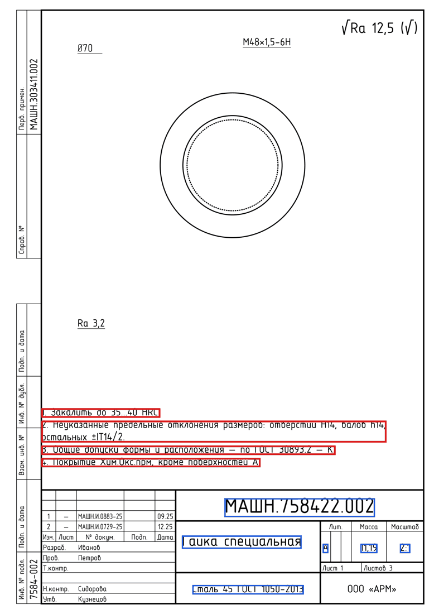
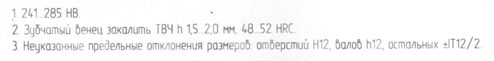
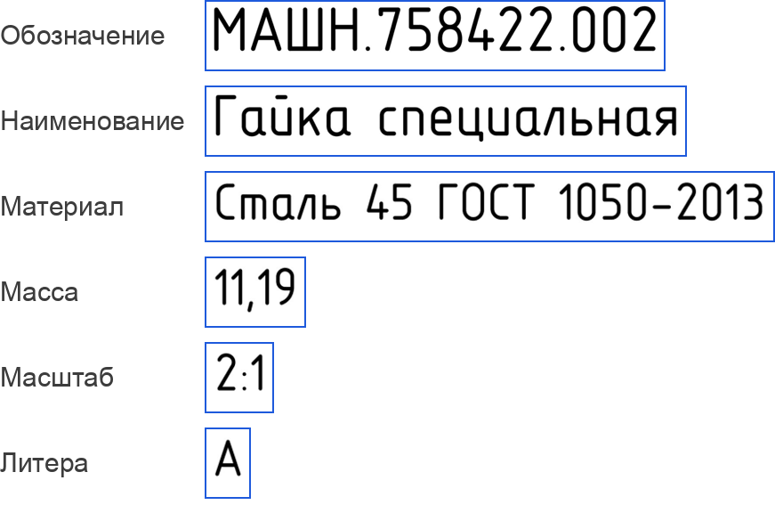

# Сравнение мультимодальных моделей на задачах чтения конструкторской документации

02.11.2026, дополнено 06.11.2026. Исходные данные: [vlm-bench.md](../../eval/results/vlm-bench.md), [vlm-title-block.md](../../eval/results/vlm-title-block.md).

## 1. Цель и модели

Цель — сравнить локальные мультимодальные модели и классическое OCR при чтении растровых документов и сканов. Измерялось чтение двух областей листа: основной надписи и технических требований (ТТ).

Критерии отбора моделей:

- локальный запуск;
- открытая лицензия;
- размер, допускающий запуск без серверного GPU.

Сравнивались два класса моделей:

- общие мультимодальные языковые модели (VLM), которые отвечают на вопрос по изображению;
- документные OCR-модели, которые переводят изображение документа в текст.

Таблица 1. Модели

| Модель | Разработчик | Класс | Параметров | Лицензия |
| --- | --- | --- | --- | --- |
| Qwen3.6-27B | Alibaba | общая VLM | 27 млрд | Apache-2.0 |
| Qwen3.8-27B | Alibaba | общая VLM | 27 млрд | Apache-2.0 |
| Qwen3.6-35B-A3B | Alibaba | общая VLM, смесь экспертов | 35 млрд, из них 3 млрд активных | Apache-2.0 |
| Gemma 4 31B | Google | общая VLM | 31 млрд | Apache-2.0 |
| Gemma 4 E4B | Google | общая VLM | ≈4 млрд эффективных | Apache-2.0 |
| MiniCPM-V 4.7 | OpenBMB | общая VLM, смесь экспертов | 35 млрд, из них 3 млрд активных | Apache-2.0 |
| GLM-4.6V-Flash | Z.ai | общая VLM | ≈10 млрд | MIT |
| Qianfan-OCR | Baidu | документная OCR-модель | ≈4,4 млрд | Apache-2.0 |
| Unlimited-OCR | Baidu | документная OCR-модель | ≈3,3 млрд | MIT |
| dots.mocr | rednote | документная OCR-модель | ≈3 млрд | MIT |
| PaddleOCR-VL-1.6 | Baidu | документная OCR-модель | 0,9 млрд | Apache-2.0 |
| LightOnOCR-3-1B | LightOn | документная OCR-модель | 1 млрд | Apache-2.0 |
| Tesseract 5.5 | открытый проект | классическое OCR, базовый уровень | — | Apache-2.0 |

HunyuanOCR (Tencent) исключена из сравнения: сервер не поддерживает её архитектуру, а лицензия требует отдельного согласования.

## 2. Методика

Условия запуска:

- каждая модель запускалась отдельно на локальном OpenAI-совместимом сервере. MiniCPM-V 4.7 запущена на сервере llama.cpp, поскольку основной сервер не загружает её кодировщик изображений; режим рассуждений у неё отключён;
- генерация детерминированная: температура 0, фиксированное зерно;
- все модели получали одни и те же изображения ([eval/vlm_bench.py](../../eval/vlm_bench.py)).

Режимы ответа:

- общие VLM заполняли поля по заданной JSON-схеме;
- OCR-модели и Tesseract возвращали сплошной текст, и значение искалось в нём. Каждая OCR-модель получала промпт из своей карточки ([prompts/](../../prompts/README.md)), LightOnOCR-3 — только изображение, без инструкции. Служебная разметка ответа — координаты блоков и теги таблиц — перед сравнением удаляется;
- Qianfan-OCR измерена в обоих режимах.

Перед сравнением значения нормализуются по правилу [eval/scoring.py](../../eval/scoring.py): регистр, «ё», десятичный разделитель, пробелы, тире, кавычки, латинские буквы, совпадающие по начертанию с кириллическими.

### Задача 1. Основная надпись с целого листа

- **Данные.** 17 листов реальной КД из открытых архивов: альбом чертежей электровоза ВЛ60 (1963), станок ИЖ-250, альбомы приборов. Это сканы и фотографии. Бланки в основном не соответствуют ГОСТ 2.104, часть надписей сделана от руки.
- **Что получает модель.** Лист целиком, длинная сторона — 2000 пикселей.
- **Что модель возвращает.** Шесть полей: обозначение, наименование, материал, масса, масштаб, литера. Из 102 полей (17 × 6) на листах заполнены 50, а 52 отсутствуют: на бланке нет такой графы или она пуста.

### Задача 2. Технические требования

- **Данные.** 30 блоков ТТ синтетических растров и сканов — сгенерированных чертежей с известной разметкой ([ADR-0013](../adr/0013-synthetic-data.md)).
- **Что получает модель.** Блок, вырезанный по разметке (рис. 1, 2). Поиск области не измеряется — только распознавание.
- **Как оценивается.** Распознанный текст разбирается парсером ядра. Сравнивается 61 параметр четырёх категорий: общие допуски, термообработка, твёрдость, покрытие.

Рис. 1. Синтетический лист с разметкой: красным — блок ТТ, синим — ячейки основной надписи.

Рис. 2. Блок ТТ другого синтетического листа, скана, в том виде, в котором его получает модель.

Из блока на рис. 2 извлекаются четыре параметра: твёрдость 241…285 HB, закалка ТВЧ на глубину 1,5…2,0 мм, твёрдость 48…52 HRC, общие допуски IT12.

Таблица 2. Ответы на блок рис. 2, строки 2 и 3

| | Строка 2 | Конец строки 3 |
| --- | --- | --- |
| Эталон | ТВЧ h 1,5...2,0 мм, 48...52 HRC | отверстий H12, валов h12, остальных ±IT12/2 |
| Qwen3.6-27B | ТВЧ h 1,5...2,0 мм, 48...52 HRC | отверстий H12, валов h12, остальных ±IT12/2 |
| dots.mocr | ТВЧ h 1,5...2,0 мм, 48...52 HRC | отверстий H12, валов h12, остальных ±IT12/2 |
| LightOnOCR-3-1B | ТВЧ h 1,5..2,0 мм, 48..52 HRC | опдверстый H12, балоб h12, остальных ±IT12/2 |
| GLM-4.6V-Flash | TV4 h 1,5..2,0 мм, 48..52 HRC | окружных H12, валов h12, осьмых ±IT12/2 |
| Tesseract | ТВЧ В 15..2,0 мм, 48..52 НВС | отферстий H12, балов h12, остальных +112 /2 |

### Задача 3. Ячейки основной надписи

- **Данные.** 112 ячеек основной надписи 20 синтетических документов.
- **Что получает модель.** Ячейку, вырезанную по разметке (рис. 3).

Рис. 3. Ячейки основной надписи листа рис. 1 в том виде, в котором их получает модель.

Таблица 3. Ответы на ячейки рис. 3, в которых ответы различаются

| | Обозначение | Наименование | Материал |
| --- | --- | --- | --- |
| Эталон | МАШН.758422.002 | Гайка специальная | Сталь 45 ГОСТ 1050-2013 |
| Qwen3.6-27B | МАШН.758422.002 | Гайка специальная | Сталь 45 ГОСТ 1050-2013 |
| Qwen3.8-27B | МАШ.758422.002 | Гайка специальная | Сталь 45 ГОСТ 1050-2013 |
| Qwen3.6-35B-A3B | МАШН.758422.002 | Гайка специальная | Сталь 45 ГОСТ 1050-2013 |
| Gemma 4 31B | МАШН.758422.002 | Гайка специальная | Сталь 45 ГОСТ 1050-2013 |
| GLM-4.6V-Flash | МАШН.758422.002 | Гаïка спецыяльная | Смаль 45 ГОСТ 1050-2013 |
| dots.mocr | МАШН.758422.002 | Гайка специальная | Сталь 45 ГОСТ 1050-2013 |
| LightOnOCR-3-1B | МАШ.758422.002 | Гайка специальная | Спаль 45 ГОСТ 1050-2013 |
| Unlimited-OCR | MAUH.758422.002 ¹ | Гайка специальная | Сталь 45 ГОСТ 1050 ¹ |
| Tesseract | МАШН.7584.22.002 | Гацка специольная | Столь 45 ГОСТ 1050-2013 |

¹ Перед значением в ответе стоят посторонние числа («0.5», «4.5»), не видимые в ячейке.

### Задача 4. Конвейер проекта с моделью

- **Данные.** 130 синтетических сканов.
- **Порядок работы.** Основную надпись читает OCR, модель дочитывает ячейки, которые OCR оставил пустыми ([ADR-0014](../adr/0014-local-vlm.md)). В прогоне с проверкой модель перечитывает и ячейки, заполненные OCR.
- **Режимы при расхождении OCR и модели**, сравниваемые на прогоне с проверкой:
  - «дочитывание» — остаётся значение OCR, так работает конвейер сейчас;
  - «модель» — берётся значение модели;
  - «проверить» — остаётся значение OCR, поле помечается для проверки человеком.

### Метрики

- **Поля прочитаны верно** — значение в нужном поле совпадает с эталоном. Только для ответа по схеме.
- **Верное значение есть в ответе** — эталонное значение содержится в тексте ответа. Для текстовых ответов это единственная мера; она завышает результат, поскольку значение ещё не отнесено к полю.
- **Заполнены отсутствующие поля** — модель вернула значение поля, которого на листе нет.
- **Параметры распознаны** — параметр найден с верной категорией и наименованием.
- **Числовые диапазоны верны** — верны обе границы, например 48…52 HRC на рис. 2.
- **Ячейки прочитаны верно** — полное совпадение с эталоном.
- **CER** — доля ошибочных символов: число посимвольных правок, делённое на длину большей из строк, среднее по ячейкам. Пример: «Гацка специольная» против «Гайка специальная» — 2 правки на 17 символов, CER 0,12.
- **Доля верных полей** (задача 4) — доля верно прочитанных полей среди 758 полей эталона.
- **Неверных значений без пометки** (задача 4) — неверные значения, которые отчёт выдаст без пометки «проверить».
- **Время** измерено на одной конфигурации оборудования и пригодно только для сравнения моделей между собой.

## 3. Результаты

Таблица 4. Основная надпись с целого листа, 17 реальных листов

| Модель | Поля прочитаны верно, из 50 | Верное значение есть в ответе, из 50 | Заполнены отсутствующие поля, из 52 | Время на лист, с |
| --- | ---: | ---: | ---: | ---: |
| Qwen3.6-27B | 40 | 42 | 4 | 67,5 |
| Qwen3.6-35B-A3B | 36 | 37 | 3 | 10,7 |
| Qwen3.8-27B | 28 | 34 | 2 | 35,0 |
| MiniCPM-V 4.7 | 20 | 21 | 5 | 3,3 |
| Gemma 4 31B | 19 | 19 | 3 | 10,8 |
| GLM-4.6V-Flash | 14 | 15 | 9 | 14,2 |
| Qianfan-OCR, ответ по схеме | 5 | 6 | 2 | 15,8 |
| Gemma 4 E4B | 5 | 6 | 10 | 2,6 |
| dots.mocr, текст | — | 35 | — | 25,1 |
| LightOnOCR-3-1B, текст | — | 24 | — | 8,1 |
| Unlimited-OCR, текст | — | 18 | — | 6,4 |
| Qianfan-OCR, текст | — | 16 | — | 38,9 |
| PaddleOCR-VL-1.6, текст | — | не измерено ² | — | — |
| Tesseract 5.5, текст | — | 13 | — | 0,8 |

² Сервер вернул ошибку на 14 листах из 17; на трёх обработанных листах (9 полей) верных значений нет.

Таблица 5. Технические требования, 30 блоков

| Модель | Параметры распознаны, из 61 | Числовые диапазоны верны, из 30 | Время на блок, с |
| --- | ---: | ---: | ---: |
| Qwen3.6-27B | 52 | 28 | 18,9 |
| Qwen3.6-35B-A3B | 52 | 28 | 2,4 |
| Qwen3.8-27B | 52 | 28 | 11,5 |
| Gemma 4 31B | 51 | 28 | 12,2 |
| dots.mocr, текст | 51 | 28 | 2,2 |
| LightOnOCR-3-1B, текст | 51 | 28 | 0,9 |
| MiniCPM-V 4.7 | 49 | 28 | 2,3 |
| Qianfan-OCR, текст | 45 | 28 | 6,6 |
| Qianfan-OCR, ответ по схеме | 43 | 28 | 7,1 |
| PaddleOCR-VL-1.6, текст | 39 | 12 | 1,6 |
| Gemma 4 E4B | 38 | 28 | 2,9 |
| GLM-4.6V-Flash | 26 | 22 | 4,4 |
| Unlimited-OCR, текст | 24 | 9 | 4,6 |
| Tesseract 5.5, текст | 19 | 9 | 0,1 |

Таблица 6. Ячейки основной надписи, 112 ячеек

| Модель | Ячейки прочитаны верно, из 112 | CER | Время на ячейку, с |
| --- | ---: | ---: | ---: |
| Gemma 4 31B | 103 | 0,049 | 4,9 |
| Qwen3.6-27B | 102 | 0,052 | 5,5 |
| Qwen3.8-27B | 100 | 0,053 | 3,4 |
| Qwen3.6-35B-A3B | 99 | 0,054 | 0,8 |
| MiniCPM-V 4.7 | 95 | 0,045 | 0,9 |
| Qianfan-OCR, ответ по схеме | 90 | 0,094 | 2,2 |
| dots.mocr, текст | 83 | 0,085 | 0,3 |
| PaddleOCR-VL-1.6, текст | 83 | 0,086 | 0,4 |
| Gemma 4 E4B | 82 | 0,109 | 1,6 |
| GLM-4.6V-Flash | 72 | 0,087 | 1,0 |
| Qianfan-OCR, текст | 71 | 0,077 | 2,0 |
| LightOnOCR-3-1B, текст | 58 | 0,206 | 0,2 |
| Tesseract 5.5, текст | 49 | 0,169 | < 0,1 |
| Unlimited-OCR, текст | 25 | 0,454 | 1,2 |

Таблица 7. Конвейер проекта с моделью, 130 синтетических сканов

| Конфигурация | Доля верных полей | Значений получено от модели | Из них верных | Время на 130 сканов, с |
| --- | ---: | ---: | ---: | ---: |
| только OCR | 0,650 | — | — | 284 |
| OCR и Gemma 4 E4B | 0,743 | 76 | 75 | 560 |
| OCR и Qwen3.6-27B | 0,747 | 82 | 78 | 1093 |
| OCR и Qianfan-OCR | 0,704 | 70 | 45 | — ³ |
| OCR и Qwen3.8-27B | 0,741 | 75 | 74 | — ³ |
| OCR и Gemma 4 31B | 0,748 | 78 | 78 | — ³ |
| OCR и Qwen3.6-35B-A3B | 0,745 | 78 | 77 | — ³ |

³ Измерены только в прогоне с проверкой (табл. 8): значения, которые модель дала пустым ячейкам, там те же.

Таблица 8. Режимы при расхождении OCR и модели, прогон с проверкой, 758 полей

| Модель | Режим | Доля верных полей | Неверных значений без пометки | Отмечено «проверить» | Время на 130 сканов, с |
| --- | --- | ---: | ---: | ---: | ---: |
| Gemma 4 E4B | дочитывание | 0,744 | 189 | 0 | 2524 |
| Gemma 4 E4B | модель | 0,898 | 72 | 0 | 2524 |
| Gemma 4 E4B | проверить | 0,744 | 8 | 234 | 2524 |
| Qianfan-OCR | дочитывание | 0,704 | 214 | 0 | 3167 |
| Qianfan-OCR | модель | 0,770 | 164 | 0 | 3167 |
| Qianfan-OCR | проверить | 0,704 | 38 | 279 | 3167 |
| Qwen3.8-27B | дочитывание | 0,741 | 190 | 0 | 3414 |
| Qwen3.8-27B | модель | 0,945 | 36 | 0 | 3414 |
| Qwen3.8-27B | проверить | 0,741 | 9 | 223 | 3414 |
| Gemma 4 31B | дочитывание | 0,748 | 188 | 0 | 4987 |
| Gemma 4 31B | модель | **0,964** | 24 | 0 | 4987 |
| Gemma 4 31B | проверить | 0,748 | **7** | 218 | 4987 |
| Qwen3.6-35B-A3B | дочитывание | 0,745 | 190 | 0 | 1536 |
| Qwen3.6-35B-A3B | модель | 0,955 | 31 | 0 | 1536 |
| Qwen3.6-35B-A3B | проверить | 0,745 | 10 | **215** | 1536 |

Там, где OCR и модель прочли одно и то же, значение верно в 435 случаях из 442 у Gemma 4 E4B, в 386 из 399 у Qianfan-OCR, в 446 из 454 у Qwen3.8-27B, в 452 из 459 у Gemma 4 31B и в 453 из 462 у Qwen3.6-35B-A3B.

## 4. Обсуждение

1. **Поля с целого листа выделяют только Qwen3.6-27B и Qwen3.6-35B-A3B: 40 и 36 из 50.** На реальных листах поля расположены нестандартно, часть надписей рукописная. Модели других семейств — Gemma, MiniCPM, GLM — находят не больше 20 полей, Qwen3.8-27B — 28. Малые VLM и OCR-модели распознают текст, но не относят его к полям. Qianfan-OCR в текстовом режиме выдаёт текст лишь части листа и до основной надписи часто не доходит.
2. **Предположение о потере разрешения в сборке MLX не подтвердилось.** Отставание Qwen3.8-27B и Gemma 4 31B на целом листе (28 и 19 полей против 40 у Qwen3.6-27B) объяснялось тем, что обе модели запущены в сборке MLX, а Qwen3.6-27B — в GGUF. Однако Qwen3.6-35B-A3B в сборке MLX находит 36 полей из 50, так что сама сборка отставания не объясняет. Причина, по-видимому, в моделях: на вырезках Qwen3.8-27B и Gemma 4 31B не уступают Qwen3.6-27B.
3. **Смесь экспертов даёт точность крупной модели при скорости малой.** Qwen3.6-35B-A3B на каждый токен задействует 3 млрд параметров из 35. На вырезках она так же точна, как Qwen3.6-27B (52 параметра ТТ из 61, 99 ячеек из 112), а работает в 7–8 раз быстрее: 2,4 с на блок и 0,8 с на ячейку; лист она читает за 10,7 с против 67,5 с. В конвейере она уступает Gemma 4 31B меньше процентного пункта (0,955 против 0,964 в режиме «модель»), а 130 сканов с проверкой читает в 3,2 раза быстрее. MiniCPM-V 4.7 устроена так же и столь же быстра, у неё наименьший CER ячеек (0,045), но точных совпадений меньше (95 из 112), а полей с целого листа — 20 из 50.
4. **Gemma 4 31B точнее всех читает ячейки основной надписи: 103 из 112 при CER 0,049.** На ТТ она близка к Qwen (51 параметр из 61). В конвейере она тоже лучшая: все 78 значений, которые она дала пустым ячейкам, верны, а в режиме «модель» доля верных полей — 0,964 (табл. 8). Цена — время: 130 сканов с проверкой она читает в 1,5 раза дольше Qwen3.8-27B и в 3,2 раза дольше Qwen3.6-35B-A3B. На целом листе каждое верное значение из её ответа стоит в своём поле (19 и 19 в табл. 4): потери связаны с чтением, а не с отнесением значения к полю.
5. **На вырезках модели значительно точнее Tesseract.** В ТТ много специальных знаков, и Tesseract их искажает: «HRC» → «НВС», «±IT12/2» → «+112 /2» (табл. 2). Языковая модель восстанавливает знаки по контексту.
6. **Среди OCR-моделей лучшая — dots.mocr.** В её тексте целого листа есть 35 значений из 50 — почти столько же, сколько в ответе Qwen3.6-35B-A3B по схеме (37), и почти втрое больше, чем у Tesseract (13). ТТ она читает так же, как крупные VLM: 51 параметр из 61 за 2,2 с на блок. На ячейках она уступает общим VLM (83 из 112): в 4 ячейках масштаба из 20 теряет двоеточие («14» вместо «1:4»), на самых плохих сканах искажает наименование («HOCO» вместо «Насос»).
7. **LightOnOCR-3-1B находит в ТТ столько же параметров, сколько dots.mocr (51 из 61), за 0,9 с на блок, но для ячеек не годится.** В 12 ячейках литеры из 20 она возвращает пустой ответ, в масштабе теряет двоеточие, путает «в» и «б» («балоб» вместо «валов»). Unlimited-OCR разбирает вырезку как целую страницу: добавляет посторонние числа и метки изображений, кириллицу обозначений пишет латиницей («MAUH» вместо «МАШН», табл. 3). На целом листе её текст содержит 18 значений из 50 при 6,4 с на лист.
8. **У Qianfan-OCR в текстовом режиме меньше точных совпадений ячеек (71 против 90), но CER ниже.** Кириллицу она частично заменяет похожими латинскими и греческими буквами («Δ» вместо «Д»). Латинские замены нормализация устраняет, греческие — нет.
9. **GLM-4.6V-Flash слабее остальных общих VLM на вырезках:** 26 параметров ТТ из 61 и 72 ячейки из 112. Кириллицу она смешивает с латиницей и другими алфавитами («закалumb», «Гаïка спецыяльная», табл. 2 и 3). Она же вместе с Gemma 4 E4B чаще остальных заполняет отсутствующие поля: 9 и 10 из 52.
10. **PaddleOCR-VL на целом листе не измерена.** Сервер не обрабатывает служебные токены координат в её ответах. Причина низкой доли верных диапазонов (12 из 30) не исследована.
11. **Задачи 2 и 3 дают верхнюю оценку.** Область задана разметкой, а синтетические сканы чище реальных. Полного результата по ТТ не достигает ни одна модель: часть формулировок не покрыта парсером.
12. **В конвейере результат определяет режим, а не модель.** В режиме «дочитывание» модель не исправляет ячейки, которые OCR заполнил неверно: наименование верно в 74 сканах из 130 при любой модели, а доля верных полей у всех моделей 0,70–0,75. Если на расхождении брать значение модели, доля растёт до 0,898 у Gemma 4 E4B, 0,945 у Qwen3.8-27B, 0,955 у Qwen3.6-35B-A3B и 0,964 у Gemma 4 31B (табл. 8). Режим «проверить» у этих четырёх моделей оставляет без пометки 7–10 неверных значений из 758, но отмечает 28–31 % полей.
13. **Согласие OCR и модели — сильный признак верного значения:** такие поля верны в 97–98 % случаев. Его можно использовать при калибровке уверенности.
14. **Qianfan-OCR в конвейере слабее, чем в бенчмарке.** В конвейере она дала 45 верных значений из 70, в режиме «модель» — 0,770, тогда как в задаче 3 читала 90 ячеек из 112. Конвейер вырезает ячейку по шаблону бланка, а бенчмарк — по эталонной разметке. Причина разницы не исследована.

## 5. Выводы

1. Основную надпись с целого листа читают только Qwen3.6-27B и Qwen3.6-35B-A3B: 40 и 36 полей из 50 при 4 и 3 ложных значениях; вторая обрабатывает лист в 6 раз быстрее. В тексте Tesseract есть 13 верных значений, в тексте dots.mocr — 35.
2. На вырезанных областях (ТТ, ячейки) Qwen3.6-27B, Qwen3.8-27B, Qwen3.6-35B-A3B и Gemma 4 31B точны одинаково: 51–52 параметра ТТ из 61 и 99–103 ячейки из 112. Самая быстрая из них — Qwen3.6-35B-A3B (2,4 с на блок, 0,8 с на ячейку), самая точная на ячейках — Gemma 4 31B (CER 0,049).
3. Среди OCR-моделей лучшая — dots.mocr: 51 параметр ТТ из 61 и 83 ячейки из 112. LightOnOCR-3-1B читает ТТ так же и в 2,4 раза быстрее, но для ячеек не годится.
4. В нынешнем режиме модель повышает долю верных полей конвейера с 0,650 до 0,704–0,748. Если на расхождении OCR и модели брать значение модели, Gemma 4 31B даёт 0,964, Qwen3.6-35B-A3B — 0,955, Qwen3.8-27B — 0,945.
5. Сочетание режимов «модель» и «проверить» — брать значение модели и помечать поле — по тем же прогонам даёт с Gemma 4 31B долю верных 0,964 при 7 неверных значениях без пометки и 218 отмеченных полях, с Qwen3.6-35B-A3B — 0,955, 10 и 215. Это расчёт по табл. 8, а не отдельный замер.

Таблица 9. Распределение ролей по результатам

| Роль | Модель | Основание |
| --- | --- | --- |
| Поля с целого листа | Qwen3.6-35B-A3B | 36 полей из 50 за 10,7 с на лист; Qwen3.6-27B находит на 4 поля больше, но в 6 раз медленнее |
| Вырезки: ячейки, ТТ, строки спецификации; перепроверка значений OCR | Qwen3.6-35B-A3B | 99 ячеек из 112 за 0,8 с; в конвейере 0,955 в режиме «модель»; Gemma 4 31B точнее на 0,9 п. п., но в 3,2 раза медленнее |
| Быстрое сплошное OCR вместо Tesseract | dots.mocr | в тексте листа 35 значений из 50 против 13, параметров ТТ 51 из 61 против 19 |

Одна модель на две первые роли выгодна и потому, что сервер держит одну модель, а каждая смена модели стоит времени загрузки.

## 6. Дальнейшая работа

Планируется:

1. Зафиксировать архитектурное решение: модель становится основным способом чтения растровых документов и сканов, а не только дочитывает за OCR. Роли — по табл. 9; на расхождении брать значение модели и помечать поле, а согласие OCR и модели считать признаком верного значения.
2. Измерить dots.mocr в конвейере как сплошной текстовый слой вместо Tesseract.
3. Повторить сравнение ролей на эталоне реальных сканов ЕСКД: вырезки здесь синтетические, а реальные листы задачи 1 — бланки до ЕСКД.
4. Сократить долю полей на проверку (28–37 % в табл. 8) калибровкой уверенности: значение модели, которое проходит проверку по ГОСТ, можно не отмечать.
5. Измерить PaddleOCR-VL на целом листе после адаптера для её токенов координат.
