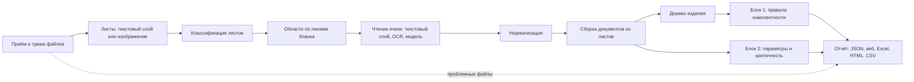

# Промежуточный отчёт: состояние проекта на 11.11.2026

Отчёт подводит итог работы над кейсом «Проверка комплектности и анализ конструкторской документации» ООО «Априорные Решения Машин» к промежуточной контрольной точке. В нём описаны принятый подход и основания выбора решений, реализованные функции, данные и методика оценки, полученные метрики, известные ошибки и ограничения, а также работа, которая остаётся до итоговой демонстрации 24.11.2026.

Каждая цифра отчёта взята из файла замера в [eval/results](../../eval/results), ссылка на него дана рядом с цифрой; там же записаны команда, дата и версии движков. Состав системы, установка, запуск и воспроизведение замеров описаны в [технической документации](../TECHNICAL.md), формат отчёта сервиса — в [report-format.md](../report-format.md), архитектурные решения — в [ARCHITECTURE.md](../ARCHITECTURE.md) и [docs/adr](../adr). Предыдущие отчёты от 02.11.2026 — [состояние проекта](2026-11-02-status.md) и [сравнение моделей](2026-11-02-models.md) — сохранены как история.

## 1. Постановка задачи

Сервис принимает комплект конструкторской документации — набор файлов PDF и JPG, векторных, растровых и сканированных, — и без участия пользователя выдаёт отчёт по двум блокам проверки. Блок 1 восстанавливает по спецификациям дерево изделия, сопоставляет его позиции с файлами чертежей по обозначению и классифицирует расхождения: нет чертежа, чертёж вне спецификаций, расхождение наименования, дублирование обозначения, расхождение литеры или номера изменения. Блок 2 извлекает поля спецификаций и основных надписей, параметры технических требований, приводит их к единой структуре и выделяет параметры, потенциально критичные для производства.

Кейс задаёт четыре требования к решению: пакетный режим; отчёт в машиночитаемой и человекочитаемой формах; устойчивость к повреждённым, посторонним и нечитаемым файлам; прослеживаемость каждого значения до документа и области страницы. Размеченных данных заказчик не предоставляет: эталонную выборку и методику оценки команда строит сама. Таблица 1 связывает критерии оценки кейса с разделами отчёта.

*Таблица 1. Критерии оценки кейса и разделы отчёта*

| Критерий кейса | Чем подтверждается | Раздел |
| --- | --- | --- |
| 1. Точность извлечения данных, в том числе на плохих сканах | Доля верных полей и параметров по видам входа и классам качества сканов | 5.4, 5.5 |
| 2. Полнота проверки комплектности | Полнота и точность по каждому правилу Блока 1 на комплектах с заложенными расхождениями | 5.1–5.3 |
| 3. Обоснованность оценки | Источники данных, правило верного извлечения, разбиение, двойная разметка, разбор ошибок | 4, 6 |
| 4. Работоспособность | Устойчивость к проблемным файлам, воспроизводимость, тесты, контейнер | 3.1, 3.5, 5.7 |

## 2. Подход и обоснование решений

### 2.1. Основной принцип

В основе решения лежат правила, опирающиеся на стандарты ЕСКД, а модели машинного обучения подключаются там, где замер показывает выигрыш. Такой выбор следует из природы документов: ГОСТ 2.104 фиксирует размеры и положение граф основной надписи, ГОСТ 2.106 — колонки спецификации. Зная форму, система вырезает каждую ячейку и читает её отдельно. Поэтому у каждого значения есть точная область на листе, а модель не может «додумать» значение за пределами ячейки.

Итоговые выводы Блока 1 вычисляются детерминированными правилами по извлечённым фактам. Модель только читает текст, но не решает, отсутствует ли чертёж. Это делает каждое расхождение объяснимым и проверяемым: у него есть правило, сообщение и ссылки на строки и листы, из которых оно следует.

Все модели работают локально. Соглашение о конфиденциальности с заказчиком не допускает передачу документов во внешние сервисы, поэтому облачные OCR и языковые модели в сравнение не входили, а возможность их подключения по умолчанию выключена.

### 2.2. Конвейер

Комплект проходит двенадцать стадий (рис. 1). Каждая пишет типизированный результат, поэтому стадии отлаживаются и проверяются по отдельности, а ошибка одного файла или листа не останавливает обработку комплекта.

*Рис. 1. Стадии обработки комплекта (подробно — [ARCHITECTURE.md](../ARCHITECTURE.md#пайплайн))*

### 2.3. Основные решения

Таблица 2 перечисляет решения, которые определяют качество результата. Для каждого указаны рассмотренные варианты и замер или требование, на котором основан выбор. Полное обоснование каждого решения записано в архитектурном решении (ADR) с тем же номером.

*Таблица 2. Решения и основания выбора*

| Решение | Рассмотренные варианты | Основание выбора |
| --- | --- | --- |
| Ядро — библиотека `kdcheck` с командной строкой; API и веб-интерфейс только вызывают ядро ([ADR-0010](../adr/0010-repo-layout.md), [ADR-0011](../adr/0011-core-public-api.md)) | Логика в серверном приложении | Командная строка и веб дают один и тот же отчёт; ядро проверяется без веба |
| Векторный PDF читается по текстовому слою через pypdfium2 ([ADR-0007](../adr/0007-pdf-library.md)) | PyMuPDF; OCR всех листов | На демо-комплекте метрики pypdfium2 и PyMuPDF совпадают ([pdf-backends.md](../../eval/results/pdf-backends.md)), а лицензия AGPL PyMuPDF неприемлема для поставки; текстовый слой не содержит ошибок распознавания |
| Основная надпись и таблица спецификации растров и сканов находятся по линиям бланка ГОСТ 2.104 и 2.106 ([ADR-0015](../adr/0015-raster-regions.md)) | Детектор областей на нейросети; распознавание листа целиком | Геометрия бланка задана стандартом и не требует обучения; доля верных полей основной надписи выросла с 0–0,16 до 0,77 на растрах и 0,74 на сканах |
| Ячейки растров и сканов читает распознаватель PP-OCRv5 для кириллицы на процессоре ([ADR-0024](../adr/0024-ppocr-cells.md)) | Tesseract | На комплекте заказчика для настройки правил обозначения строк спецификаций, отвечающие грамматике, получены у 49 строк из 64 вместо 19; полнота Блока 1 на синтетике 0,870 вместо 0,844 при той же точности |
| Мультимодальная модель Qwen3.6-35B-A3B перечитывает ячейки растров и сканов; при расхождении с OCR в отчёт идёт её прочтение с пометкой «конфликт» ([ADR-0014](../adr/0014-local-vlm.md), [ADR-0019](../adr/0019-vlm-main-reader.md)) | 12 локальных моделей и документных OCR; режимы «модель дочитывает пустые ячейки» и «расхождение только отмечается» | Сравнение моделей на одних изображениях ([vlm-bench.md](../../eval/results/vlm-bench.md)) и режимов на 130 сканах ([vlm-title-block.md](../../eval/results/vlm-title-block.md)): доля верных полей основной надписи 0,955 против 0,650 у одного OCR и 0,745 у режима дочитывания |
| Грамматики обозначений вынесены в настройки, по одной на систему обозначения ([ADR-0016](../adr/0016-designation-grammars.md)) | Одна грамматика классификатора ГОСТ 2.201 | Заказчик применяет собственную систему обозначения: до решения ни один из 520 документов его комплектов не получал обозначения |
| Документ, разложенный по листу в файл, собирается в один документ ([ADR-0017](../adr/0017-sheet-assembly.md)) | Каждый файл — документ | В комплектах заказчика листы спецификаций лежат в отдельных файлах; иначе каждый лист считался бы дубликатом |
| Групповые документы ГОСТ 2.113 по вариантам А и Б читаются с исполнениями ([ADR-0025](../adr/0025-group-spec-variant-b.md), [ADR-0026](../adr/0026-group-spec-variant-a.md)) | Групповой документ как обычный | Без этого у дерева изделия комплекта заказчика не находился корень, а на синтетике групповые документы и пометка «БЧ» давали 116 из 170 лишних срабатываний ([отчёт 02.11](2026-11-02-status.md#2-основные-ограничения)) |
| Контракт отчёта — модели pydantic; из них генерируются JSON Schema и типы веб-интерфейса; каждое значение несёт источник ([ADR-0009](../adr/0009-report-contract.md), [ADR-0012](../adr/0012-configs.md)) | Свободный JSON | Прослеживаемость — требование кейса; схема проверяет отчёт и защищает веб от расхождения форматов |
| Каждое задание выполняется отдельным процессом с лимитами времени и памяти ([ADR-0006](../adr/0006-job-execution.md)) | Очередь заданий на Redis и RQ | Изоляция недоверенных файлов без дополнительного сервера |

## 3. Реализованные функции

### 3.1. Приём комплекта и устойчивость

Сервис принимает папку или набор файлов PDF, JPG, PNG и TIFF. Тип файла определяется по сигнатуре, а не по расширению. Файлы, которые не удаётся прочитать, получают в отчёте отдельный статус: повреждённый, зашифрованный, неподдерживаемый, посторонний документ, нечитаемый скан, пустой лист, побайтовая копия другого файла. Сбой на одной странице помечает только эту страницу, остальные читаются. Лимиты на размер загрузки, число страниц, размер изображения, время и память задания защищают сервис от зависания на огромном или специально испорченном файле.

### 3.2. Блок 1: комплектность

Дерево изделия строится по спецификациям: сборочные единицы раскрываются рекурсивно по собственным спецификациям, исполнения групповых документов — по групповой спецификации и групповому чертежу базового обозначения. Позиции сопоставляются с документами комплекта по нормализованному обозначению. Расхождения находят 19 правил, у каждого есть код, сообщение для технолога и тесты на срабатывание и на молчание (табл. 3). Все пять видов расхождений из текста кейса покрыты; остальные правила находят неочевидные случаи, которые кейс отмечает отдельно.

*Таблица 3. Правила Блока 1*

| Вид расхождения | Правила | Когда срабатывает |
| --- | --- | --- |
| Чертёж отсутствует (кейс) | `B1.MISSING.001`, `B1.MISSING.002` | У позиции раздела «Детали» или у документа из раздела «Документация» нет файла в комплекте |
| Чертёж вне спецификаций (кейс) | `B1.ORPHAN.001` | Документ комплекта не указан ни в одной спецификации |
| Расхождение наименования (кейс) | `B1.NAME.001`, `B1.NAME.002` | Наименование на чертеже или в собственной спецификации сборочной единицы отличается от наименования в спецификации |
| Дублирование обозначения (кейс) | `B1.DUP.001`–`B1.DUP.003` | Одно обозначение у нескольких документов, у позиций с разными наименованиями или у нескольких спецификаций |
| Литера и номер изменения (кейс) | `B1.VERSION.001`, `B1.LITERA.001`, `B1.LITERA.002` | Разные версии одного документа; литеры спецификации и сборочного чертежа различаются; литера составной части ниже литеры изделия |
| Нет спецификации сборочной единицы | `B1.SPEC.001` | Состав сборочной единицы раскрыть нельзя |
| Не хватает листов | `B1.SHEETS.001` | Листов меньше, чем указано в графе «Листов», или в нумерации пропуск |
| Формат, раздел, позиция, первое применение | `B1.FORMAT.001`, `B1.SECTION.001`, `B1.POS.001`–`B1.POS.003`, `B1.FIRSTUSE.001` | Формат в строке не совпадает с форматом листов; деталь в разделе сборочных единиц; повтор номера позиции или нет количества; «Перв. примен.» называет изделие, в составе которого документа нет |

Если в комплекте есть документы, которые система не прочитала, находка «документ отсутствует» отмечается как предварительная: искомый документ может оказаться среди непрочитанных. Так технолог отличает подтверждённую находку от той, которую может объяснить нечитаемый скан.

### 3.3. Блок 2: анализ документов

Из спецификаций извлекаются формат, позиция, обозначение, наименование, количество и примечание, а у групповых спецификаций — количество по исполнениям. Из основных надписей — обозначение, наименование, материал, масса, масштаб, литера, номер изменения, архивный номер и первое применение. Из технических требований и поля чертежа — допуски размеров с квалитетами, общие допуски по ГОСТ 30893.1 и 30893.2, шероховатость Ra и Rz, допуски формы и расположения, термообработка с глубиной слоя, твёрдость и покрытия.

Параметры приводятся к единой структуре «деталь × параметр»: категория, номинал, предельные значения, единица, квалитет, предельные отклонения по таблицам ГОСТ 25346, исходный текст и область на листе ([ADR-0028](../adr/0028-limit-deviations.md)). Эта таблица выгружается в CSV для учётных систем.

Критичность определяется семью правилами с порогами в настройках: квалитет IT6 и точнее, шероховатость Ra не грубее 0,8 мкм, твёрдость от 45 HRC, химико-термическая обработка, допуск формы и расположения не более 0,02 мм, покрытие, которое встречается у одной детали комплекта, и значение из «хвоста» распределения по комплекту. Порогов производственной площадки заказчик не предоставляет, поэтому обоснование каждой отметки указывает, какую долю значений комплекта параметр превосходит по жёсткости, например «точнее 69 % посадочных размеров комплекта».

### 3.4. Отчёт

Машиночитаемый отчёт — файл `report.json`, проверяемый JSON Schema версии 1.9. Человекочитаемый отчёт — веб-интерфейс с разделами «Сводка», «Дерево изделия», «Расхождения», «Параметры деталей», «Критичные параметры», «Спецификации», «Документы» и «Качество», а также выгрузки в Excel, печатную HTML-форму и CSV. Любое значение и любое расхождение открывается в исходном листе с подсветкой области, из которой оно получено (рис. 2–4; изображения получены на синтетическом демо-комплекте).

*Рис. 2. Сводка отчёта по комплекту*

*Рис. 3. Дерево изделия с отметками расхождений*

*Рис. 4. Источник значения, подсвеченный на листе*

### 3.5. Воспроизводимость

Пороги, шаблоны форм, словари, правила и выбор движков хранятся в настройках, а не в коде. Отчёт записывает хэш настроек, имена и версии всех движков, а у каждого значения — движок, которым оно прочитано. Промпты модели — версионируемые файлы, генераторы синтетики работают от фиксированного сида. Прочтения OCR и модели можно кэшировать по содержимому запроса, поэтому повторный прогон не читает заново ячейку, пиксели которой не изменились ([ADR-0018](../adr/0018-read-cache.md)).

Тесты ядра, API и генератора — 617 автоматических проверок, тесты веб-интерфейса запускаются отдельно. Непрерывная интеграция выполняет их на Ubuntu с Python 3.11 и 3.12 и на macOS, а также проверяет оформление и типы кода, границы модулей, сборку контейнера и отсутствие зависимостей с лицензией AGPL в поставке.

## 4. Данные и методика оценки

### 4.1. Источники данных

Разметка не предоставляется, поэтому качество оценивается по нескольким источникам, каждый из которых измеряет то, что недоступно другим (табл. 4).

*Таблица 4. Источники данных для оценки*

| Источник | Объём | Что измеряется | Ограничение |
| --- | --- | --- | --- |
| Синтетические комплекты по ГОСТ с заложенными ошибками ([ADR-0013](../adr/0013-synthetic-data.md)) | 20 комплектов, 550 документов, 77 заложенных расхождений и 21 проблемный файл; векторные документы, растры и сканы трёх классов качества | Полнота и точность Блока 1 по каждому правилу, параметры Блока 2, верность областей-источников | Разнообразие оформления ограничено генератором |
| Стрессовый корпус сканов | Те же комплекты со сканами, искажёнными независимой библиотекой Augraphy; заморожен по контрольным суммам файлов | Устойчивость чтения к дефектам, которых нет в собственном генераторе | Искусственные дефекты |
| Эталон реальных документов | 45 документов: 22 листа производственной КД из открытых источников и 23 документа трёх учебных комплектов; часть размечена дважды | Чтение реальных листов и Блок 1 на реальных комплектах | Малый объём; реальные сканы — в основном бланки до ЕСКД |
| Комплекты заказчика | Три комплекта и 16 отдельных листов | Работа на реальных данных заказчика | Разметка ещё не готова; данные не публикуются |

Генератор вносит в синтетические комплекты ошибки 19 видов: 13 видов расхождений комплекта (удалённый чертёж, удалённая спецификация, переименование, дублирование обозначения и позиции, литеры, вторая версия документа, формат в строке, пропущенный лист и другие) и 6 видов проблемных файлов (повреждённый, зашифрованный, неподдерживаемый, посторонний, нечитаемый скан, побайтовая копия). Каждая ошибка записывается в разметку с ожидаемым правилом, поэтому полнота считается по каждому виду расхождения.

Комплекты заказчика хранятся вне репозитория, а в публичных материалах обозначаются только обезличенными идентификаторами и числами. Они разбиты по комплектам: на одном (растровые листы, выгруженные из системы проектирования) настраиваются правила, два других — растровый и векторный — отложены для однократного замера после заморозки правил. Разбиение по комплектам, а не по листам, выбрано потому, что листы одного комплекта оформлены одинаково, и разбиение по листам перенесло бы оформление контрольной части в настроечную. Сканов в переданных комплектах нет, поэтому качество чтения сканов измеряется на синтетике, стрессовом корпусе и реальных листах эталона.

### 4.2. Правило верного извлечения и метрики

Что считается верным извлечением, задаёт одно правило для всех замеров ([eval/gold/README.md](../../eval/gold/README.md#что-считается-верным-извлечением)). Значения сравниваются без учёта регистра, буквы «ё», десятичного разделителя, пробелов и латинских букв, похожих на русские. Параметр сопоставляется с разметкой один к одному по категории. Область-источник верна, если она лежит на той же странице и содержит центр области значения из разметки, но ни одного центра других значений того же документа.

Для Блока 1 расхождение считается найденным, если отчёт содержит то же правило с тем же обозначением. Найденное расхождение из разметки — верное срабатывание, не найденное — пропуск, срабатывание без пары в разметке — лишнее. Точность — доля верных среди всех срабатываний, полнота — доля найденных среди заложенных. Отдельно считаются ложные срабатывания на комплектах без ошибок.

Двойная разметка эталона выполнена независимо двумя разметчиками; согласие разметок — от 0,89 до 1,00 по наборам, каждое несовпадение разрешено по листу с записью в протоколе ([gold-agreement.md](../../eval/results/gold-agreement.md)). Правила настраиваются только на синтетике, открытом корпусе и настроечном комплекте заказчика; отложенные комплекты до заморозки правил не запускаются.

## 5. Результаты

### 5.1. Блок 1 на синтетических комплектах

Таблица 5 показывает Блок 1 на 20 синтетических комплектах в трёх конфигурациях: без распознавания растров и сканов, с OCR и с OCR и моделью ([synth-kits.md](../../eval/results/synth-kits.md)).

*Таблица 5. Блок 1 на синтетических комплектах: 77 заложенных расхождений*

| Конфигурация | Найдено | Лишних срабатываний | Точность | Полнота | Ложных срабатываний на 4 комплектах без ошибок |
| --- | ---: | ---: | ---: | ---: | ---: |
| Без OCR: растры и сканы — только по имени файла | 66 | 66 | 0,500 | 0,857 | 12 |
| OCR | 75 | 28 | 0,728 | 0,974 | 5 |
| OCR и модель | 76 | 10 | 0,884 | 0,987 | 2 |

Распознавание растров и сканов поднимает полноту с 0,857 до 0,974, а модель снижает число лишних срабатываний с 28 до 10. Цель этапа по плану — полнота не ниже 0,95 по каждому обязательному виду расхождения при точности не ниже 0,9. С моделью полнота достигнута по всем видам, кроме расхождения литеры и номера изменения (9 из 10), а общая точность 0,884 пока немного ниже цели. Без OCR лишние срабатывания почти целиком вызваны листами, у которых известно только обозначение из имени файла. С моделью они распределены так: 9 вызваны ошибками чтения сканов и растров, 1 — заголовком исполнения группового документа, который не был опознан. Проблемные файлы получают верный статус во всех конфигурациях — 21 из 21.

### 5.2. Блок 1 на учебных комплектах

На трёх учебных комплектах из открытых источников с независимой разметкой ([gold-kits.md](../../eval/results/gold-kits.md)) найдено 14 из 23 размеченных расхождений, лишних срабатываний 8. Восемь из девяти пропусков приходятся на один комплект: ни в одном его документе не заполнена графа «Обозначение», а дерево изделия и сопоставление позиций с чертежами строятся по обозначению, поэтому дерево не построено. На двух других комплектах найдено 11 из 12 расхождений. Лишние срабатывания — три дублирования обозначения и четыре расхождения наименования на одном комплекте и одно расхождение литеры на другом — в согласованной разметке отсутствуют; их разбор войдёт в итоговую оценку.

### 5.3. Блок 1 на комплекте заказчика

Комплект для настройки правил состоит из 53 растровых листов. На нём система находит все 11 спецификаций и обозначения всех 53 документов, читает 100 строк спецификаций и строит дерево изделия из 122 элементов с одним корнем ([arm-kits-dev.md](../../eval/results/arm-kits-dev.md), [arm-kits-dev-vlm.md](../../eval/results/arm-kits-dev-vlm.md)). Обработка занимает около 1,7 с на лист с OCR и около 14 с на лист с моделью. С OCR система выдаёт 12 расхождений, с OCR и моделью — 11.

Эталонной разметки этого комплекта пока нет, поэтому каждое срабатывание проверено вручную — по листам или по совпадению прочтений OCR и модели (раздел 6.2): с OCR верны 11 из 12, с моделью — 10 из 11.

### 5.4. Блок 2: основная надпись и спецификация по видам входа

Таблица 6 показывает чтение основных надписей и строк спецификаций по видам входа и классам качества на шести синтетических комплектах без ошибок ([scan-quality.md](../../eval/results/scan-quality.md)). Растры и сканы читает OCR, без модели. У чертежа считаются обозначение, наименование, материал, масса, масштаб и литера, у спецификации — обозначение и наименование; в строках спецификации — обозначения. В каждой ячейке таблицы — число верных значений из всех, в скобках — доля. Классы качества «хорошее», «среднее» и «плохое» читаются человеком, как кейс обещает о сканах заказчика; стрессовый корпус — те же листы, искажённые независимой библиотекой.

*Таблица 6. Чтение по видам входа и классам качества, OCR без модели*

| Вход и класс качества | Чертежей | Поля основной надписи чертежей | Спецификаций | Поля основной надписи спецификаций | Обозначения строк спецификаций |
| --- | ---: | ---: | ---: | ---: | ---: |
| Вектор | 45 | 264/264 (1,00) | 9 | 18/18 (1,00) | 61/61 (1,00) |
| Растр, хорошее | 20 | 103/111 (0,93) | 4 | 4/8 (0,50) | 20/20 (1,00) |
| Растр, среднее | 17 | 88/96 (0,92) | 1 | 2/2 (1,00) | 5/5 (1,00) |
| Растр, плохое | 13 | 63/75 (0,84) | 7 | 13/14 (0,93) | 48/49 (0,98) |
| Скан, хорошее | 31 | 161/182 (0,88) | 4 | 6/8 (0,75) | 23/27 (0,85) |
| Скан, среднее | 17 | 89/98 (0,91) | 8 | 10/16 (0,62) | 41/51 (0,80) |
| Скан, плохое | 23 | 106/132 (0,80) | 5 | 7/10 (0,70) | 21/27 (0,78) |
| Стрессовый корпус, хорошее | 31 | 106/182 (0,58) | 4 | 4/8 (0,50) | 8/27 (0,30) |
| Стрессовый корпус, среднее | 17 | 34/98 (0,35) | 8 | 7/16 (0,44) | 15/51 (0,29) |
| Стрессовый корпус, плохое | 23 | 54/132 (0,41) | 5 | 3/10 (0,30) | 3/27 (0,11) |

Векторные документы читаются по текстовому слою без ошибок. На растрах верны 84–93 % полей основной надписи чертежей, на сканах — 80–91 %; обозначение, от которого зависит Блок 1, верно у 49 из 50 растров и 70 из 71 скана, слабее всего читаются наименование и материал. По сравнению с замером 06.11.2026, когда ячейки читал Tesseract, доля верных полей основной надписи растров выросла с 0,73–0,79 до 0,84–0,93, сканов — с 0,64–0,83 до 0,80–0,91: с тех пор ячейки читает распознаватель PP-OCRv5, а обозначение сверяется с именем файла. Стрессовый корпус читается заметно хуже — 0,35–0,58: его искажения сильнее тех, что собственный генератор относит к читаемым.

Модель, перечитывающая ячейки основной надписи сканов, поднимает долю верных полей с 0,650 до 0,955 на другом корпусе — 130 сканах демо-комплекта и десяти синтетических комплектов ([vlm-title-block.md](../../eval/results/vlm-title-block.md)).

На 17 реальных сканах бланков до ЕСКД система пока не читает ни одного поля основной надписи ([vlm-title-block-real.md](../../eval/results/vlm-title-block-real.md)): эти бланки не соответствуют ГОСТ 2.104, и поиск формы по линиям их не находит. Сравнение моделей показало, что такие листы целиком читает только крупная модель: 36–40 полей из 50 ([vlm-bench.md](../../eval/results/vlm-bench.md)).

### 5.5. Блок 2: параметры технических требований

Таблица 7 сравнивает извлечение параметров на векторных документах и на растрах и сканах синтетических комплектов ([synth-kits.md](../../eval/results/synth-kits.md)). «Ожидалось» — число параметров в разметке, «найдено» — сопоставленных с разметкой, «лишних» — найденных без пары в разметке.

*Таблица 7. Параметры технических требований на синтетических комплектах, конфигурация «OCR и модель»*

| Категория | Вектор: ожидалось | Вектор: найдено | Вектор: лишних | Растры и сканы: ожидалось | Растры и сканы: найдено | Растры и сканы: лишних |
| --- | ---: | ---: | ---: | ---: | ---: | ---: |
| Допуск размера | 385 | 385 | 0 | 82 | 16 | 17 |
| Общие допуски | 274 | 274 | 0 | 47 | 42 | 0 |
| Шероховатость | 675 | 675 | 0 | 126 | 47 | 28 |
| Допуск формы и расположения | 215 | 215 | 0 | 49 | 19 | 0 |
| Термообработка | 146 | 146 | 0 | 30 | 30 | 0 |
| Твёрдость | 197 | 197 | 0 | 44 | 42 | 0 |
| Покрытие | 169 | 169 | 0 | 26 | 22 | 4 |

На векторных документах полнота и точность равны 1, а значение верно у всех 393 параметров с числом в разметке. На растрах и сканах полнота — 0,295 с одним OCR и 0,540 с моделью, точность — 0,669 и 0,816 соответственно. Записи технических требований (общие допуски, термообработка, твёрдость, покрытия) модель читает почти полностью. Основные потери приходятся на допуски размеров и шероховатость, которые записаны не в технических требованиях, а на поле чертежа рядом с изображением детали; поле чертежа растра система пока не читает.

На комплекте заказчика пункты технических требований с одним OCR найдены у 4 из 26 чертежей деталей, с моделью — у всех 26 ([arm-kits-dev-vlm.md](../../eval/results/arm-kits-dev-vlm.md)).

### 5.6. Прослеживаемость

На синтетических комплектах область-источник верна у всех 3687 значений основных надписей и 1164 строк спецификаций векторных документов, у всех 583 значений основных надписей и 132 строк растров и сканов, у 2061 из 2061 параметра векторных документов и у 207 из 218 параметров растров и сканов ([synth-kits.md](../../eval/results/synth-kits.md)). Ошибочные области параметров растров захватывают соседнее значение или указывают на другой лист.

### 5.7. Устойчивость

Все 21 проблемный файл синтетических комплектов получают верный статус, сканы ниже порога читаемости человеком — статус «нечитаемый» в 6 случаях из 6 ([scan-quality.md](../../eval/results/scan-quality.md)). Пустые листы распознаются на всех чистых растрах и хороших сканах синтетики, а на сканах плохого качества — только в 2 случаях из 12; ни один лист с содержимым в синтетике, эталоне и комплекте заказчика пустым не признан ([blank-sheets.md](../../eval/results/blank-sheets.md)).

## 6. Разбор ошибок и ограничения

### 6.1. Ошибки на синтетике

Ошибки Блока 1 с моделью вызваны чтением, а не правилами: из 10 лишних срабатываний 9 следуют из неверно прочитанных обозначений и наименований на сканах и растрах, одно — из заголовка исполнения группового документа по варианту А, который распознаватель не прочитал. Единственный пропуск — литера составной части, неверно прочитанная на скане. Ошибки Блока 2 сосредоточены на поле чертежа растров и сканов (раздел 5.5).

### 6.2. Срабатывания на комплекте заказчика

Каждое срабатывание на настроечном комплекте заказчика проверено вручную. Первый разбор выявил три причины ложных срабатываний и пропусков, связанные с наименованиями, прочитанными OCR или моделью.

Во-первых, наименование сборочного чертежа включает слова «Сборочный чертёж», которые при сравнении отбрасываются. Если OCR читал их с ошибкой, например «Сдорочный», слова не отбрасывались, и наименования считались разными: так возникли четыре ложных расхождения. Во-вторых, допуск на ошибки распознавания сравнивал наименование целиком, и разница в одно слово терялась на фоне совпадающих: «правый» и «левый», «цилиндр» и «гидроцилиндр» в наименованиях из трёх слов давали сходство выше порога, и два настоящих расхождения были скрыты. В-третьих, модель читала только первую строку позиции спецификации, поэтому наименование, перенесённое на следующую строку по ГОСТ 2.106, приходило обрезанным и давало ложное расхождение.

11.11.2026 все три места исправлены. Слова «Сборочный чертёж» отбрасываются и при ошибке распознавания, наименования из одинакового числа слов сравниваются по словам, а модель читает все строки позиции. На синтетических комплектах ни одна метрика Блоков 1 и 2 при этом не изменилась ([synth-kits.md](../../eval/results/synth-kits.md)). Таблица 8 показывает срабатывания после исправления.

*Таблица 8. Срабатывания на настроечном комплекте заказчика и их проверка*

| Вид срабатывания | С OCR | С OCR и моделью | Результат проверки |
| --- | ---: | ---: | --- |
| Позиция детали без чертежа в комплекте | 1 | 1 | Верно: строку одинаково прочли OCR и модель, документа с таким обозначением в комплекте нет |
| Исполнение детали без своего чертежа, базовый чертёж не групповой | 2 | 1 | Верно по листам в обоих случаях; с моделью одно пропущено (см. ниже) |
| Одно обозначение у двух позиций с разными наименованиями и следующее из этого расхождение наименования с чертежом | 2 | 2 | Верно: строки одинаково прочли OCR и модель |
| Наименование в спецификации отличается одним словом от наименования на чертеже или в собственной спецификации | 3 | 3 | Верно по листам; до исправления скрыто допуском на ошибки распознавания |
| Формат в строке спецификации не совпадает с форматом листов сборочного чертежа | 3 | 3 | Верно по листам |
| Наименование основной надписи прочитано OCR с искажением | 1 | 0 | Ложное: ошибка чтения |
| Модель дописала наименование позиции по первым буквам | 0 | 1 | Ложное: ошибка чтения |
| Всего срабатываний / из них верных | 12 / 11 | 11 / 10 | |

С моделью пропущено одно отсутствие исполнения. В графе «Масса» базового чертежа, где OCR ничего не прочёл, модель прочла «См. табл.». По ГОСТ 2.113 такая запись означает групповой чертёж, на котором изображены и исполнения, поэтому исполнение было сочтено изображённым. На листе этой записи нет. Оба ложных срабатывания и пропуск — ошибки чтения, а не правил: OCR исказил крупный текст основной надписи, а модель достроила текст, которого в ячейке нет. Ещё два исполнения система сочла изображёнными на групповых документах базы, что согласуется с прочитанной записью «См. табл.» и групповой спецификацией; по листам они пока не проверялись.

Полноту этот разбор не измеряет: расхождение, которого не нашёл ни один прогон, при проверке срабатываний не выявляется. Полноту на реальных данных даст эталон комплекта (раздел 7).

### 6.3. Ограничения

- **Поле чертежа растров и сканов.** Размеры с допусками и знаки шероховатости на изображении детали не читаются; это основная причина низкой полноты Блока 2 на растрах и сканах.
- **Нестандартные бланки.** Листы, оформленные не по ГОСТ 2.104 и 2.106, в том числе бланки до ЕСКД, система не разбирает; такие листы получают статус и попадают в отчёт, но их поля не извлекаются.
- **Неоткалиброванная уверенность.** Порог уверенности пока не подобран по эталону, поэтому каждое значение, прочитанное OCR или моделью или взятое из имени файла, отмечается «проверить».
- **Реальные данные.** Эталонной разметки комплекта заказчика пока нет, поэтому на реальных данных приводятся числа найденного, а не точность и полнота. Сканов в переданных комплектах нет.
- **Модель.** Чтение моделью требует отдельного сервера модели и примерно в 8 раз медленнее OCR. Модель изредка достраивает текст, которого в ячейке нет, — наименование по первым буквам или запись в пустой графе. Поэтому её прочтение, расходящееся с OCR, отмечается как конфликт; запись моделью в ячейку, которую OCR оставил пустой, пока такой отметки не получает.
- **Границы кейса.** Геометрия, размеры на изображении и соответствие всем требованиям ЕСКД не проверяются; проверяется формализуемая часть входного контроля.

## 7. Работа до итоговой демонстрации

*Таблица 9. План до 24.11.2026*

| Шаг | Срок | Результат |
| --- | --- | --- |
| Эталон настроечного комплекта заказчика | 12–15.11 | Двойная разметка всех документов, строк и расхождений; согласие разметок; точность и полнота Блоков 1 и 2 на реальных данных |
| Блоки 1 и 2: оставшиеся пробелы | 12–16.11 | Поле чертежа растров для допусков размеров и шероховатости; групповые документы по варианту А на сканах |
| Калибровка уверенности и заморозка правил | 16–18.11 | Порог отметки «проверить» по целевой доле ошибок; однократный замер двух отложенных комплектов заказчика |
| Итоговая оценка качества | 17–20.11 | Метрики Блоков 1 и 2 по видам входа и классам качества, метрика дерева изделия, разбор ошибок, обоснование выбранной конфигурации движков |
| Веб-интерфейс | 18–21.11 | Путь «загрузил комплект → увидел расхождение → открыл лист с подсветкой» без командной строки |
| Упаковка и демонстрация | 20–24.11 | Контейнер с заранее загруженными весами модели, проверенный на чистой машине; прогон на реальном комплекте с примерами верных и ошибочных срабатываний |

Вопросы к консультации с заказчиком собраны по ходу работы: трактовка литеры, применяемые формы основной надписи, правило номера листа в имени файла, варианты групповых документов и требование отдельного чертежа для исполнения, системы обозначения, комплекты со сканами.
