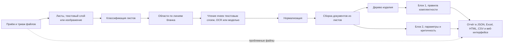
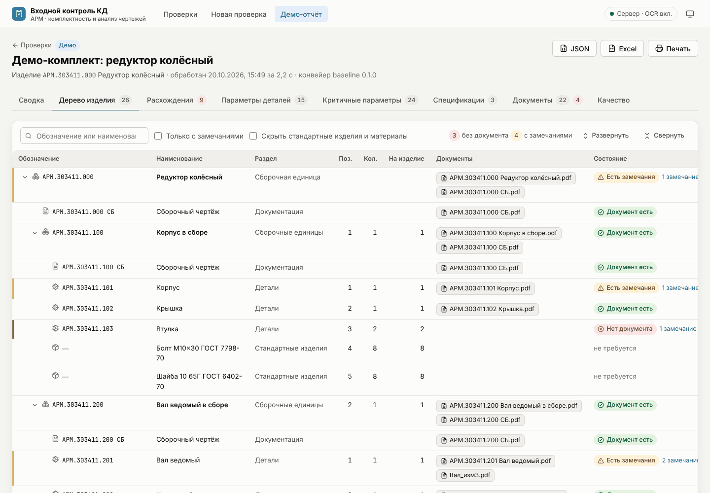
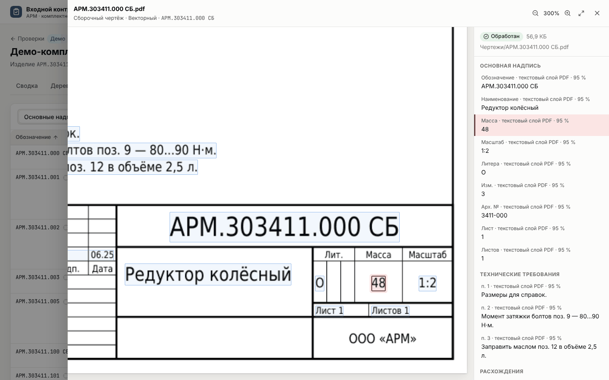

# Промежуточный отчёт о состоянии проекта на 11.11.2026

Отчёт подводит итог работы над кейсом «Проверка комплектности и анализ конструкторской документации» ООО «Априорные Решения Машин» к промежуточной контрольной точке. В нём описаны выбранный подход и причины, по которым приняты основные решения, реализованные функции, данные и методика оценки, полученные метрики, известные ошибки и ограничения. В конце перечислена работа, которая остаётся до итоговой демонстрации.

Все цифры в отчёте взяты из файлов замеров в [eval/results](../../eval/results), ссылка на нужный файл дана рядом с цифрой. В начале каждого файла записаны команда, дата и версии движков. Состав системы, установка, запуск и повторение замеров описаны в [технической документации](../TECHNICAL.md). Формат отчёта сервиса приведён в [report-format.md](../report-format.md), архитектура и решения в [ARCHITECTURE.md](../ARCHITECTURE.md) и [docs/adr](../adr). Отчёты от 02.11.2026 о [состоянии проекта](2026-11-02-status.md) и [сравнении моделей](2026-11-02-models.md) оставлены для истории.

## 1. Постановка задачи

Сервис получает комплект конструкторской документации в виде набора файлов PDF и JPG. Среди них могут быть векторные документы, растры и сканы. Без участия пользователя сервис выдаёт отчёт по двум блокам проверки.

Блок 1 восстанавливает по спецификациям дерево изделия, сопоставляет позиции дерева с файлами чертежей по обозначению и классифицирует расхождения. Кейс называет пять видов расхождений. Это отсутствующий чертёж, чертёж вне спецификаций, расхождение наименования, дублирование обозначения и расхождение литеры или номера изменения. Блок 2 извлекает поля спецификаций и основных надписей и параметры технических требований, приводит их к единой структуре и выделяет параметры, потенциально критичные для производства.

К решению предъявляются четыре требования. Комплект должен обрабатываться целиком в пакетном режиме. Отчёт нужен в машиночитаемой и человекочитаемой формах. Повреждённые, посторонние и нечитаемые файлы не должны прерывать обработку. По каждому значению должно быть видно, из какого документа и какой области страницы оно получено. Размеченных данных заказчик не предоставляет, поэтому эталонную выборку и методику оценки команда строит сама. Таблица 1 показывает, в каких разделах отчёта рассматривается каждый критерий оценки кейса.

*Таблица 1. Критерии оценки кейса и разделы отчёта*

| Критерий кейса | Чем подтверждается | Раздел |
| --- | --- | --- |
| 1. Точность извлечения данных, в том числе на плохих сканах | Доля верных полей и параметров по видам входа и классам качества сканов | 5.4, 5.5 |
| 2. Полнота проверки комплектности | Полнота и точность каждого правила Блока 1 на комплектах с заложенными расхождениями, проверка срабатываний на комплекте заказчика | 5.1, 5.2, 5.3, 6.2 |
| 3. Обоснованность оценки | Источники данных, правило верного извлечения, разбиение данных, двойная разметка, разбор ошибок | 4, 6 |
| 4. Работоспособность | Устойчивость к проблемным файлам, воспроизводимость, тесты, контейнер | 3.1, 3.5, 5.7 |

## 2. Подход и обоснование решений

### 2.1. Основной принцип

Основу решения составляют правила, построенные на стандартах ЕСКД. Модели машинного обучения подключаются только там, где замер показывает выигрыш. Так сделано потому, что геометрия документов задана стандартами. ГОСТ 2.104 определяет размеры и положение граф основной надписи, ГОСТ 2.106 задаёт колонки спецификации. Зная форму, система вырезает каждую ячейку и читает её отдельно. Благодаря этому у каждого значения есть точная область на листе, а модель видит только одну ячейку и не может перенести в неё значение из другого места листа.

Выводы Блока 1 вычисляются детерминированными правилами по извлечённым фактам. Модель читает текст, но не решает, отсутствует ли чертёж. Поэтому каждое расхождение можно объяснить и проверить. У него есть правило, сообщение для технолога и ссылки на строки и листы, из которых оно следует.

Документы заказчика конфиденциальны, и все модели работают локально. Облачные сервисы распознавания и языковые модели в сравнение не включались, а возможность их подключения по умолчанию выключена.

### 2.2. Конвейер

Комплект проходит стадии, показанные на рис. 1. Каждая стадия сохраняет типизированный результат, поэтому стадии можно отлаживать и проверять по отдельности. Ошибка в одном файле или на одном листе не останавливает обработку комплекта.

*Рис. 1. Стадии обработки комплекта, подробнее в [ARCHITECTURE.md](../ARCHITECTURE.md#пайплайн)*

### 2.3. Основные решения

В таблице 2 собраны решения, от которых больше всего зависит качество результата. Для каждого указаны рассмотренные варианты и замер или требование, на котором основан выбор. Подробное обоснование записано в архитектурных решениях (ADR), ссылки на них даны в первой графе.

*Таблица 2. Решения и основания выбора*

| Решение | Рассмотренные варианты | Основание выбора |
| --- | --- | --- |
| Ядро реализовано библиотекой `kdcheck` с командной строкой, API и веб-интерфейс только вызывают ядро ([ADR-0010](../adr/0010-repo-layout.md), [ADR-0011](../adr/0011-core-public-api.md)) | Логика в серверном приложении | Командная строка и веб-интерфейс выдают один и тот же отчёт, ядро проверяется без веба |
| Векторный PDF читается по текстовому слою через pypdfium2 ([ADR-0007](../adr/0007-pdf-library.md)) | PyMuPDF, распознавание всех листов | На демо-комплекте метрики pypdfium2 и PyMuPDF совпадают ([pdf-backends.md](../../eval/results/pdf-backends.md)), а лицензия AGPL у PyMuPDF не подходит для поставки. В текстовом слое нет ошибок распознавания |
| Основная надпись и таблица спецификации на растрах и сканах находятся по линиям бланка ГОСТ 2.104 и 2.106 ([ADR-0015](../adr/0015-raster-regions.md)) | Детектор областей на нейросети, распознавание листа целиком | Геометрия бланка задана стандартом и не требует обучения. Доля верных полей основной надписи выросла с уровня не выше 0,16 до 0,77 на растрах и 0,74 на сканах |
| Ячейки растров и сканов читает распознаватель PP-OCRv5 для кириллицы на процессоре ([ADR-0024](../adr/0024-ppocr-cells.md)) | Tesseract | На настроечном комплекте заказчика обозначения строк спецификаций, соответствующие грамматике, получены в 49 строках из 64 вместо 19. Полнота Блока 1 на синтетике выросла с 0,844 до 0,870 при той же точности |
| Мультимодальная модель Qwen3.6-35B-A3B перечитывает ячейки растров и сканов. Если её прочтение расходится с OCR, в отчёт попадает прочтение модели с пометкой «конфликт» ([ADR-0014](../adr/0014-local-vlm.md), [ADR-0019](../adr/0019-vlm-main-reader.md)) | 12 локальных моделей и документных OCR. Режимы, в которых модель только дочитывает пустые ячейки или только отмечает расхождение | Модели сравнивались на одних и тех же изображениях ([vlm-bench.md](../../eval/results/vlm-bench.md)), режимы на 130 сканах ([vlm-title-block.md](../../eval/results/vlm-title-block.md)). В выбранном режиме верны 0,955 полей основной надписи, у одного OCR 0,650, в режиме дочитывания 0,745 |
| Грамматики обозначений вынесены в настройки, по одной на каждую систему обозначения ([ADR-0016](../adr/0016-designation-grammars.md)) | Одна грамматика классификатора ГОСТ 2.201 | Заказчик использует собственную систему обозначения. До этого решения ни один из 520 документов его комплектов не получал обозначения |
| Документ, листы которого лежат в разных файлах, собирается в один документ ([ADR-0017](../adr/0017-sheet-assembly.md)) | Каждый файл считается отдельным документом | В комплектах заказчика листы спецификаций хранятся в отдельных файлах, и иначе каждый лист считался бы дубликатом |
| Групповые документы ГОСТ 2.113 по вариантам А и Б читаются вместе с исполнениями ([ADR-0025](../adr/0025-group-spec-variant-b.md), [ADR-0026](../adr/0026-group-spec-variant-a.md)) | Групповой документ обрабатывается как обычный | Без этого у дерева изделия комплекта заказчика не находился корень. На синтетике групповые документы и пометка «БЧ» давали 116 из 170 лишних срабатываний ([отчёт 02.11](2026-11-02-status.md#2-основные-ограничения)) |
| Контракт отчёта описан моделями pydantic, из них генерируются JSON Schema и типы веб-интерфейса. Каждое значение хранит свой источник ([ADR-0009](../adr/0009-report-contract.md), [ADR-0012](../adr/0012-configs.md)) | Свободный JSON | Прослеживаемость требуется кейсом. Схема проверяет отчёт и не даёт формату веб-интерфейса разойтись с ядром |
| Каждое задание выполняется отдельным процессом с лимитами времени и памяти ([ADR-0006](../adr/0006-job-execution.md)) | Очередь заданий на Redis и RQ | Недоверенные файлы изолированы, и дополнительный сервер не нужен |

## 3. Реализованные функции

### 3.1. Приём комплекта и устойчивость

Сервис принимает папку или набор файлов PDF, JPG, PNG и TIFF. Тип файла определяется по сигнатуре, а не по расширению. Файл, который не удалось прочитать, получает в отчёте отдельный статус. Различаются повреждённые, зашифрованные и неподдерживаемые файлы, посторонние документы, нечитаемые сканы, пустые листы и побайтовые копии других файлов. Сбой на одной странице отмечается только у этой страницы, остальные страницы читаются. Лимиты на размер загрузки, число страниц, размер изображения, время и память задания не дают сервису зависнуть на огромном или специально испорченном файле.

### 3.2. Блок 1. Комплектность

Дерево изделия строится по спецификациям. Сборочные единицы раскрываются рекурсивно по их собственным спецификациям, а исполнения групповых документов по групповой спецификации и групповому чертежу базового обозначения. Позиции сопоставляются с документами комплекта по нормализованному обозначению. Расхождения находят 19 правил (табл. 3). У каждого правила есть код, сообщение для технолога и тесты на срабатывание и на молчание. Все пять видов расхождений из текста кейса покрыты, остальные правила ищут менее очевидные случаи, которые кейс выделяет отдельно.

*Таблица 3. Правила Блока 1*

| Вид расхождения | Правила | Когда срабатывает |
| --- | --- | --- |
| Чертёж отсутствует (вид из кейса) | `B1.MISSING.001`, `B1.MISSING.002` | У позиции раздела «Детали» или у документа из раздела «Документация» нет файла в комплекте |
| Чертёж вне спецификаций (вид из кейса) | `B1.ORPHAN.001` | Документ комплекта не указан ни в одной спецификации |
| Расхождение наименования (вид из кейса) | `B1.NAME.001`, `B1.NAME.002` | Наименование на чертеже или в собственной спецификации сборочной единицы отличается от наименования в спецификации |
| Дублирование обозначения (вид из кейса) | `B1.DUP.001`, `B1.DUP.002`, `B1.DUP.003` | Одно обозначение у нескольких документов, у позиций с разными наименованиями или у нескольких спецификаций |
| Литера и номер изменения (вид из кейса) | `B1.VERSION.001`, `B1.LITERA.001`, `B1.LITERA.002` | Разные версии одного документа, разные литеры у спецификации и сборочного чертежа, литера составной части ниже литеры изделия |
| Нет спецификации сборочной единицы | `B1.SPEC.001` | Состав сборочной единицы раскрыть нельзя |
| Не хватает листов | `B1.SHEETS.001` | Листов меньше, чем указано в графе «Листов», или в нумерации есть пропуск |
| Формат, раздел, позиция, первое применение | `B1.FORMAT.001`, `B1.SECTION.001`, `B1.POS.001`, `B1.POS.002`, `B1.POS.003`, `B1.FIRSTUSE.001` | Формат в строке не совпадает с форматом листов, деталь записана в разделе сборочных единиц, номер позиции повторяется или нет количества, «Перв. примен.» называет изделие, в составе которого документа нет |

Если в комплекте есть документы, которые система не прочитала, находка об отсутствующем документе отмечается как предварительная, потому что искомый документ может оказаться среди непрочитанных. Так технолог может отличить подтверждённую находку от той, которую объясняет нечитаемый скан.

### 3.3. Блок 2. Анализ документов

Из спецификаций извлекаются формат, позиция, обозначение, наименование, количество и примечание, у групповых спецификаций также количество по исполнениям. Из основных надписей извлекаются обозначение, наименование, материал, масса, масштаб, литера, номер изменения, архивный номер и первое применение. Из технических требований и с поля чертежа берутся допуски размеров с квалитетами, общие допуски по ГОСТ 30893.1 и 30893.2, шероховатость Ra и Rz, допуски формы и расположения, термообработка с глубиной слоя, твёрдость и покрытия.

Параметры приводятся к единой структуре «деталь × параметр». У каждого параметра есть категория, номинал, предельные значения, единица, квалитет, предельные отклонения по таблицам ГОСТ 25346, исходный текст и область на листе ([ADR-0028](../adr/0028-limit-deviations.md)). Эта таблица выгружается в CSV для загрузки в учётные системы.

Критичность параметра определяют семь правил, их пороги заданы в настройках. Критичными считаются квалитет IT6 и точнее, шероховатость Ra 0,8 мкм и тоньше, твёрдость от 45 HRC, химико-термическая обработка, допуск формы и расположения не более 0,02 мм, покрытие, которое встречается только у одной детали комплекта, и значения из «хвоста» распределения по комплекту. Ограничений производственной площадки заказчик не передавал. Поэтому в обосновании каждой отметки указано, какую долю значений комплекта параметр превосходит по жёсткости, например «точнее 69 % посадочных размеров комплекта».

### 3.4. Отчёт

Машиночитаемый отчёт сохраняется в файл `report.json`, который проверяется JSON Schema версии 1.9. Человекочитаемый отчёт представлен веб-интерфейсом с разделами «Сводка», «Дерево изделия», «Расхождения», «Параметры деталей», «Критичные параметры», «Спецификации», «Документы» и «Качество», а также выгрузками в Excel, печатную HTML-форму и CSV. Любое значение и любое расхождение можно открыть на исходном листе с подсветкой области, из которой оно получено (рис. 2, 3 и 4, изображения сделаны на синтетическом демо-комплекте).

*Рис. 2. Сводка отчёта по комплекту*

*Рис. 3. Дерево изделия с отметками расхождений*

*Рис. 4. Источник значения, подсвеченный на листе*

### 3.5. Воспроизводимость

Пороги, шаблоны форм, словари, правила и выбор движков хранятся в настройках, а не в коде. В отчёт записываются хэш настроек, имена и версии всех движков, а у каждого значения указан движок, которым оно прочитано. Промпты модели хранятся версионируемыми файлами, генераторы синтетики работают от фиксированного сида. Прочтения OCR и модели можно кэшировать по содержимому запроса, и тогда повторный прогон не читает заново ячейку, пиксели которой не изменились ([ADR-0018](../adr/0018-read-cache.md)).

Для ядра, API и генератора написано 617 автоматических тестов, у веб-интерфейса свой набор тестов. Непрерывная интеграция запускает их на Ubuntu с Python 3.11 и 3.12 и на macOS. Она же проверяет оформление и типы кода, границы модулей, сборку контейнера и отсутствие в поставке зависимостей с лицензией AGPL.

## 4. Данные и методика оценки

### 4.1. Источники данных

Разметки нет, поэтому качество оценивается по нескольким источникам. Каждый из них позволяет измерить то, чего не дают остальные (табл. 4).

*Таблица 4. Источники данных для оценки*

| Источник | Объём | Что измеряется | Ограничение |
| --- | --- | --- | --- |
| Синтетические комплекты по ГОСТ с заложенными ошибками ([ADR-0013](../adr/0013-synthetic-data.md)) | 20 комплектов, 550 документов, 77 заложенных расхождений и 21 проблемный файл. Векторные документы, растры и сканы трёх классов качества | Полнота и точность Блока 1 по каждому правилу, параметры Блока 2, верность областей-источников | Разнообразие оформления ограничено генератором |
| Стрессовый корпус сканов | Те же комплекты, сканы которых искажены независимой библиотекой Augraphy. Корпус заморожен по контрольным суммам файлов | Устойчивость чтения к дефектам, которых не даёт собственный генератор | Дефекты искусственные |
| Эталон реальных документов | 45 документов, из них 22 листа производственной КД из открытых источников и 23 документа трёх учебных комплектов. Часть документов размечена дважды | Чтение реальных листов, Блок 1 на реальных комплектах | Небольшой объём. Реальные сканы в основном относятся к бланкам до ЕСКД |
| Комплекты заказчика | Три комплекта и 16 отдельных листов | Работа на реальных данных заказчика | Разметка ещё не готова, данные не публикуются |

Генератор вносит в синтетические комплекты ошибки 19 видов. Тринадцать из них относятся к комплектности. Это удалённый чертёж или спецификация, переименование, дублирование обозначения и позиции, изменение литеры, вторая версия документа, неверный формат в строке, пропущенный лист и другие. Остальные шесть видов составляют проблемные файлы, то есть повреждённый, зашифрованный, неподдерживаемый и посторонний файлы, нечитаемый скан и побайтовая копия. Каждая ошибка записывается в разметку вместе с правилом, которое должно её найти, поэтому полнота считается отдельно для каждого вида расхождения.

Комплекты заказчика хранятся вне репозитория. В публичных материалах они обозначаются только обезличенными идентификаторами, и о них приводятся только числа. Данные разбиты по комплектам. На одном комплекте растровых листов, выгруженных из системы проектирования, настраиваются правила. Два других, растровый и векторный, отложены и будут измерены один раз после заморозки правил. Разбиение сделано по комплектам, а не по листам, потому что листы одного комплекта оформлены одинаково и при разбиении по листам оформление контрольной части попало бы в настроечную. Сканов в переданных комплектах нет, поэтому чтение сканов измеряется на синтетике, стрессовом корпусе и реальных листах эталона.

### 4.2. Правило верного извлечения и метрики

Для всех замеров действует одно правило верного извлечения ([eval/gold/README.md](../../eval/gold/README.md#что-считается-верным-извлечением)). Значения сравниваются без учёта регистра, буквы «ё», десятичного разделителя, пробелов и латинских букв, похожих на русские. Параметр сопоставляется с разметкой один к одному в пределах категории. Область-источник считается верной, если она находится на той же странице и содержит центр области значения из разметки, но не содержит центров других значений того же документа.

В Блоке 1 расхождение считается найденным, если в отчёте есть то же правило с тем же обозначением. Найденное расхождение из разметки засчитывается как верное срабатывание, ненайденное как пропуск, а срабатывание без пары в разметке как лишнее. Точность равна доле верных срабатываний среди всех, полнота равна доле найденных расхождений среди заложенных. Отдельно считаются ложные срабатывания на комплектах без ошибок.

Эталон размечали два разметчика независимо друг от друга. Согласие разметок по наборам составляет от 0,89 до 1,00, каждое несовпадение решено по листу и записано в протокол ([gold-agreement.md](../../eval/results/gold-agreement.md)). Правила настраиваются только на синтетике, открытом корпусе и настроечном комплекте заказчика, а отложенные комплекты до заморозки правил не запускаются.

## 5. Результаты

### 5.1. Блок 1 на синтетических комплектах

В таблице 5 приведены результаты Блока 1 на 20 синтетических комплектах в трёх конфигурациях. В первой растры и сканы не распознаются, во второй их читает OCR, в третьей OCR и модель ([synth-kits.md](../../eval/results/synth-kits.md)).

*Таблица 5. Блок 1 на синтетических комплектах, 77 заложенных расхождений*

| Конфигурация | Найдено | Лишних срабатываний | Точность | Полнота | Ложных срабатываний на 4 комплектах без ошибок |
| --- | ---: | ---: | ---: | ---: | ---: |
| Без OCR, у растров и сканов известно только обозначение из имени файла | 66 | 66 | 0,500 | 0,857 | 12 |
| OCR | 75 | 28 | 0,728 | 0,974 | 5 |
| OCR и модель | 76 | 10 | 0,884 | 0,987 | 2 |

Распознавание растров и сканов поднимает полноту с 0,857 до 0,974, а модель сокращает число лишних срабатываний с 28 до 10. По плану целью этапа были полнота не ниже 0,95 для каждого обязательного вида расхождения и точность не ниже 0,9. С моделью полнота достигнута для всех видов, кроме расхождения литеры и номера изменения, где найдено 9 из 10. Общая точность 0,884 пока немного не дотягивает до цели. Без OCR лишние срабатывания почти полностью вызваны листами, у которых известно только обозначение из имени файла. С моделью 9 лишних срабатываний из 10 связаны с ошибками чтения сканов и растров, ещё одно с неопознанным заголовком исполнения в групповом документе. Проблемные файлы во всех конфигурациях получают верный статус, 21 из 21.

### 5.2. Блок 1 на учебных комплектах

На трёх учебных комплектах из открытых источников с независимой разметкой найдено 14 из 23 размеченных расхождений при 8 лишних срабатываниях ([gold-kits.md](../../eval/results/gold-kits.md)). Восемь из девяти пропусков приходятся на один комплект. Ни в одном его документе не заполнена графа «Обозначение», а дерево изделия и сопоставление позиций с чертежами строятся именно по обозначению, поэтому дерево не построено. На двух других комплектах найдено 11 расхождений из 12. Лишних срабатываний на них восемь, это три дублирования обозначения и четыре расхождения наименования на одном комплекте и одно расхождение литеры на другом. В согласованной разметке их нет, и их разбор войдёт в итоговую оценку.

### 5.3. Блок 1 на комплекте заказчика

Настроечный комплект заказчика состоит из 53 растровых листов. Система находит в нём все 11 спецификаций и обозначения всех 53 документов, читает 100 строк спецификаций и строит дерево изделия из 122 элементов с одним корнем ([arm-kits-dev.md](../../eval/results/arm-kits-dev.md), [arm-kits-dev-vlm.md](../../eval/results/arm-kits-dev-vlm.md)). На обработку уходит около 1,7 с на лист с OCR и около 14 с на лист с моделью. С OCR система выдаёт 12 расхождений, с OCR и моделью 11.

Эталонной разметки этого комплекта пока нет. Поэтому каждое срабатывание проверено вручную, по листам или по совпадению прочтений OCR и модели (раздел 6.2). С OCR верны 11 срабатываний из 12, с моделью 10 из 11.

### 5.4. Блок 2. Основная надпись и спецификация по видам входа

Таблица 6 показывает, как читаются основные надписи и строки спецификаций в зависимости от вида входа и класса качества. Замер выполнен на шести синтетических комплектах без ошибок, растры и сканы читает OCR без модели ([scan-quality.md](../../eval/results/scan-quality.md)). У чертежа учитываются обозначение, наименование, материал, масса, масштаб и литера, у спецификации обозначение и наименование, в строках спецификации обозначения. В ячейках таблицы указано число верных значений из общего числа, в скобках их доля. Классы «хорошее», «среднее» и «плохое» соответствуют сканам, которые уверенно читает человек, как это обещано в кейсе о сканах заказчика. Стрессовый корпус содержит те же листы, искажённые независимой библиотекой.

*Таблица 6. Чтение по видам входа и классам качества, OCR без модели*

| Вход и класс качества | Чертежей | Поля основной надписи чертежей | Спецификаций | Поля основной надписи спецификаций | Обозначения строк спецификаций |
| --- | ---: | ---: | ---: | ---: | ---: |
| Вектор | 45 | 264/264 (1,00) | 9 | 18/18 (1,00) | 61/61 (1,00) |
| Растр, хорошее | 20 | 103/111 (0,93) | 4 | 4/8 (0,50) | 20/20 (1,00) |
| Растр, среднее | 17 | 88/96 (0,92) | 1 | 2/2 (1,00) | 5/5 (1,00) |
| Растр, плохое | 13 | 63/75 (0,84) | 7 | 13/14 (0,93) | 48/49 (0,98) |
| Скан, хорошее | 31 | 161/182 (0,88) | 4 | 6/8 (0,75) | 23/27 (0,85) |
| Скан, среднее | 17 | 89/98 (0,91) | 8 | 10/16 (0,62) | 41/51 (0,80) |
| Скан, плохое | 23 | 106/132 (0,80) | 5 | 7/10 (0,70) | 21/27 (0,78) |
| Стрессовый корпус, хорошее | 31 | 106/182 (0,58) | 4 | 4/8 (0,50) | 8/27 (0,30) |
| Стрессовый корпус, среднее | 17 | 34/98 (0,35) | 8 | 7/16 (0,44) | 15/51 (0,29) |
| Стрессовый корпус, плохое | 23 | 54/132 (0,41) | 5 | 3/10 (0,30) | 3/27 (0,11) |

Векторные документы читаются по текстовому слою без ошибок. На растрах верны от 84 до 93 % полей основной надписи чертежей, на сканах от 80 до 91 %. Обозначение, от которого зависит Блок 1, верно прочитано у 49 растров из 50 и у 70 сканов из 71. Хуже всего читаются наименование и материал. По сравнению с замером 06.11.2026, когда ячейки читал Tesseract, результат заметно вырос. У растров худший и лучший классы качества поднялись с 0,73 и 0,79 до 0,84 и 0,93, у сканов с 0,64 и 0,83 до 0,80 и 0,91. За это время ячейки стал читать распознаватель PP-OCRv5, а обозначение стало сверяться с именем файла. Стрессовый корпус читается заметно хуже, от 0,35 до 0,58, потому что его искажения сильнее тех, которые собственный генератор относит к читаемым.

Модель, перечитывающая ячейки основной надписи сканов, повышает долю верных полей с 0,650 до 0,955 ([vlm-title-block.md](../../eval/results/vlm-title-block.md)). Этот замер выполнен на другом корпусе, на 130 сканах демо-комплекта и десяти синтетических комплектов.

На 17 реальных сканах бланков до ЕСКД система пока не читает ни одного поля основной надписи ([vlm-title-block-real.md](../../eval/results/vlm-title-block-real.md)). Эти бланки не соответствуют ГОСТ 2.104, и поиск формы по линиям их не находит. Сравнение моделей показало, что такие листы целиком читают только крупные модели, лучшие из них верно извлекают 36 и 40 полей из 50 ([vlm-bench.md](../../eval/results/vlm-bench.md)).

### 5.5. Блок 2. Параметры технических требований

Таблица 7 сравнивает извлечение параметров на векторных документах и на растрах и сканах синтетических комплектов ([synth-kits.md](../../eval/results/synth-kits.md)). В графе «ожидалось» указано число параметров в разметке, в графе «найдено» число сопоставленных с разметкой, в графе «лишних» число найденных параметров без пары в разметке.

*Таблица 7. Параметры технических требований на синтетических комплектах, конфигурация «OCR и модель»*

| Категория | Вектор, ожидалось | Вектор, найдено | Вектор, лишних | Растры и сканы, ожидалось | Растры и сканы, найдено | Растры и сканы, лишних |
| --- | ---: | ---: | ---: | ---: | ---: | ---: |
| Допуск размера | 385 | 385 | 0 | 82 | 16 | 17 |
| Общие допуски | 274 | 274 | 0 | 47 | 42 | 0 |
| Шероховатость | 675 | 675 | 0 | 126 | 47 | 28 |
| Допуск формы и расположения | 215 | 215 | 0 | 49 | 19 | 0 |
| Термообработка | 146 | 146 | 0 | 30 | 30 | 0 |
| Твёрдость | 197 | 197 | 0 | 44 | 42 | 0 |
| Покрытие | 169 | 169 | 0 | 26 | 22 | 4 |

На векторных документах полнота и точность равны 1, а все 393 параметра с числовым значением в разметке прочитаны верно. На растрах и сканах полнота составляет 0,295 с одним OCR и 0,540 с моделью, точность 0,669 и 0,816. Записи технических требований, то есть общие допуски, термообработку, твёрдость и покрытия, модель читает почти полностью. Больше всего теряется допусков размеров и знаков шероховатости. Они записаны не в технических требованиях, а на поле чертежа рядом с изображением детали, а поле чертежа растра система пока не читает.

На комплекте заказчика пункты технических требований с одним OCR найдены у 4 чертежей деталей из 26, с моделью у всех 26 ([arm-kits-dev-vlm.md](../../eval/results/arm-kits-dev-vlm.md)).

### 5.6. Прослеживаемость

На синтетических комплектах область-источник верна у всех 3687 значений основных надписей и всех 1164 строк спецификаций векторных документов, а также у всех 583 значений основных надписей и 132 строк растров и сканов. Для параметров область верна у всех 2061 параметра векторных документов и у 207 из 218 параметров растров и сканов ([synth-kits.md](../../eval/results/synth-kits.md)). Неверные области параметров растров захватывают соседнее значение или указывают на другой лист.

### 5.7. Устойчивость

Все проблемные файлы синтетических комплектов, 21 из 21, получают верный статус. Сканы, которые человек уже не может прочитать, получают статус «нечитаемый» в 6 случаях из 6 ([scan-quality.md](../../eval/results/scan-quality.md)). Пустые листы распознаются на всех чистых растрах и хороших сканах синтетики, но на плохих сканах только в 2 случаях из 12. Ни один лист с содержимым в синтетике, эталоне и комплекте заказчика не был принят за пустой ([blank-sheets.md](../../eval/results/blank-sheets.md)).

## 6. Разбор ошибок и ограничения

### 6.1. Ошибки на синтетике

С моделью ошибки Блока 1 вызваны чтением, а не правилами. Из 10 лишних срабатываний 9 появились из-за неверно прочитанных обозначений и наименований на сканах и растрах, ещё одно из-за заголовка исполнения группового документа по варианту А, который распознаватель не прочитал. Единственный пропуск связан с литерой составной части, неверно прочитанной на скане. Ошибки Блока 2 сосредоточены на поле чертежа растров и сканов (раздел 5.5).

### 6.2. Срабатывания на комплекте заказчика

Все срабатывания на настроечном комплекте заказчика проверены вручную. При первой проверке нашлись три причины ложных срабатываний и пропусков, и все они касались наименований, прочитанных OCR или моделью.

Наименование сборочного чертежа включает слова «Сборочный чертёж», которые при сравнении отбрасываются. Когда OCR читал их с ошибкой, например как «Сдорочный», слова оставались, и наименования считались разными. Так возникли четыре ложных расхождения. Кроме того, допуск на ошибки распознавания применялся к наименованию целиком, и различие в одном слове терялось среди совпадающих. Пары «правый» и «левый», «цилиндр» и «гидроцилиндр» в наименованиях из трёх слов давали сходство выше порога, из-за чего два настоящих расхождения оставались скрытыми. Наконец, модель читала только первую строку позиции спецификации, и наименование, перенесённое на следующую строку по ГОСТ 2.106, приходило обрезанным и давало ложное расхождение.

11.11.2026 все три места исправлены. Теперь слова «Сборочный чертёж» отбрасываются и при ошибке распознавания, наименования с одинаковым числом слов сравниваются по словам, а модель читает все строки позиции. Ни одна метрика Блоков 1 и 2 на синтетических комплектах после исправления не изменилась ([synth-kits.md](../../eval/results/synth-kits.md)). Срабатывания после исправления приведены в таблице 8.

*Таблица 8. Срабатывания на настроечном комплекте заказчика и их проверка*

| Вид срабатывания | С OCR | С OCR и моделью | Результат проверки |
| --- | ---: | ---: | --- |
| Позиция детали без чертежа в комплекте | 1 | 1 | Верно, строку одинаково прочли OCR и модель, а документа с таким обозначением в комплекте нет |
| Исполнение детали без своего чертежа, базовый чертёж не групповой | 2 | 1 | Оба случая верны по листам, с моделью один из них пропущен |
| Одно обозначение у двух позиций с разными наименованиями и вытекающее из этого расхождение наименования с чертежом | 2 | 2 | Верно, строки одинаково прочли OCR и модель |
| Наименование в спецификации отличается одним словом от наименования на чертеже или в собственной спецификации | 3 | 3 | Верно по листам, до исправления скрыто допуском на ошибки распознавания |
| Формат в строке спецификации не совпадает с форматом листов сборочного чертежа | 3 | 3 | Верно по листам |
| Наименование в основной надписи искажено OCR | 1 | 0 | Ложное, ошибка чтения |
| Модель дописала наименование позиции по первым буквам | 0 | 1 | Ложное, ошибка чтения |
| Всего срабатываний / из них верных | 12 / 11 | 11 / 10 | |

С моделью пропущен один случай отсутствующего исполнения. В графе «Масса» базового чертежа OCR ничего не прочитал, а модель прочла там «См. табл.». По ГОСТ 2.113 такая запись означает групповой чертёж, на котором изображены и исполнения, и система сочла исполнение изображённым. На листе этой записи нет. Оба ложных срабатывания и этот пропуск вызваны ошибками чтения, а не правилами. OCR исказил крупный текст основной надписи, а модель достроила текст, которого в ячейке нет. Ещё два исполнения система отнесла к групповым документам базового обозначения и отдельного чертежа для них не потребовала. Проверка по листам это подтвердила. На базовом чертеже детали есть запись «См. табл.» в графе «Масса» и таблица исполнений со строкой этого исполнения, а спецификация сборочной единицы групповая, с графой количества на исполнение, и её сборочный чертёж содержит таблицу исполнений.

Такая проверка не позволяет оценить полноту, потому что расхождение, которое не нашёл ни один прогон, при разборе срабатываний остаётся незамеченным. Полноту на реальных данных покажет эталон комплекта (раздел 7).

### 6.3. Ограничения

- Размеры с допусками и знаки шероховатости на поле чертежа растров и сканов не читаются. Это главная причина низкой полноты Блока 2 на растрах и сканах.
- Листы, оформленные не по ГОСТ 2.104 и 2.106, в том числе бланки до ЕСКД, не разбираются. Такие листы получают статус и попадают в отчёт, но их поля не извлекаются.
- Уверенность пока не откалибрована по эталону. Поэтому каждое значение, прочитанное OCR или моделью или взятое из имени файла, отмечается «проверить».
- Эталонной разметки комплекта заказчика пока нет, и для реальных данных приводятся числа найденного, а не точность и полнота. Сканов в переданных комплектах нет.
- Для чтения моделью нужен отдельный сервер модели, и оно примерно в 8 раз медленнее OCR. Модель иногда достраивает текст, которого в ячейке нет, например наименование по первым буквам или запись в пустой графе. Её прочтение, расходящееся с OCR, отмечается как конфликт, но запись в ячейку, которую OCR оставил пустой, такой отметки пока не получает.
- Геометрия, размеры на изображении и соответствие всем требованиям ЕСКД не проверяются. Система выполняет формализуемую часть входного контроля.

## 7. Работа до итоговой демонстрации

Оставшаяся работа приведена в таблице 9 в том порядке, в котором она будет выполняться.

*Таблица 9. Оставшаяся работа*

| Шаг | Результат |
| --- | --- |
| Эталон настроечного комплекта заказчика | Двойная разметка всех документов, строк и расхождений, согласие разметок, точность и полнота Блоков 1 и 2 на реальных данных |
| Оставшиеся пробелы Блоков 1 и 2 | Чтение допусков размеров и шероховатости с поля чертежа растров, групповые документы по варианту А на сканах, проверка записи модели в ячейку, которую OCR оставил пустой |
| Калибровка уверенности и заморозка правил | Порог отметки «проверить», подобранный по целевой доле ошибок, и однократный замер двух отложенных комплектов заказчика |
| Итоговая оценка качества | Метрики Блоков 1 и 2 по видам входа и классам качества, метрика дерева изделия, разбор ошибок, обоснование выбранной конфигурации движков |
| Веб-интерфейс | Технолог без командной строки загружает комплект, видит расхождение и открывает лист с подсветкой |
| Упаковка и демонстрация | Контейнер с заранее загруженными весами модели, проверенный на чистой машине, и прогон на реальном комплекте с примерами верных и ошибочных срабатываний |

Вопросы для консультации с заказчиком собирались по ходу работы. Они касаются трактовки литеры, применяемых форм основной надписи, правила номера листа в имени файла, вариантов групповых документов и того, нужен ли отдельный чертёж для исполнения, систем обозначения и комплектов со сканами.
