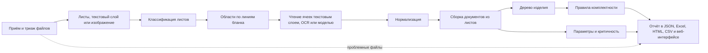

# Промежуточный отчёт о состоянии проекта на 17.11.2026

Отчёт по работе над кейсом «Проверка комплектности и анализ конструкторской документации» ООО «Априорные Решения Машин».

## 1. Постановка задачи

Сервис получает комплект конструкторской документации в виде набора файлов PDF и JPG и выдаёт отчёт по двум блокам проверки.

Первый блок, проверка комплектности, строит по спецификациям дерево изделия, сопоставляет его позиции с чертежами по обозначению и находит расхождения пяти видов из кейса: отсутствующий чертёж, чертёж вне спецификаций, расхождение наименования, дублирование обозначения и расхождение литеры или номера изменения. Второй блок, анализ документов, извлекает поля спецификаций и основных надписей и параметры технических требований и выделяет параметры, критичные для производства.

К решению предъявляются четыре требования. Комплект должен обрабатываться целиком в пакетном режиме. Отчёт нужен в машиночитаемой и человекочитаемой формах. Повреждённые, посторонние и нечитаемые файлы не должны прерывать обработку. По каждому значению должно быть видно, из какого документа и какой области страницы оно получено. Размеченных данных заказчик не предоставляет, поэтому эталонную выборку и методику оценки команда строит сама.

## 2. Подход и обоснование решений

### 2.1. Основной принцип

Основу решения составляют правила, построенные на стандартах Единой системы конструкторской документации (ЕСКД). Модели машинного обучения подключаются только там, где замер показывает выигрыш. Так сделано потому, что геометрия документов задана стандартами. Зная форму, система вырезает каждую ячейку и читает её отдельно.

Решение о расхождении принимает правило. Модель только читает текст, а отсутствует ли чертёж, определяет правило по прочитанным данным. Поэтому каждое расхождение можно объяснить и проверить. У него есть сообщение для технолога и ссылки на строки и листы, из которых оно следует.

### 2.2. Как работает решение

Комплект проходит стадии, показанные на рис. 1. Каждая стадия сохраняет свой результат, поэтому её можно проверить отдельно, а ошибка в одном файле или на одном листе не останавливает обработку комплекта.

*Рис. 1. Стадии обработки комплекта, подробнее в [ARCHITECTURE.md](../ARCHITECTURE.md#пайплайн)*

1. **Приём.** Тип каждого файла определяется по сигнатуре. Принимаются PDF, JPG, PNG и TIFF. Повреждённые, зашифрованные и посторонние файлы, нечитаемые сканы, пустые листы и копии других файлов получают в отчёте свой статус и дальше не обрабатываются.
2. **Листы.** У векторного листа берётся текстовый слой, у растра или скана изображение. По виду основной надписи лист относится к спецификациям, чертежам или прочим документам.
3. **Области.** На растре и скане основная надпись и таблица спецификации находятся по линиям бланка, размеры которого заданы ГОСТ, и каждая ячейка вырезается отдельно.
4. **Чтение.** Ячейки векторных листов читаются из текстового слоя. Ячейки растров и сканов читает распознаватель PP-OCRv5, затем их перечитывает мультимодальная модель Qwen3.6-35B-A3B, и при расхождении в отчёт идёт прочтение модели с пометкой «конфликт». Блок технических требований модель читает по его вырезке. У каждого значения сохраняются область на листе и движок, которым оно прочитано.
5. **Нормализация и сборка.** Обозначения разбираются по грамматике системы обозначения, листы одного документа из разных файлов собираются в один документ, а групповые документы читаются вместе с исполнениями.
6. **Комплектность.** По спецификациям строится дерево изделия, его позиции сопоставляются с документами комплекта по обозначению, и 20 правил ищут расхождения. Кроме пяти видов из кейса, правила находят нехватку листов, ошибки в строках спецификации и сборочные единицы без спецификации. Если часть документов не прочитана, находка об отсутствующем документе отмечается как предварительная.
7. **Параметры и критичность.** Из технических требований и с поля чертежа извлекаются допуски размеров, шероховатость, допуски формы и расположения, термообработка, твёрдость и покрытия, и все они сводятся в таблицу «деталь × параметр». Семь правил с порогами в настройках отмечают критичные параметры, каждая отметка обоснована сравнением с остальным комплектом.
8. **Отчёт.** Результат сохраняется в файл `report.json` по JSON Schema и показывается в веб-интерфейсе, где любое значение и любое расхождение открывается на исходном листе с подсветкой области. Отчёт выгружается также в Excel, печатную HTML-форму и CSV.

### 2.3. Основные решения

Ниже перечислены решения, от которых больше всего зависит качество результата.

1. Вся логика реализована в библиотеке `kdcheck` с командной строкой, а API и веб-интерфейс только вызывают её ([ADR-0010](../adr/0010-repo-layout.md)). Логика в серверном приложении отвергнута, потому что тогда командная строка и веб-интерфейс могли бы выдавать разные отчёты, а ядро нельзя было бы проверить без веба.
2. Векторные листы читаются по текстовому слою библиотекой pypdfium2 ([ADR-0007](../adr/0007-pdf-library.md)). Рассматривались библиотека PyMuPDF и распознавание всех листов как изображений. С PyMuPDF результаты на демо-комплекте те же ([pdf-backends.md](../../eval/results/pdf-backends.md)), но её лицензия AGPL не подходит для поставки. Распознавать векторные листы незачем, потому что в текстовом слое нет ошибок распознавания.
3. Основная надпись и таблица спецификации на растрах и сканах находятся по линиям бланка ГОСТ ([ADR-0015](../adr/0015-raster-regions.md)). Рассматривались нейросетевой детектор областей и распознавание листа целиком. Геометрия бланка задана стандартом и не требует обучения. При распознавании листа целиком верно читались 9 % полей основной надписи растров и 6 % сканов, а с поиском по линиям бланка и чтением каждой ячейки отдельно 77 % и 74 % (раздел 4.1).
4. Ячейки растров и сканов читает распознаватель PP-OCRv5, а мультимодальная модель Qwen3.6-35B-A3B перечитывает их. Если прочтения расходятся, в отчёт попадает прочтение модели с пометкой «конфликт» ([ADR-0024](../adr/0024-ppocr-cells.md), [ADR-0019](../adr/0019-vlm-main-reader.md)).
5. Правила разбора обозначений вынесены в настройки, по одному набору на каждую систему обозначения ([ADR-0016](../adr/0016-designation-grammars.md)). Одной грамматики классификатора ГОСТ недостаточно, заказчик использует собственную систему обозначения.
6. Документ, листы которого лежат в разных файлах, собирается в один документ ([ADR-0017](../adr/0017-sheet-assembly.md)). В комплектах заказчика листы спецификаций хранятся в отдельных файлах, и иначе каждый лист считался бы дубликатом.
7. Групповые документы по ГОСТ читаются вместе с исполнениями ([ADR-0025](../adr/0025-group-spec-variant-b.md), [ADR-0026](../adr/0026-group-spec-variant-a.md)). Без этого у дерева изделия комплекта заказчика не находился корень, а на синтетике групповые документы давали больше половины лишних срабатываний.
8. Формат отчёта описан моделями pydantic, из которых генерируются JSON Schema и типы веб-интерфейса, и каждое значение хранит свой источник на листе ([ADR-0009](../adr/0009-report-contract.md)). Свободный JSON отвергнут, потому что кейс требует прослеживаемости, а схема не даёт формату веб-интерфейса разойтись с ядром.
9. Каждое задание выполняется отдельным процессом с лимитами времени и памяти, а стадии после разбора документов изолированы друг от друга ([ADR-0006](../adr/0006-job-execution.md), [ADR-0029](../adr/0029-stage-isolation-and-block1-fixes.md)). Очередь заданий на Redis не понадобилась, потому что недоверенные файлы изолированы и без отдельного сервера. Сбой одной стадии оставляет пустым только её раздел отчёта.

### 2.4. RAG и формирование промптов

**Нужен ли RAG, например LightRAG?** Нет. Значения читаются из ячеек листа, а нормативные данные для проверки, такие как таблицы допусков и ряд шероховатости, невелики и хранятся в настройках как таблицы, по которым значение проверяется точно, поэтому извлекать из базы знаний нечего.

**Есть ли в решении динамически формируемый промпт?** Есть, в простой форме. В шаблон промпта подставляется название ячейки, например «Материал», поэтому каждая графа получает свой запрос. Прочтение распознавателя в промпт не добавляется, чтобы модель читала независимо и их расхождение оставалось сигналом для пометки «конфликт». Добавить в промпт ожидаемый формат обозначения возможно, и это планируется проверить замером на эталоне.

## 3. Данные для оценки

Размеченных данных нет, поэтому качество оценивается по пяти источникам.

Основной источник составляют синтетические комплекты, которые генератор строит по ГОСТ и в которые закладывает ошибки. На них измеряются полнота и точность каждого правила комплектности и извлечение параметров. Разнообразие оформления в синтетике ограничено генератором.

Отложенный синтетический корпус служит тестовой выборкой. Он состоит из 120 комплектов с 380 заложенными расхождениями, по крайней мере 36 на каждый обязательный вид, и собран с другим начальным значением генератора. Файлы корпуса записаны в манифест с контрольными суммами ([heldout_corpus.json](../../eval/heldout_corpus.json)). Правила на нём не настраиваются, и он будет измерен один раз, после заморозки правил.

Стрессовый корпус содержит те же сканы, искажённые независимой библиотекой Augraphy, и проверяет устойчивость чтения к дефектам, которых не даёт собственный генератор.

Эталон реальных документов включает 45 документов: 22 листа производственной конструкторской документации из открытых источников и 23 документа трёх учебных комплектов. Эталон показывает, как система читает реальные листы, но невелик, а реальные сканы в нём в основном относятся к бланкам до ЕСКД.

Заказчик передал три комплекта и 16 отдельных листов. На одном растровом комплекте настраиваются правила, а два других, растровый и векторный, отложены как контрольные. Эталон настроечного комплекта размечается по обезличенным копиям листов. Сканов в переданных комплектах нет, поэтому чтение сканов измеряется на синтетике, стрессовом корпусе и реальных листах эталона.

## 4. Выбор моделей

Модели чтения выбирались отдельными замерами, в которых все кандидаты читают одни и те же изображения. Выбор делался для пяти задач: поиск областей на листе, чтение ячеек распознавателем, перечитывание ячеек мультимодальной моделью, способ совместной работы распознавателя и модели и чтение поля чертежа, то есть той части листа, где изображена деталь и рядом с размерами записаны допуски и шероховатость. В конце раздела приведено качество, которое даёт выбранная конфигурация.

### 4.1. Поиск областей на листе

Сначала система распознавала растровый лист целиком и искала основную надпись по подписям граф. Таблица 1 показывает, как менялась доля верно прочитанных полей основной надписи, когда изменения включались по одному, на шести синтетических комплектах ([ADR-0015](../adr/0015-raster-regions.md), [scan-quality.md](../../eval/results/scan-quality.md)). Ячейки в этом замере читал Tesseract.

*Таблица 1. Вклад изменений в поиск и чтение областей растров и сканов*

| Что изменено | Поля основной надписи растров | Поля основной надписи сканов | Строки спецификаций, верно из 284 |
| --- | ---: | ---: | ---: |
| Распознавание листа целиком | 0,09 | 0,06 | 4 |
| Основная надпись находится по линиям бланка | 0,25 | 0,18 | 4 |
| Каждая ячейка читается отдельно | 0,68 | 0,57 | 4 |
| Ячейки увеличиваются до высоты строки 40 пикселей | 0,72 | 0,64 | 4 |
| Строки спецификации читаются по ячейкам | 0,72 | 0,64 | 109 |
| Значения проверяются по ГОСТ, нечитаемый скан определяется по контрасту | 0,77 | 0,74 | 127 |

Распознавание листа целиком задачу не решает. Главная потеря была не в распознавании текста, а в поиске и вырезке области, и наибольший прирост дали поиск надписи по линиям бланка и чтение каждой ячейки отдельно. Поэтому все дальнейшие распознаватели и модели получают вырезанную ячейку, а не лист.

### 4.2. Распознаватель ячеек

Сравнивались распознаватель Tesseract, с которого начиналась работа, и распознаватель PP-OCRv5 для кириллицы в нескольких исполнениях (табл. 2). Все варианты читали одни и те же 672 ячейки, вырезанные системой на 20 синтетических комплектах. На настроечном комплекте заказчика проверялось, совпадает ли прочитанное обозначение основной надписи с обозначением в имени файла и соответствует ли обозначение строки спецификации грамматике заказчика ([ADR-0024](../adr/0024-ppocr-cells.md)).

*Таблица 2. Распознаватели ячеек*

| Распознаватель | Основная надпись, верно из 506 ячеек | Доля ошибочных символов | Строки спецификаций, верно из 166 ячеек | Доля ошибочных символов | Время на ячейку, мс | Комплект заказчика: обозначение надписи совпало с именем файла, из 53 | Комплект заказчика: обозначение строки по грамматике, из 64 |
| --- | ---: | ---: | ---: | ---: | ---: | ---: | ---: |
| Tesseract | 357 | 0,126 | 82 | 0,077 | 16 | 0 | 2 |
| PP-OCRv5 в PaddleOCR, ячейка целиком | 190 | 0,417 | 73 | 0,229 | 50 | не мерилось | не мерилось |
| PP-OCRv5 в PaddleOCR, детектор строк и распознаватель | 407 | 0,058 | 98 | 0,060 | 77 | не мерилось | не мерилось |
| PP-OCRv5 в PaddleOCR, строки вырезает система | 394 | 0,073 | 107 | 0,049 | 54 | не мерилось | не мерилось |
| PP-OCRv5 через onnxruntime, строки вырезает система, выбран | 405 | 0,064 | 107 | 0,055 | 4 | 49 | 48 |
| То же с моделью `cyrillic` | 390 | 0,070 | 110 | 0,048 | 4 | 49 | 34 |

Tesseract уступает PP-OCRv5 по всем показателям, а на листах заказчика не прочёл верно ни одного обозначения. PP-OCRv5 нельзя подавать ячейку целиком: он рассчитан на одну строку текста, и ячейка из двух строк читается плохо, поэтому строки ячейки вырезает система. Реализации PP-OCRv5 читают почти одинаково, но исполнение через onnxruntime работает в 13–19 раз быстрее. Модель `cyrillic` хуже читает коды обозначений заказчика, 34 строки из 64 против 48. Поэтому ячейки читает PP-OCRv5 через onnxruntime с моделью для восточнославянских языков.

### 4.3. Мультимодальные модели

Для перечитывания ячеек сравнивались 12 локальных моделей с открытыми лицензиями: семь мультимодальных моделей общего назначения и пять моделей распознавания документов, а Tesseract служил базовым уровнем ([сравнение моделей](2026-11-02-models.md), [vlm-bench.md](../../eval/results/vlm-bench.md)). Модель Qianfan-OCR проверена в двух режимах: с ответом по заданной схеме полей и с ответом простым текстом.

Модели получали изображение тремя способами, от целого листа до одной ячейки. В первой задаче модель видела целый реальный лист и должна была найти на нём шесть полей основной надписи (табл. 3). Это 17 сканов и фотографий из открытых архивов, в основном на бланках до ЕСКД, на которых заполнено 50 полей. Во второй задаче модель видела вырезанный блок технических требований синтетического растра или скана и должна была прочитать его текст, из которого система извлекает 61 параметр (табл. 4). В третьей задаче модель видела одну ячейку основной надписи (табл. 5).

*Таблица 3. Основная надпись с целого листа, 17 реальных листов, 50 заполненных полей*

| Модель | Поля прочитаны верно, из 50 | Верное значение есть в ответе, из 50 | Заполнены отсутствующие поля, из 52 | Время на лист, с |
| --- | ---: | ---: | ---: | ---: |
| Qwen3.6-27B | 40 | 42 | 4 | 67,5 |
| Qwen3.6-35B-A3B | 36 | 37 | 3 | 10,7 |
| Qwen3.8-27B | 28 | 34 | 2 | 35,0 |
| MiniCPM-V 4.7 | 20 | 21 | 5 | 3,3 |
| Gemma 4 31B | 19 | 19 | 3 | 10,8 |
| GLM-4.6V-Flash | 14 | 15 | 9 | 14,2 |
| Qianfan-OCR, ответ по схеме | 5 | 6 | 2 | 15,8 |
| Gemma 4 E4B | 5 | 6 | 10 | 2,6 |
| dots.mocr, текст | — | 35 | — | 25,1 |
| LightOnOCR-3-1B, текст | — | 24 | — | 8,1 |
| Unlimited-OCR, текст | — | 18 | — | 6,4 |
| Qianfan-OCR, текст | — | 16 | — | 38,9 |
| PaddleOCR-VL-1.6, текст | — | не измерено, сервер вернул ошибку на 14 листах из 17 | — | — |
| Tesseract 5.5, текст | — | 13 | — | 0,8 |

*Таблица 4. Блок технических требований по вырезке, 30 блоков, 61 параметр*

| Модель | Параметры распознаны, из 61 | Числовые диапазоны верны, из 30 | Время на блок, с |
| --- | ---: | ---: | ---: |
| Qwen3.6-27B | 52 | 28 | 18,9 |
| Qwen3.6-35B-A3B | 52 | 28 | 2,4 |
| Qwen3.8-27B | 52 | 28 | 11,5 |
| Gemma 4 31B | 51 | 28 | 12,2 |
| dots.mocr, текст | 51 | 28 | 2,2 |
| LightOnOCR-3-1B, текст | 51 | 28 | 0,9 |
| MiniCPM-V 4.7 | 49 | 28 | 2,3 |
| Qianfan-OCR, текст | 45 | 28 | 6,6 |
| Qianfan-OCR, ответ по схеме | 43 | 28 | 7,1 |
| PaddleOCR-VL-1.6, текст | 39 | 12 | 1,6 |
| Gemma 4 E4B | 38 | 28 | 2,9 |
| GLM-4.6V-Flash | 26 | 22 | 4,4 |
| Unlimited-OCR, текст | 24 | 9 | 4,6 |
| Tesseract 5.5, текст | 19 | 9 | 0,1 |

*Таблица 5. Ячейки основной надписи, 112 ячеек*

| Модель | Ячейки прочитаны верно, из 112 | Доля ошибочных символов | Время на ячейку, с |
| --- | ---: | ---: | ---: |
| Gemma 4 31B | 103 | 0,049 | 4,9 |
| Qwen3.6-27B | 102 | 0,052 | 5,5 |
| Qwen3.8-27B | 100 | 0,053 | 3,4 |
| Qwen3.6-35B-A3B | 99 | 0,054 | 0,8 |
| MiniCPM-V 4.7 | 95 | 0,045 | 0,9 |
| Qianfan-OCR, ответ по схеме | 90 | 0,094 | 2,2 |
| dots.mocr, текст | 83 | 0,085 | 0,3 |
| PaddleOCR-VL-1.6, текст | 83 | 0,086 | 0,4 |
| Gemma 4 E4B | 82 | 0,109 | 1,6 |
| GLM-4.6V-Flash | 72 | 0,087 | 1,0 |
| Qianfan-OCR, текст | 71 | 0,077 | 2,0 |
| LightOnOCR-3-1B, текст | 58 | 0,206 | 0,2 |
| Tesseract 5.5, текст | 49 | 0,169 | менее 0,1 |
| Unlimited-OCR, текст | 25 | 0,454 | 1,2 |

С целого листа поля надёжно выделяют только две модели семейства Qwen, а остальные распознают текст, но не относят его к полям. При этом даже лучшая модель на целом листе не указывает точную область значения и читает лист больше минуты. На вырезках разрыв между крупными моделями мал: четыре из них распознают 51–52 параметра технических требований и 99–103 ячейки из 112. Поэтому модель в решении получает вырезанную ячейку или блок, область которых система уже знает. На вырезках Qwen3.6-35B-A3B работает в 4–8 раз быстрее остальных крупных моделей, и при этом лучше всех, кроме Qwen3.6-27B, читает целый лист. MiniCPM-V 4.7 устроена так же и так же быстра, но читает меньше ячеек точно и целые листы хуже, 20 полей из 50 против 36. Поэтому ячейки и блоки технических требований перечитывает Qwen3.6-35B-A3B.

### 4.4. Совместная работа распознавателя и модели

Модель можно подключить тремя способами. Она может только дочитывать ячейки, которые распознаватель оставил пустыми, или перечитывать все ячейки и при расхождении либо заменять прочтение распознавателя, либо оставлять его с пометкой «проверить». Способы сравнивались на 130 синтетических сканах основных надписей, 758 полей, для пяти моделей (табл. 6). Ячейки в этом замере читал Tesseract ([vlm-title-block.md](../../eval/results/vlm-title-block.md)).

*Таблица 6. Способы совместной работы распознавателя и модели, 130 сканов, 758 полей*

| Модель | Время на 130 сканов, с | Дочитывание пустых ячеек: доля верных полей | Прочтение модели заменяет распознаватель: доля верных полей | То же: неверных значений без пометки | Остаётся распознаватель с пометкой: неверных значений без пометки | То же: полей с пометкой |
| --- | ---: | ---: | ---: | ---: | ---: | ---: |
| Без модели, только распознаватель | 257 | 0,650 | — | — | — | — |
| Gemma 4 E4B | 2524 | 0,744 | 0,898 | 72 | 8 | 234 |
| Qianfan-OCR | 3167 | 0,704 | 0,770 | 164 | 38 | 279 |
| Qwen3.8-27B | 3414 | 0,741 | 0,945 | 36 | 9 | 223 |
| Gemma 4 31B | 4987 | 0,748 | 0,964 | 24 | 7 | 218 |
| Qwen3.6-35B-A3B, выбрана | 1088 | 0,745 | 0,955 | 31 | 9 | 216 |

Дочитывание пустых ячеек даёт немного, потому что основная часть ошибок распознавателя приходится на заполненные, но неверно прочитанные ячейки. Если при расхождении оставлять распознаватель с пометкой, неверных значений без пометки почти нет, но пометку получает больше четверти полей, и технологу пришлось бы проверять их вручную. Если брать прочтение модели, доля верных полей у лучших моделей растёт с 0,65 до 0,955–0,964. Gemma 4 31B даёт на 0,009 больше, чем Qwen3.6-35B-A3B, но работает в 4,6 раза дольше. Поэтому в отчёт попадает прочтение Qwen3.6-35B-A3B, а расхождение с распознавателем отмечается как «конфликт».

### 4.5. Поле чертежа

Допуски размеров, шероховатость и допуски формы и расположения записываются не только в технических требованиях, но и на поле чертежа рядом с изображением детали. Здесь заранее неизвестно, где стоит надпись, поэтому способы чтения смотрят на лист по-разному. Распознаватель ищет строки текста на всём листе, мультимодальная модель читает лист по четырём перекрывающимся фрагментам, а документная модель dots.mocr читает лист целиком. Семь способов сравнивались на шести синтетических комплектах без ошибок, где на поле записано 123 параметра на растрах и 207 на сканах ([drawing-field.md](../../eval/results/drawing-field.md)). F1 в таблице 7 объединяет полноту и точность в одно число.

*Таблица 7. Параметры поля чертежа растров и сканов на синтетических комплектах*

| Способ чтения | Растры: найдено из 123, лишних | Растры: F1 | Сканы: найдено из 207, лишних | Сканы: F1 | Область верна, растры и сканы | Время на лист, с |
| --- | ---: | ---: | ---: | ---: | ---: | ---: |
| Tesseract без правил ГОСТ 2789 | 40, 39 | 0,396 | 71, 55 | 0,426 | 0,97 и 0,99 | 0,9 |
| Tesseract с правилами ГОСТ 2789, как в ядре | 73, 6 | 0,722 | 113, 13 | 0,679 | 0,99 и 0,99 | 0,9 |
| PP-OCRv5 по строкам Tesseract | 87, 0 | 0,828 | 141, 4 | 0,801 | 0,99 и 0,99 | 0,9 |
| Модель по четырём фрагментам листа | 120, 0 | 0,988 | 194, 10 | 0,944 | 0,82 и 0,84 | 9,7 |
| PP-OCRv5 и модель по фрагментам | 120, 0 | 0,988 | 194, 11 | 0,941 | 0,82 и 0,87 | 9,6 |
| Документная модель по листу целиком | 70, 1 | 0,722 | 134, 3 | 0,779 | 0,83 и 0,78 | 11,3 |
| PP-OCRv5 и документная модель | 96, 1 | 0,873 | 167, 7 | 0,877 | 0,90 и 0,86 | 11,2 |

Правила восстановления шероховатости по ГОСТ 2789-73 почти вдвое поднимают результат при том же распознавателе. PP-OCRv5, перечитывающий строки, найденные Tesseract, добавляет ещё около 0,1 F1 без потери точности и времени, поэтому он станет способом чтения поля по умолчанию. Модель по фрагментам находит почти все параметры, в том числе допуски формы и надписи вдоль вертикальных размерных линий, но читает лист в десять раз дольше и не для всех записей указывает точную область. Документная модель, читающая лист целиком, уступает модели по фрагментам и по полноте, и по времени. Синтетическое поле проще реального, поэтому вопрос о том, нужна ли модель для поля, будет решён замером на размеченных чертежах комплекта заказчика.

### 4.6. Итоговая конфигурация и её качество

В итоге векторные листы читаются по текстовому слою, области растров и сканов находятся по линиям бланка, ячейки читает PP-OCRv5, а Qwen3.6-35B-A3B перечитывает ячейки и блоки технических требований. Таблица 8 сводит качество этой конфигурации по задачам. Доля верных полей основной надписи сканов выросла с 0,06 при распознавании листа целиком до 0,86 с PP-OCRv5 по ячейкам, а с моделью доля верных полей на другом корпусе сканов составила 0,955 (раздел 4.4).

*Таблица 8. Качество выбранной конфигурации*

| Задача | Данные | Результат |
| --- | --- | --- |
| Поля основной надписи, вектор | 6 синтетических комплектов | Все значения верны |
| Поля основной надписи, растры и сканы, распознаватель | 6 синтетических комплектов | 0,90 на растрах, 0,86 на сканах |
| Поля основной надписи сканов, распознаватель и модель | 130 синтетических сканов | 0,955 |
| Обозначения строк спецификаций, растры и сканы | 6 синтетических комплектов | 0,99 на растрах, 0,81 на сканах |
| Проверка комплектности | 20 синтетических комплектов | Полнота 0,970, точность 0,855 |
| Проверка комплектности | Настроечный комплект заказчика | 11 верных срабатываний из 12 |
| Параметры технических требований, вектор | 20 синтетических комплектов | Полнота и точность 1,00 |
| Параметры технических требований, растры и сканы | 20 синтетических комплектов | Полнота 0,68, точность 0,92 |
| Параметры поля чертежа, PP-OCRv5 | 6 синтетических комплектов | F1 0,83 на растрах, 0,80 на сканах |

## 5. Результаты

### 5.1. Комплектность на синтетических комплектах

Таблица 9 показывает проверку комплектности на 20 синтетических комплектах с 67 заложенными расхождениями в трёх конфигурациях: без чтения растров и сканов, с распознавателем и с распознавателем и моделью ([synth-kits.md](../../eval/results/synth-kits.md)). Точность равна доле верных срабатываний среди всех, полнота равна доле найденных расхождений среди заложенных.

*Таблица 9. Проверка комплектности на синтетических комплектах, 67 заложенных расхождений*

| Конфигурация | Найдено | Лишних срабатываний | Точность | Полнота | Ложных срабатываний на 4 комплектах без ошибок |
| --- | ---: | ---: | ---: | ---: | ---: |
| Без OCR, у растров и сканов известно только обозначение из имени файла | 58 | 79 | 0,423 | 0,866 | 12 |
| OCR | 65 | 25 | 0,722 | 0,970 | 5 |
| OCR и модель | 65 | 11 | 0,855 | 0,970 | 1 |

Чтение растров и сканов нужно для полноты: без него система не видит содержания растровых листов и пропускает расхождения. Модель нужна для точности, потому что она убирает большую часть лишних срабатываний, вызванных ошибками распознавателя. С моделью найдены все заложенные расхождения четырёх видов из пяти, а среди отсутствующих документов пропущен один. Целью этапа были полнота не ниже 0,95 по каждому виду и точность не ниже 0,9. Полнота цели почти достигает, точность пока нет, и оставшиеся лишние срабатывания вызваны ошибками чтения, а не правилами. Все 13 проблемных файлов во всех конфигурациях получают верный статус.

### 5.2. Комплектность на учебных комплектах

Таблица 10 показывает проверку комплектности на трёх учебных комплектах из открытых источников с независимой разметкой ([gold-kits.md](../../eval/results/gold-kits.md)).

*Таблица 10. Проверка комплектности на учебных комплектах*

| Комплект | Расхождений в разметке | Найдено | Лишних срабатываний |
| --- | ---: | ---: | ---: |
| Учебный комплект 1 | 11 | 3 | 0 |
| Учебный комплект 2 | 5 | 5 | 7 |
| Учебный комплект 3 | 7 | 6 | 2 |

На двух комплектах из трёх найдены почти все размеченные расхождения. В первом комплекте ни в одном документе не заполнена графа «Обозначение», а дерево изделия строится именно по обозначениям, поэтому дерево не построено и большая часть расхождений пропущена. Лишние срабатывания на двух других комплектах относятся к наименованиям и обозначениям, которых нет в согласованной разметке, и будут разобраны в итоговой оценке.

### 5.3. Комплектность на комплекте заказчика

Настроечный комплект заказчика состоит из 53 растровых листов. Система находит в нём все 11 спецификаций и обозначения всех 53 документов, строит дерево изделия с одним корнем и выдаёт 12 расхождений, из которых проверка по листам подтвердила 11 ([arm-kits-dev-vlm.md](../../eval/results/arm-kits-dev-vlm.md)). Единственное ложное срабатывание вызвано ошибкой чтения. На лист уходит около 2 с с распознавателем и около 12 с с моделью.

Когда эталон настроечного комплекта будет готов, на нём будут посчитаны точность и полнота и выбрана итоговая конфигурация. Проверкой на новых данных служат два отложенных комплекта заказчика, которые будут обработаны один раз, на замороженных правилах. Полной разметки для них нет, поэтому каждое срабатывание на них разбирается по листам, полнота проверяется заранее внесёнными изменениями файлов, такими как удалённый чертёж, лишний документ или копия файла, а чтение полей оценивается на размеченной выборке листов.

### 5.4. Основная надпись и спецификация по видам входа

Таблица 11 показывает, как распознаватель без модели читает основные надписи и строки спецификаций в зависимости от вида входа и класса качества, на шести синтетических комплектах без ошибок ([scan-quality.md](../../eval/results/scan-quality.md)). В ячейках указано число верных значений из общего числа, в скобках их доля. Стрессовый корпус содержит те же листы, искажённые независимой библиотекой.

*Таблица 11. Чтение по видам входа и классам качества, OCR без модели*

| Вход и класс качества | Чертежей | Поля основной надписи чертежей | Спецификаций | Поля основной надписи спецификаций | Обозначения строк спецификаций |
| --- | ---: | ---: | ---: | ---: | ---: |
| Вектор | 45 | 264/264 (1,00) | 9 | 18/18 (1,00) | 61/61 (1,00) |
| Растр, хорошее | 20 | 103/111 (0,93) | 4 | 4/8 (0,50) | 20/20 (1,00) |
| Растр, среднее | 17 | 88/96 (0,92) | 1 | 2/2 (1,00) | 5/5 (1,00) |
| Растр, плохое | 13 | 63/75 (0,84) | 7 | 13/14 (0,93) | 48/49 (0,98) |
| Скан, хорошее | 31 | 161/182 (0,88) | 4 | 6/8 (0,75) | 23/27 (0,85) |
| Скан, среднее | 17 | 89/98 (0,91) | 8 | 10/16 (0,62) | 41/51 (0,80) |
| Скан, плохое | 23 | 106/132 (0,80) | 5 | 7/10 (0,70) | 21/27 (0,78) |
| Стрессовый корпус, хорошее | 31 | 106/182 (0,58) | 4 | 4/8 (0,50) | 8/27 (0,30) |
| Стрессовый корпус, среднее | 17 | 34/98 (0,35) | 8 | 7/16 (0,44) | 15/51 (0,29) |
| Стрессовый корпус, плохое | 23 | 54/132 (0,41) | 5 | 3/10 (0,30) | 3/27 (0,11) |

Векторные документы читаются без ошибок. На растрах и сканах распознаватель верно читает большую часть полей, а обозначение, от которого зависит проверка комплектности, почти всегда. Хуже всего читаются наименование и материал, и именно их исправляет модель (раздел 4.4). Стрессовый корпус читается заметно хуже, потому что его искажения сильнее тех, которые генератор относит к читаемым сканам. Реальные бланки до ЕСКД система пока не разбирает, потому что они не соответствуют ГОСТ 2.104 ([vlm-title-block-real.md](../../eval/results/vlm-title-block-real.md)).

### 5.5. Параметры технических требований

Таблица 12 сравнивает извлечение параметров технических требований на векторных документах и на растрах и сканах синтетических комплектов в конфигурации с моделью ([synth-kits.md](../../eval/results/synth-kits.md)). «Ожидалось» означает число параметров в разметке, «найдено» число сопоставленных с разметкой, «лишних» число найденных параметров без пары в разметке.

*Таблица 12. Параметры технических требований на синтетических комплектах, конфигурация «OCR и модель»*

| Категория | Вектор, ожидалось | Вектор, найдено | Вектор, лишних | Растры и сканы, ожидалось | Растры и сканы, найдено | Растры и сканы, лишних |
| --- | ---: | ---: | ---: | ---: | ---: | ---: |
| Допуск размера | 392 | 392 | 0 | 86 | 13 | 18 |
| Общие допуски | 273 | 273 | 0 | 49 | 43 | 1 |
| Шероховатость | 675 | 675 | 0 | 131 | 114 | 2 |
| Допуск формы и расположения | 213 | 213 | 0 | 49 | 19 | 0 |
| Термообработка | 143 | 143 | 0 | 29 | 29 | 0 |
| Твёрдость | 193 | 193 | 0 | 43 | 42 | 0 |
| Покрытие | 168 | 168 | 0 | 26 | 22 | 4 |

На векторных документах все параметры извлекаются верно. На растрах и сканах полнота составляет 0,68 при точности 0,92. Записи технических требований, то есть общие допуски, термообработку, твёрдость и покрытия, модель читает почти полностью. Теряются в основном допуски размеров и допуски формы и расположения, потому что они записаны на поле чертежа, а его система пока читает Tesseract. Поэтому следующий шаг состоит в переводе чтения поля на способ, выбранный в разделе 4.5. На комплекте заказчика пункты технических требований с моделью найдены у всех 26 чертежей деталей, с одним распознавателем только у четырёх ([arm-kits-dev-vlm.md](../../eval/results/arm-kits-dev-vlm.md)).

### 5.6. Прослеживаемость и устойчивость

Область-источник верна у всех значений основных надписей и строк спецификаций синтетических комплектов, у всех параметров векторных документов и у 268 из 282 параметров растров и сканов ([synth-kits.md](../../eval/results/synth-kits.md)). Все 13 проблемных файлов синтетических комплектов получают верный статус, нечитаемые сканы опознаются в 6 случаях из 6, а ни один лист с содержимым не принят за пустой ([blank-sheets.md](../../eval/results/blank-sheets.md)).

## 6. Ошибки и ограничения

- Основной источник ошибок связан с чтением, а не с правилами. Лишние срабатывания на синтетике и на комплекте заказчика вызваны неверно прочитанными обозначениями и наименованиями, поэтому расхождение прочтений распознавателя и модели отмечается как «конфликт».
- Модель иногда достраивает текст, которого нет в ячейке, например наименование по первым буквам. Запись, которую прочла только модель в пустой ячейке, не снимает находку.
- Поле чертежа растров и сканов пока читается не полностью. Способ чтения выбран (раздел 4.5), а необходимость модели для поля будет проверена на реальных листах.
- Синтетическое поле проще реального, потому что генератор пишет допуск формы строкой текста, а не рамкой со знаком.
- Листы, оформленные не по ГОСТ 2.104 и 2.106, в том числе бланки до ЕСКД, получают статус и попадают в отчёт, но их поля не извлекаются.
- Уверенность пока не откалибрована, поэтому каждое значение, прочитанное с растра или скана, отмечается «проверить».
- Эталона комплекта заказчика пока нет, поэтому для реальных данных приведены проверенные срабатывания, а не точность и полнота. Сканов в переданных комплектах нет.
- Консультации с заказчиком не проводились. Принятые трактовки литеры, форм основной надписи и групповых документов заданы настройками.
- Геометрия, размеры на изображении и соответствие всем требованиям ЕСКД не проверяются. Система выполняет формализуемую часть входного контроля.

## 7. Работа до итоговой демонстрации

Оставшаяся работа приведена в таблице 13 в том порядке, в котором она будет выполняться.

*Таблица 13. Оставшаяся работа*

| Шаг | Результат |
| --- | --- |
| Эталон настроечного комплекта заказчика | Двойная независимая разметка обезличенных листов, согласие разметок, точность и полнота обоих блоков на реальных данных |
| Способ чтения поля чертежа | PP-OCRv5 на строках поля по умолчанию и решение о модели по размеченным чертежам деталей заказчика |
| Калибровка уверенности и заморозка правил | Порог отметки «проверить», подобранный по целевой доле ошибок, затем однократный замер отложенных комплектов заказчика и отложенного синтетического корпуса |
| Итоговая оценка качества | Метрики обоих блоков по видам входа и классам качества с 95-процентными интервалами, разбор ошибок и обоснование выбранной конфигурации |
